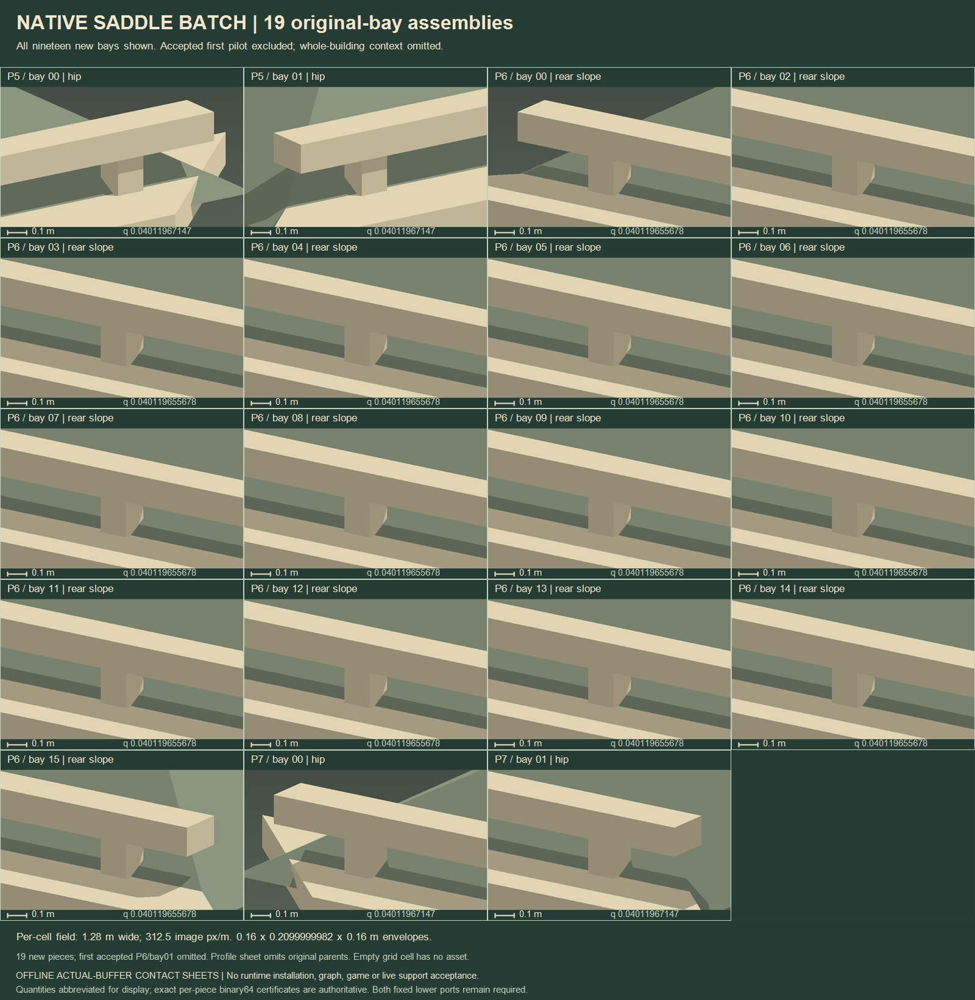
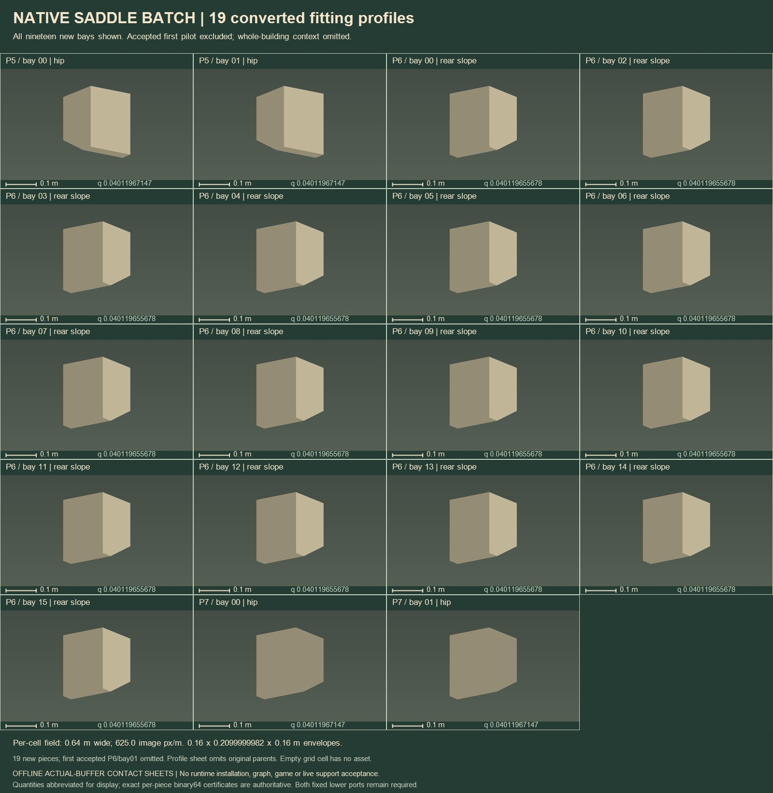

# Nineteen remaining native roof-saddle fittings

17 November 2026. Candidate on `codex/shared-map-fire-bindings`; its containing
Git commit identifies this delivery. Architect authority:
`e1945001d1af9012235a8d64e8032666f5efb210`
([exact brief](authority-e1945001.md)).
Artist parent: `c1ed407aedfc5ffec8b473dc7b88c697e140c054`.

## Exact set and compact sharing

[Batch asset](../../../../assets/art/shared-map-support-additions/new-york-roof-saddle-native-batch-v1/index.json)
adds exactly nineteen remaining positions from the frozen twenty-row table:

- Parapet 5, bays 00 and 01: two east-hip fittings.
- Parapet 6, bays 00 and 02 through 15: fifteen rear-slope fittings.
- Parapet 7, bays 00 and 01: two west-hip fittings.

The accepted first pilot, parapet 6 bay 01, is excluded and byte-identical.
Every new canonical ID uses `carrier/roof-saddle-native/main-parapet-N/bay-NN`.
The batch has 304 instance triangles, with 10 shared physical vertices and
48 mapped render vertices per fitting. Three exact buffer profiles suffice:
the fifteen rear fittings reuse the accepted pilot's exact physical/render/
mapping/binary buffers; the two hip profiles are new shared data. Identical
new binary payloads are deduplicated by SHA-256. No whole-building archive is
copied per piece.

Each pose is independently derived and checked against its own original
cornice, actual roof source facets and upper footprint. Shared profile identity
does not replace per-instance proof or quantity derivation. Original source
matrices, normalized-box centre pivots, .16 x .20999999821185966 x .16 m
envelopes, metre bay intervals, stock 1 x 1 x 2.12 m grid, UV density and finish
are preserved. Only these original poses are supplied; no procedural rotation,
reflection or alternative attachment is authorized.

## Actual conversion and four preserved initial failures

[Conversion audit](conversion-audit.json) retains each initial Float32 position
array, exact initial roof margin, source-face identity and any repair.

Fifteen rear conversions passed directly. All four hip conversions initially
penetrated the original roof. Each required **one upward Float32 step at new
cut vertices 0 and 5 only**. Actual initial world vectors are retained in
[buffer evidence](actual-buffer-results.json), and the four failed conversions
are independently rejected in [proof results](check-results.json).
There was no unrepresentable bay.

No old roof, cornice, parapet, matrix or source vertex moves. No native tolerance
is widened: the existing **1e-5 m** contact predicate remains in use.
Each accepted closed body lies wholly above its own exact roof support plane;
the unchanged roof lies on or below that plane. Each fitting remains a subset
of its original envelope with a positive continuous material path.

The checks use real `BufferGeometry`, `Float32BufferAttribute`,
`Uint16Array`, `Matrix4` and `Vector3.applyMatrix4` from the existing shared
Three dependency. Actual typed-array bytes match the serialized binary files.
Per pose, all render positions match their physical vertices before and after
the world transform, and transformed normals remain outward.

Nineteen new physical shapes plus seven unique original parents are checked:
**26 physical shapes**. Shared buffer caching creates **12 geometry objects**:
three physical profiles, three alternate render profiles and six original
geometry files used by seven parent poses. All CPU geometry is disposed.
The initial nineteen typed conversion vectors are retained separately as
pre-acceptance evidence, not as extra assets or runtime bodies.

## Per-piece proof and quantity

1,759 deterministic/source checks pass, including exact shared-index closure,
one connected component, outward nondegenerate convex triangles, actual
occupied bounds, roof separation, complete upper footprints, positive local
cornice and roof-seat areas, a continuous material path, and metric UV precision
after Float32 conversion.

**57 fresh fixed-port contact queries pass**: three for each new fitting.
Queries use only each declared physical port's two triangles and its named
original source triangles. Single-facet hip/rear roof seats and the remaining
two-facet seam position retain their own source selectors. No nearest-parent
search is used. Microscopic representation gaps remain explicit in the
per-piece proof; JPGs cannot establish them.

[Quantity certificates](quantity-certificates.json) contain nineteen independent
exact-volume calculations. For each actual converted world body, signed
tetrahedra give the exact closed volume; division uses **exact-binary64 .12**.
The selected reference is the greatest finite binary64 at or below that
certified lower result. Each certificate proves
`selected <= lower < nextafter(selected, +infinity)`, with exact fractions,
hexadecimal values and stored bits.

No quantity is copied from another pose as proof. No runtime stock, aggregate
world ledger, literal renormalization or six-decimal substitute is introduced.
The first pilot's quantity and all front48/clear96 literals stay unchanged.
The quantity text on the contact sheets is abbreviated; certificates contain
the authoritative values.

## Both original lower ports remain required

Each fitting serializes **ALL_FIXED_PORTS** for its own original cornice and
roof-seat ports. Both parents require independent support that cannot come
from the fitting, upper part or descendants. The original upper bay depends
on the fitting's fixed top port, scoped along the correct X or Z metre interval.

The roof keeps its existing roof-covering role. There are no new anchors,
reverse braces, surviving-parent remaps, independent any-parent fallback or
cycle-created support.

[Interface report](interface-gates.json) shares old-parent provenance and ten
relevant frozen family records once. No direct old edge exists within any of
the nineteen named parent triplets. No old edge changes. Transitive conflicts
are not searched by constructing a graph.

Runtime physical/render mapping, fixed native fragment binding, port liveness,
all-of support and old-edge compatibility remain an explicit coder gate.
Correct serialized intent is not live support acceptance. No compiler,
activation, world, trial, graph, build, benchmark, game renderer or new
dependency was run or added.

## Preservation and source pins

All 3,770 earlier tracked source/art/proof paths remain unchanged, including
the accepted first pilot, its quantity, double-precision source forms/JPGs,
native pilot JPGs, front48, clear96 and earlier archives.

| Shared input / output | SHA-256 |
| --- | --- |
| Frozen twenty-row design table | `481294255d3afd8dd0ea208d2dc0cc1c7adf1f2e6108e5929a0e887bbb1abfa4` |
| Original complete bindings | `407c0f8bd582f8d95b9ade1471cd51892ac7b9a40fd2c005696bcc5485991eba` |
| Preserved accepted pilot index | `0d1469e541657fa6f3ed537ff2f4ba7fe01f3952c273e0eba2720c224a436bcd` |
| New nineteen-piece index | `e1c2ff019f5dcf4e05f48739be843afdaa818f6c7f3c1ff8f11de1561a8e05fd` |

The asset index, [package](review-package.json) and shared references pin all
physical/render geometry, mappings, binary payloads, source parents and
per-piece certificates. Runtime paths remain self-contained inside Tinderbox.
Historical producer pins are distinct from the approved verification context.
Existing provenance and rights remain unchanged; no new license grant.

Reproduce only this bounded batch:

```text
python -B art/source/shared-map-fire-bindings/roof-saddle-native-batch-v1/export.py --check
node art/source/shared-map-fire-bindings/roof-saddle-native-batch-v1/check-buffers.mjs --check
python -B art/source/shared-map-fire-bindings/roof-saddle-native-batch-v1/check.py
python -B art/source/shared-map-fire-bindings/roof-saddle-native-batch-v1/review.py
git diff --check
```

## Two new actual-buffer contact sheets



All nineteen new bays with their own original parents. Each 400-pixel cell
has a 1.28 m horizontal field, 312.5 image pixels per metre and a 0.1 m ruler.
The end/hip crops show unchanged original parent facets; whole-building context
is omitted.



All nineteen actual converted profiles isolated. Each 400-pixel cell has a
.64 m horizontal field, 625 image pixels per metre and a 0.1 m ruler.
Original parents are omitted in this sheet. No new bay is omitted from either
sheet. The accepted first P6/bay01 pilot is omitted from both, as labeled.
The unused twentieth grid cell contains no asset.

Both JPGs are 1600 x 1640. They were produced in **one 85.218-second offline
session**, with a real 120-second deadline, using the existing software raster
and OS image encoder. Old double/native JPGs are untouched.
[Cleanup receipts](preview-session/cleanup-receipt.json) verify both exact
helper lifetimes exited and released all ports; no server/browser/helper is
retained and execution policy is unchanged.

This is a compact nineteen-piece source/asset batch for architect review.
Runtime installation and both-port liveness/support acceptance remain open.
