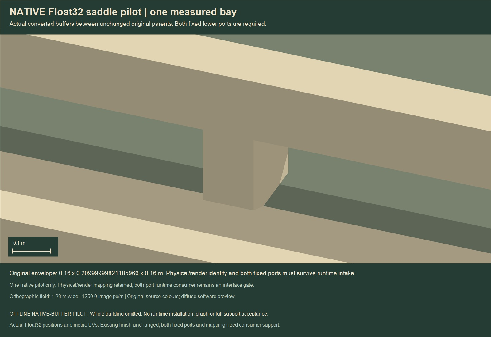
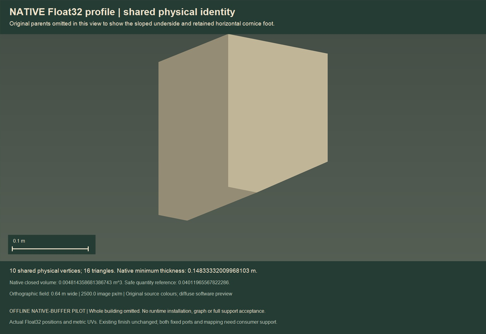

# One native-buffer roof-saddle pilot

17 November 2026. Candidate on `codex/shared-map-fire-bindings`; the containing
Git commit identifies this one-piece delivery. Authority is architect
`44c7aa333a6c74d5723120a404fc1dec33cce162`
([exact local brief](authority-44c7aa33.md)).
The accepted double source remains at
`9df30ffc4b8e06ca3a36df2a624cb04f52480297`, unchanged.

## Result and open interface gate

[One pilot asset](../../../../assets/art/shared-map-support-additions/new-york-roof-saddle-native-v1/index.json)
contains actual Float32/Uint16 native-compatible geometry, binary buffer
receipts, physical/render mapping and the selected fixed-port semantics.
**Geometry/buffer checks pass. The asset is not installed into a compiler,
world or support graph.** The other nineteen fittings remain unauthored.

The required dependency is explicitly **both fixed original ports**:

1. Original `carrier/edge-6/cornice-7` cornice foot.
2. Original `carrier/roof/rear-tail` roof seat.

The upper `carrier/main-parapet-6/base` uses the saddle's fixed top port and
the original one-metre local interval. Loss of either lower port invalidates
this fitting requirement. Independent parent support must exclude the fitting,
upper part and descendants; cycles cannot create support. There is no remap,
reverse brace, new anchor, roof role promotion or any-parent fallback.

[Interface gates](interface-gates.json) are explicit. The legacy addition
format has one geometry reference and a flat joins list; it does not by itself
carry this physical/render mapping and all-required fixed-port condition.
The inspected current binary support/reachability interface cannot encode
the condition merely by installing two independent incoming edges.
This manifest retains the selected semantics as data; no consumer is claimed
to implement them yet. Native fragment/port binding, port retirement,
cold/active behavior and transitive old-edge reconciliation remain coder gates.

The frozen base has no direct old support edge among the three named parents.
Cornice and roof have 34 and 72 original parents respectively; upper base has
zero. Six relevant frozen family relationships are recorded, including the
cornice's old lower fitting and the five piers depending on the upper base.
No old edge changes. This is direct record inspection, not a transitive graph
or cycle search. The source roof keeps its `roof-covering` role.

## Actual buffer identity and geometry

The source profile converts directly to Float32 without extra cut rounding.
All four changed source components belong to the two new cut locations:
two near-roof Y values and two crease Z values. Original roof, cornice,
parapet, matrix, pivot, upper footprint and envelope are unchanged.
The existing native contact tolerance stays **1e-5 m**.

The physical representation has **10 shared vertices / 16 triangles**.
The render representation has **48 vertices / 16 triangles**, duplicating
attributes for flat normals and UV seams. [Vertex mapping](../../../../assets/art/shared-map-support-additions/new-york-roof-saddle-native-v1/geometry/vertex-mapping.json)
records render-to-physical vertices, reverse references, triangle identity
and original source face membership. These are two representations of
one solid, one owner and one quantity reference.

`check-buffers.mjs` creates actual `BufferGeometry`,
`Float32BufferAttribute` and `Uint16Array` objects with the project's single
shared Three dependency, then applies the original `Matrix4` through
`Vector3.applyMatrix4`. It reads every accepted array and compares its bytes
with the delivered little-endian binary files. Every render position matches
its physical vertex bit for bit, before and after the world transform.
All created CPU geometry resources are disposed; no renderer or scene exists.

[Actual-buffer evidence](actual-buffer-results.json) records the converted
arrays, world coordinates, original parent triangles, byte hashes and three
fresh native contact queries restricted to each fixed declared port face and
its two fixed original parent triangles. Four physical shapes are inspected: one pilot
and three original parents. Five geometry buffers are instantiated because
the render representation is counted separately from physical shape ownership.

[Independent proof](check-results.json) passes exact indexed closure,
one connected component, outward orientation, nondegeneracy, convexity,
occupied bounds, positive material path and source roof separation after
actual conversion. Physical closure does not rely on reference welding.
The source precision gaps remain explicit:

- Minimum roof-plane margin: **3.209495119812933e-10 m**.
- Maximum roof-seat vertical gap: **7.829021710759803e-10 m**.
- Upper footprint and original tiny separation remain unchanged.
- Minimum actual body thickness: **0.14833332009968103 m**.

The same original finish is retained. Native metric UVs are generated from
the actual converted world faces and stored as Float32 `uv`/`grossUV`.
Maximum UV edge-distance error is **5.960287763340233e-9 m**, bounded by
attribute quantization. This is a UV precision result, not a wider contact
tolerance. Render normal/world geometric-normal dot is at least
0.9999999999999999.

The world-coordinate proof uses the actual CPU/native `Matrix4` result.
GPU shader/world precision, game rendering, runtime fragment mapping and
damage behavior are not claimed by this offline pilot.

## Quantity selected from the accepted buffer

[Quantity certificate](quantity-certificate.json) uses the actual native-buffer
closed world volume, **0.004814358681386743 m^3**, divided by **exact-binary64 .12**.

Selected greatest finite binary64 not above that certified lower result:

**0.04011965567822286**, hexadecimal **`0x1.48a90422126a2p-5`**.

Exact rational signed-tetrahedron volume and division give a certified lower
result without a measurement heuristic. The certificate proves
`selected <= exact lower < nextafter(selected, +infinity)` and records
the stored bits, exact selected fraction and next representable value.

The earlier six-decimal **.04012 is not selected**; it exceeds this bound.
The original front48 and clear96 literal quantities remain unchanged.
This is one asset quantity reference; zero stock is registered in a runtime.
No combined world ledger or other-nineteen quantity is calculated.

## Scope, pins and controls

All **3,733** earlier tracked source/art/proof paths remain unchanged,
including the accepted double geometry and both double JPGs. Only this source
directory and the separate one-piece pilot asset directory are added.

| Input / output | SHA-256 |
| --- | --- |
| Accepted double source geometry | `68fcb9a576b246bd517b59bc47cf27860cbb19db88133d081011a680677ebe8c` |
| Frozen original source table | `481294255d3afd8dd0ea208d2dc0cc1c7adf1f2e6108e5929a0e887bbb1abfa4` |
| Original complete bindings | `407c0f8bd582f8d95b9ade1471cd51892ac7b9a40fd2c005696bcc5485991eba` |
| Pilot asset index | `0d1469e541657fa6f3ed537ff2f4ba7fe01f3952c273e0eba2720c224a436bcd` |

The index and review package pin physical/render JSON, every binary buffer,
mapping, original parent geometry/face references and selected semantics.
All dependencies resolve within Tinderbox. Historical producer dependency
pins are separate from the accepted original/approved verification contexts;
no unknown current source is silently repinned.
Existing source provenance and rights remain unchanged; no new license grant.

170 checks and four rejection controls pass:

- A one-Float32-step cut move into the roof is rejected without tolerance change.
- .04012 is rejected as above the certified lower result.
- An any-parent dependency fallback is rejected.
- A changed render-to-physical vertex mapping is rejected.

The initial actual Float32 conversion passed; there is no invented conversion
failure. The actual [CLI summary failure](attempt-01-summary-name/failure.json),
failed checker source and already-written buffer evidence are retained.
A printed variable name was fixed; geometry and quantity did not change.

Reproduce only this bounded pilot:

```text
python -B art/source/shared-map-fire-bindings/roof-saddle-native-buffer-v1/export.py --check
node art/source/shared-map-fire-bindings/roof-saddle-native-buffer-v1/check-buffers.mjs --check
python -B art/source/shared-map-fire-bindings/roof-saddle-native-buffer-v1/check.py
python -B art/source/shared-map-fire-bindings/roof-saddle-native-buffer-v1/review.py
git diff --check
```

These do not start a compiler, activation, world, trial, graph, build,
benchmark or game renderer. The support requirement is verified as serialized
data, not tested by inventing a new support solver.

## New actual-buffer JPGs



1.28 m horizontal field, 1,250 image pixels per metre and a 0.1 m ruler.
The three original parents and the converted pilot are shown.



0.64 m horizontal field, 2,500 image pixels per metre and a 0.1 m ruler.
The same converted pilot is isolated; original parents are explicitly omitted.

Both 1600 x 1100 JPGs were newly rendered from the converted render buffer,
whose positions match the physical buffer exactly. The double source JPGs
were not relabeled or overwritten. Images are offline actual-buffer evidence,
with whole-building context omitted and runtime consumer gates stated.

One short **32.393-second** software preview session had a real 120-second
deadline. [Cleanup receipts](preview-session/cleanup-receipt.json) verify
both exact preview/conversion lifetimes exited and no owned TCP connection,
retained helper, browser or server remains. Execution policy is unchanged;
no blocked binary was retried.

This is the scoped one-piece geometry/asset handoff. Installation waits for
architect/coder review of the physical/render mapping, both fixed ports,
old-edge compatibility and runtime ownership behavior. The other nineteen
are not exported.
