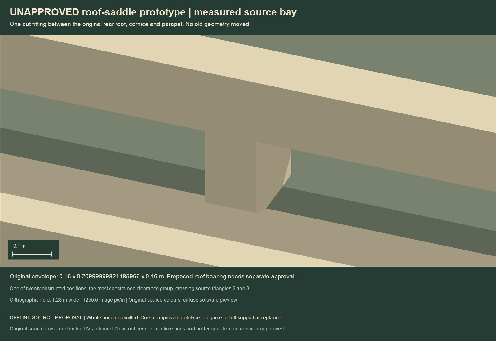
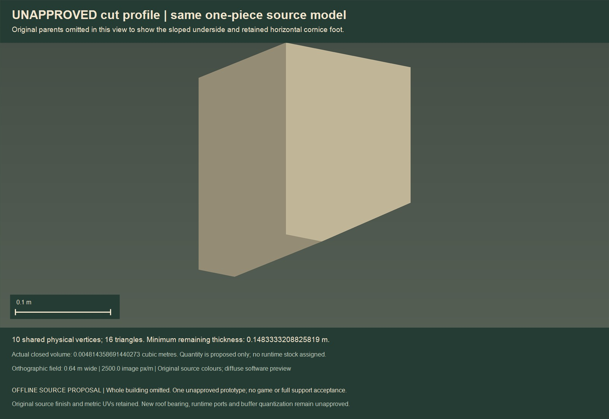

# One proposed rear-roof saddle

17 November 2026. Source proposal on `codex/shared-map-fire-bindings`; the
containing Git commit identifies the candidate. Authority:
`8263a876cfa911c8a11b72fdfd3328a295039fa2`
([exact brief](authority-8263a876.md)). **This is one unapproved prototype,
not an export of twenty assets or an accepted support joint.**

## Chosen position and bounded classification

[Classification](classification.json) covers exactly the twenty frozen
obstruction records. All intersect the original `carrier/roof/rear-tail`.
Actual captured roof triangles/matrices are clipped over each footprint using
exact rational arithmetic on the emitted binary64 coordinates. The original
table's floating measurements and collision witnesses are retained separately.

| Class | Positions | Original upward roof triangles |
| --- | ---: | --- |
| Rear slope, single source facet | 14 | 2 or 3 |
| Rear slope, crossing a coplanar triangle seam | 2 | 2 and 3 |
| East hip | 2 | 5 |
| West hip | 2 | 4 |

Choose the least exact remaining thickness to the original envelope top;
ties prefer more intersected source triangles, then lexicographic proposal ID.
This selects **parapet 6, bay 01**, one of the sixteen least-clearance rear
positions and one of the two crossing the original triangulation seam.
The seam is coplanar source triangulation, not an invented physical break.
The stable rule does not round positions to make them equal.

The selected source ID is `proposal-only/blocking/main-parapet-6/bay-01`;
the proposed fitting is `proposal-only/roof-saddle/main-parapet-6/bay-01`.
Its bay remains 49–50 m on X. Other nineteen positions have classified actual
roof facets and positive reference clearance, but have no authored fitting,
per-instance UV/closure/quantity/contact acceptance or runtime installation.

## One continuous cut body

[Source proposal](source-proposal.json) and [geometry](geometry/proposed-saddle.json)
preserve the original normalized-box pivot, exact source matrix, 0.16 by
0.20999999821185966 by 0.16 m envelope, occupied bounds and complete upper
parapet footprint. No roof, cornice, parapet, native wall or character moves.

Cut the underside from the original envelope with the actual rear-roof plane.
The resulting pentagonal cross-section retains an outer horizontal cornice
foot and an inner sloping roof seat. It is **one genuinely closed indexed solid:
10 shared physical vertices, 16 outward triangles, 24 edges, Euler value 2**.
Per-corner UVs are separate data; texture seams do not split the physical body.
The mesh uses metric face UVs at the existing physical metre density and the
same original cornice finish. No bitmap, finish fuel or physical paint layer
is added. Original dimensions and the 1 x 1 x 2.12 m stock grid are preserved.
Occupied stock cells are (49, 8, 59) and (49, 8, 60), in zero-based
X, Y/level, Z order. Level 8 has base elevation 16.96 m; this fitting creates
no new floor or walking surface.

The proposal uses double-precision authored positions and the original matrix.
A tiny conservative rounding of **new cut vertices only** avoids penetration
of the unchanged roof plane. Old source vertices, reference datums and contact
tolerance are untouched. Runtime buffer quantization and native fragment/port
generation remain unproved; this source mesh is not an installed runtime asset.

[Exact mathematical evidence](mathematical-evidence.json) distinguishes the ideal
rational reference cut from the actual emitted closed body. Closure is checked
on the actual shared indices without tolerance welding. The unchanged original
roof has eight nonindexed triangles whose six coordinate vertices close exactly;
that source observation does not turn its layout into the new indexed fitting.

The actual minimum remaining thickness is **0.1483333208825819 m**. A vertical
material segment connects an interior point of the real sloping underside to
the upper face. Exact face halfspaces prove that its interior is within this
single convex body, with positive thickness. A filled measurement envelope
does not substitute for material.

## Contacts requiring review

[Contact and geometry evidence](check-results.json) records three actual source
contacts; all remain proposals:

| Contact | Actual measured area |
| --- | ---: |
| Retained local flat cornice patch | 0.007384610843018891 m² |
| **New proposed sloping roof patch**, source triangles 2 and 3 | 0.020715973231156933 m² |
| Unchanged complete upper parapet footprint | 0.025599999999940337 m² |

The original lower cornice contact is reduced rather than silently retained
over the removed wedge. The additional roof seat is an explicit new bearing
proposal on `carrier/roof/rear-tail`, whose source role remains
`roof-covering`. That role is not promoted to a structural member or anchor.
Load interpretation and the resulting support path need architect review.

The actual fitting lies wholly above one exact support plane, and every
original roof vertex lies on or below it. This separates their actual solids.
The roof patch and emitted fitting face have explicitly recorded vertical
gaps of at most **1.3158197503222668e-15 m**, caused by conservative new-vertex
representation. They are not claimed to be mathematically identical planes.
The existing **1e-5 m** native contact precision remains unchanged. The original
upper separation, **3.552713678800501e-15 m**, is preserved.

The existing contact predicate passes three finite calls for **one prototype
plus exactly three original parents**: four shapes and four geometry buffers.
This is not native activation, a world, a support graph or damage acceptance.
The native predicate SHA-256 remains
`4a1c082c518c22d31bfbf6c6d01ff49d4b6589a246eb8182b662b48d16f58441`.

No other old solid can gain an intersection through this cut: the actual
new body is a subset of the exact frozen untrimmed envelope, whose complete
obstruction record identifies only this roof. All 182 original New York
geometry byte pins are reverified. This uses the accepted old exclusion proof
by identity/subset; it is not a fresh whole-building intersection run.

## Separately proposed quantity

The actual closed emitted volume is **0.004814358691440273 m³**.
Applying the existing volume / binary64 .12 frame convention gives
**0.04011965576200227** unrounded prototype units. A six-decimal quantity
proposal would be **0.040120**. Exact rational values are in the mathematical
evidence. These are proposed source measurements, not historical timber mass
or assigned canonical fuel. **Zero runtime stock is assigned.** No quantity for
the remaining nineteen or combined world ledger is computed, and no old
untrimmed twenty-position estimate is used.

## Pins and preservation

| Frozen input / output | SHA-256 |
| --- | --- |
| Original gap-design table | `481294255d3afd8dd0ea208d2dc0cc1c7adf1f2e6108e5929a0e887bbb1abfa4` |
| Original complete bindings | `407c0f8bd582f8d95b9ade1471cd51892ac7b9a40fd2c005696bcc5485991eba` |
| Original rear-roof geometry | `9f3ed10d083a5a52c316b83f1579e4fa6148e3b4974b5d7969257d3beddf6669` |
| Reviewed original front prototype | `a5a34f18a4d18b5a316096edf58b941e727a7546e544636a5a29469bc5c5b1c2` |
| One new proposal record | `cb7f54e07464e7834086d71d4d073322edab1fd4198d24aef890f8585010c8f6` |
| One new prototype geometry | `68fcb9a576b246bd517b59bc47cf27860cbb19db88133d081011a680677ebe8c` |

The artist parent is `11f0a153e02ed0ad68673e5b3403497941308d6d`.
All 3,706 earlier tracked source/art/proof paths stay unchanged, including
the front48, clear96, source geometry, material/quantity records, all earlier
failed cases, vegetation archive and JPGs. Original source provenance/rights
remain unchanged; this proposal makes no additional license grant.

Producer dependency pins remain frozen at authoring. Verification separately
uses the already accepted exact original/approved helper context policy from
the clear96 correction. Unknown helpers are not repinned into producer
provenance. No source/compiler/runtime index is changed.

## Checks, rejected cases and reproduction

303 source checks pass, plus the three finite native contact queries.
Two raw rejected fixtures are retained inside the check evidence:

- The closed original rectangular envelope intersects the actual roof. Its
  original witness is strictly inside both the fixture and every real roof
  halfspace.
- Two individually closed and clear pieces separated by an air gap fail the
  single continuous-body requirement. Their actual vertices/indices remain
  in the rejection record.

The initial [source generator failure](attempt-01-name-shadow/failure.json)
and complete producer snapshot are preserved. A helper-name collision was
corrected before any geometry output was emitted.
A separate [handoff encoding failure](attempt-02-readme-encoding/failure.json)
and its raw document bytes are retained; only the new README encoding changed.

Run only the scoped source checks:

```text
python -B art/source/shared-map-fire-bindings/roof-saddle-proposal-v1/propose.py --check
node art/source/shared-map-fire-bindings/roof-saddle-proposal-v1/check-native-contacts.mjs --check
python -B art/source/shared-map-fire-bindings/roof-saddle-proposal-v1/check.py
python -B art/source/shared-map-fire-bindings/roof-saddle-proposal-v1/review.py
git diff --check
```

These do not construct a native compiler, world, trial, support graph, build,
game renderer or benchmark. The other nineteen remain source classifications.
No further plant/glass or query-kernel work is included.

## Two views, one short offline session



The assembled view shows the one prototype and its three original parents,
with 1.28 m horizontal field, 1,250 image pixels per metre and a 0.1 m ruler.



The second isolates the same fitting so the cut profile is visible; original
parents are explicitly omitted. Horizontal field is 0.64 m, 2,500 image pixels
per metre, with a 0.1 m ruler. Both 1600 x 1100 JPGs are labeled unapproved,
with whole-building context omitted. Microscopic gaps are below image scale.

The existing software rasterizer and OS encoder produced both views in one
**31.809-second** session with a real 120-second worker deadline. No blocked
binary was retried, no execution policy changed, and no browser/server ran.
[Lifecycle receipts](preview-session/cleanup-receipt.json) verify both exact
process lifetimes exited and own no TCP connection. No helper is retained.

The [review package](review-package.json) inventories all new source/evidence
and JPG bytes. This delivery is ready for architect review of one proposed
profile and its new roof bearing; it grants no runtime installation or
acceptance of the other nineteen.
