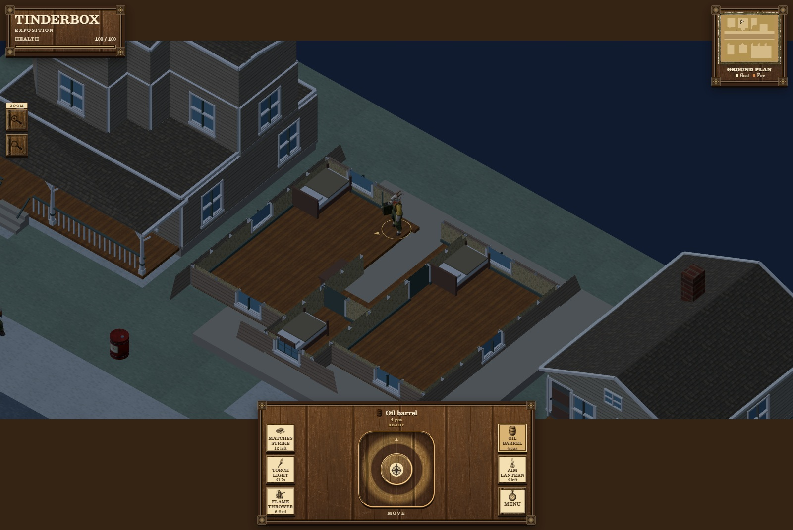

# Hopkins 15 live access variant

This is the additive artist delivery `catalogue-h15-access-125-v1` on `codex/catalogue-modular-art`. The exact candidate commit is reported with the delivery. Architect/coder own final combined input/build acceptance, integration and publication.

## Version and source boundary

The unchanged original Catalogue control is `2db04797846c9f14e47259ae6d5282932421b4b8`. Its house SHA-256 is `124d10f7fee9a5b03193aff61ecee9375bef623b8de0cba363ac49c00c64f546`. The original furnished-house fixture and sandbox house-route source remain unchanged. Existing pins, inherited licenses and unresolved rights records continue to apply. This is a measured game-access adaptation; it is not a claim about the original Hopkins plan.

The live house retains its original `[24,0,13]` half-turn placement, 0.48/2.60 m walking levels, 2.12 m pitch, all twelve original stair rises and their 3 m run. Native walls, doors, roofs, central treads, furniture, materials, UV density and body sizes are preserved. The shop changes only its exporter provenance hash; all shop geometry, contents, stairs and placement remain semantically identical to the control.

## Measured correction

The old aperture was exactly 1 m wide for the reviewed 1 m body diameter. The reported 10.46 mm lateral offset intersects actual `floor/l1/9,8` on the second riser, where the 1.66 m body head extends 13.33 mm above the 2.48 m slab underside. The old newels leave only 7.5 mm per side. These remain failing controls in the focused receipt.

The main upper-floor aperture is now local X `4.875..6.125`, Z `3..7`: 1.25 m clear. The native newels move 117.5 mm outboard on each side; the rails leave 1.26 m clear. Post bases seat down 5 mm and handrails down 8 mm to remove the original small placement gaps, with every authored piece retaining its size. The lower route uses X 5.44; after the ninth-riser gate `[5.44,2.07,6.01]` it transitions to X 5.56. This clears the retained lower header and upper corner. The upper exit crosses the real terminal tread edge at `[6.2,2.6,6.875]`.

The sixteen clipped surfaces are `floor/l1/9,6`, `floor/l1/9,7`, `floor/l1/9,8`, `floor/l1/9,9`, `floor/l1/9,10`, `floor/l1/9,11`, `floor/l1/9,12`, `floor/l1/9,13`, and the corresponding eight `floor/l1/12,6` through `floor/l1/12,13`. Each becomes 0.1875 m² from 0.25 m². Canonical support/thermal polygons, underside geometry, captured painted floor meshes and level floor geometry agree.

All moved mesh IDs share prefix `house/gross-housing-hopkins-4-15/0/level-0/1/group/`:

| ID suffix | Translation in metres |
| --- | --- |
| `17/stair-newel` | `[-0.1175, -0.005, 0]` |
| `18/stair-newel` | `[-0.1175, -0.005, 0]` |
| `19/stair-newel` | `[-0.1175, -0.005, 0]` |
| `20/stair-newel` | `[-0.1175, -0.005, 0]` |
| `21/stair-handrail` | `[-0.1175, -0.008, 0]` |
| `22/stair-newel` | `[0.1175, -0.005, 0]` |
| `23/stair-newel` | `[0.1175, -0.005, 0]` |
| `24/stair-newel` | `[0.1175, -0.005, 0]` |
| `26/stair-handrail` | `[0.1175, -0.008, 0]` |

The relocated upper-right post `25/stair-newel` is retained in its existing position. The [focused receipt](h15-access-125-checks.json) records full mesh and physical surface IDs, before/after bounds and each cut.

## Actual bearing pieces and finite quantities

Six end cuts of the existing 0.12 m native slab supply actual closed solid render/collision/support geometry and finite timber fuel. Their identifiers are shared by source mesh, render mesh and physical record. No support plane or decorative-only bearing is substituted.

| Added ID | X bounds | Z bounds | Top Y | Top area (m²) |
| --- | --- | --- | --- | --- |
| `access125/bearing-left-z5` | 4.8..5.015 | 4.9675..5.0325 | 1.1866667 | 0.0139750 |
| `access125/bearing-right-z5` | 5.985..6.2 | 4.9675..5.0325 | 1.1866667 | 0.0139750 |
| `access125/bearing-left-z6` | 4.8..5.015 | 5.9675..6.0325 | 1.8933333 | 0.0139750 |
| `access125/bearing-right-z6` | 5.985..6.2 | 5.9675..6.0325 | 1.8933333 | 0.0139750 |
| `access125/bearing-upper-left-edge` | 4.81..4.875 | 7..7.0325 | 2.6000000 | 0.0021125 |
| `access125/upper-tread-edge` | 6..6.125 | 6.75..7 | 2.6000000 | 0.0312500 |

The four intermediate bearers overlap the native adjacent tread solids by positive volume and cover all shifted post-base corners. The small upper-left edge supplies the otherwise unsupported half of that post at the retained floor/wall joint. The terminal right tread edge contacts the actual native top tread and cut floor lip. Rails intersect real translated posts. All new and changed pieces are rooted in the focused trial with the actual manifest-qualified host flight and both named landings. The inherited inferred stair stringer remains the existing structural approximation.

| Quantity | Before | After / change |
| --- | --- | --- |
| Main upper-room floor | 68 m² | 67 m²; 1 m² removed |
| Added bearing/edge top area | 0 | 0.0892625 m² |
| Added native timber volume | 0 | 0.0107115 m³ |
| Total house surface fuel | 587.7940003 | 586.8832628; net −0.9107375 |

Fuel is the unchanged prototype frame quantity at native slab density, not measured mass. Additional skins, textures, lights, simulation coefficients and collision tolerances are unchanged.

## Checks and one new host JPG

The [focused check receipt](h15-access-125-checks.json) passes 11 checks. Native 0.5 m radius / 1.66 m height traversal passes upward and downward at −50, −25, 0, +25 and +50 mm lateral offsets, with slide disabled, the normal 25 mm sampling and 0.22 m step limit. Furniture remains enabled. The original floor-lip failure reproduces. Removing the terminal edge from physical records, source meshes and render geometry makes that crossing fail for missing support; retiring an intermediate bearer makes its dependent post unsupported.

The 781 represented native H15 source meshes have no omitted or duplicate compared area; maximum relative error is 1.25e−14. Attribute interpolation, native guard dimensions, closed added solids, level/floor area and finite fuel checks pass. Component resource counts return to zero. The focused zero-unresolved count applies to H15 with its host flight; broader retained full-map structural findings are outside this check.

The [new host receipt](h15-access-125-host.json) records current data in the actual 51 × 47 m Catalogue host, normal 1600 × 1070 HUD and 12.6 m follow span. Native joystick movement passes 23 route points, the actual nearby Open button, all twelve rises and the new landing edge, ending at world `[17.5,2.6,6.6]`. The player is the native goat, radius 0.5 m and height 1.66 m. No player teleport or forced thermal state is used. The captured frame is tick 124 / world time 2.066667 s; fixed-step driving is a reproducible visit, not a frame-rate measurement.



The normal active-upper-floor cutaway hides the lower storey and its stair guards in this view; this image shows the actual arrival and floor opening. Source/contact measurements above provide the bearing evidence.

The browser uses the frozen coder checkpoint `5784a604bec52f59a2ed9e816ebf5c316336dddd` plus 20 individually hashed working JavaScript/CSS inputs, recorded in the host receipt. It records no page errors, actual RTX 3080/D3D11 WebGL, and zero component resources after disposal. The [retirement receipt](h15-access-125-helper-retirement.json) confirms browser/server exit, released ports 4558/4559 and removed private profile. No helper is retained.

## Export hashes

| Export | SHA-256 |
| --- | --- |
| `scene-data.json` | `75bc8a85553343b1ad11af44969e7cb2f8f115a8198020fecb81d86703e38eba` |
| `shop-data.json` | `cd8ecffe491043546935dc162f0db88e8bd0056d1acb5fe97251db900269b2b5` |
| `house-data.json` | `965abd52ee8c06d77a96187c61568ba5325ff44cbab6515eca5f1422c359611b` |

Runtime intake remains the same production file family: `workbenches/catalogue-modular/{art.js,scene-data.json,shop-data.json,house-data.json}` and its existing art dependencies. The access helper, checks, capture/freeze scripts, docs/media and raw QA overlays are authoring/review inputs and do not belong in the Pages package. All runtime references stay within Tinderbox.

Original 2db phone/fire/cache/WebGL captures keep their original data/source pin and are preserved as controls. Unchanged renderer/cache code is verified by LF-normalized source where Windows working copies have CRLF; the receipt records both byte hashes. No whole action library, burn replay, phone series or GPU benchmark was repeated for this variant.

## Reproduction and remaining gate

From the assigned artist worktree, with Node 24, Python, PowerShell and installed Chrome available:

```powershell
node art/source/catalogue-modular/export.mjs
node art/source/catalogue-modular/check-h15-access.mjs C:/Users/baals/.codex/worktrees/coding-9200/tinderbox
node art/source/catalogue-modular/freeze-h15-review.mjs C:/Users/baals/.codex/worktrees/coding-9200/tinderbox
./art/source/catalogue-modular/run-h15-access.ps1
```

Reproduction against later coder working sources produces a new input record. Preserve earlier controls when changing pins. Final combined keyboard/input, release build, whole-map performance and package/publication checks belong to coder/architect. Other species and the full posed/equipment sweep retain their prior limitations. The shared artist workflow remains the original AFT artist’s Version 2.
