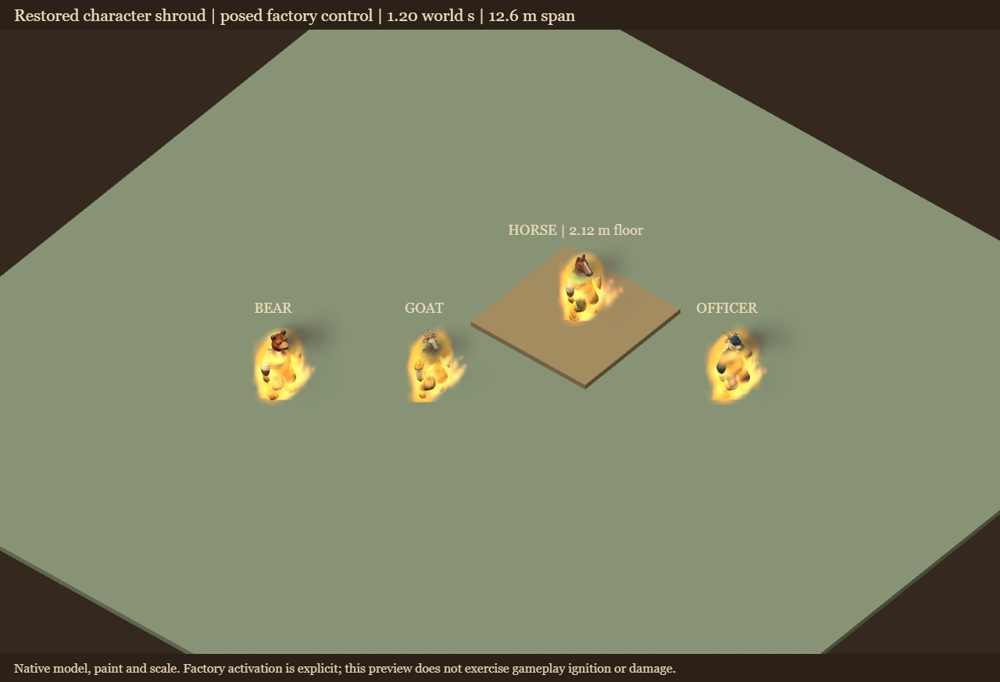

# Approved character shroud artist handoff

Artist branch: `codex/character-fire-shroud-art`, existing art worktree, from common contract `064d41865ae35f00f8a33d7cf1bd6f368f327c17`. The exact candidate commit is reported with delivery. Prior artist `5deda67f` and its branch remain preserved.

## Result and intake

Import `createCharacterShroud` from `src/art/character-shroud/index.js`. Its complete runtime closure is `index.js`, `splats.js`, `fit.js` and `mounts.js` in that directory; it receives the existing shared Three.js namespace. It imports no raw source archive, private workbench, donor checkout, texture, renderer, light or simulation. The [frozen Version 1 API](API.md) is ready for the coder.

Use `bind(id,{species,worker})`, with the already-posed native worker root and skinned parts. After native pose, patrol aim and elevation, call `update({worldTime,camera,characters,sampleWind,windMetadata,effects})`. Character records remain the accepted flat `{id,active,startedAt,intensity?}` shape. Coder maps `startedAt = worldTime - characterFire.age` and supplies intensity from the detached authoritative marker. The factory creates no ignition, damage, expiry or player afterburn. `unbind`, `reset`, `diagnostics` and `dispose` complete the lifecycle.

The effect uses the approved close connected bands, four cloth-mounted flame/smoke emitters and stable per-actor phase. Fitted bands and barycentric tips follow actual native skin transforms, movement, heading and floor elevation. Native model geometry, paint, skeletons, scales and attachments remain unchanged. The original bear ring dimensions are retained; goat and horse effects fit their own native clothing bounds. Onset angle is explicitly a deterministic visual default because no gameplay impact direction is supplied.

The known `chicago-1893-city-beat` root is inspected once per fit for visible replacement coat, trousers and footwear. Hidden original garments are excluded; helmets, badges, weapons and metal are excluded. The existing garment geometry is used unchanged. No new binding field or clothing asset is needed.

## Source and provenance

The approved source pin is `7c60ba4b41f79de9dcca1f10b6e1dfffe9a74b26`. Seven verbatim source/support files are preserved under `art/source/character-fire-shroud/upstream/<pin>/`, including the actual harness `workbenches/fire-realism/gaussian-patch/character.js`. The [provenance manifest](../../../art/source/character-fire-shroud/provenance.json) records original paths, full SHA-256 values, direct dependency edges, native model/paint pins, adaptations and existing rights limitations. Raw archival files are not production dependencies.

The [original native comparison](previews/reference-7c60-bear-shroud.jpg) is preserved unchanged; its right panel is the approved target at the 12.6 m game span. Original AFT bear pin is `4f5f53917990ec03b2f14c65f067e4b99ec8fcaa`; goat/horse use Farmyard `30a3b8cae5f36bb0c1df3685b7fba16f701c2083`. The original Nautilus bake remains separately labelled; the new factory accepts the current host wind sampler and reports its metadata. It does not install another wind model.

## Focused checks

The [check receipt](checks.json) passes all 13 focused CPU/native-model controls: inactive/warm-only allocation, native fittings, constant-world-time freeze, stable rebinding, movement/heading/elevation, true skinned band/tip tracking, actual replacement-clothing clearance, intensity/activation separation, hidden/removal/expiry handling, unsupported/capped diagnostics, presentation switches/reset/rewind/disposal, native data/provenance preservation and exact default Gaussian output.

The three native species fit 32 bands and four cloth mounts each, submitting 204 flame and 55 smoke splats in one shared draw in the focused control, below the 264 combined allowance. The real uniformed goat supplies actual coat/skirt/trouser anchors. Four cloth mounts use rendered replacement cloth rather than hidden original shirt/overalls. At the measured torso samples, 14 actual coat-ray checks place band centres outside the coat; minimum clearance is 0.000265 m. This is a focused fit measurement, not a full posed/gameplay sweep.

Capacity defaults to 16 active bodies and at most 88 submitted splats per body. One shared pool is created lazily and reused through a visit; inactive frames clear its draw count and skip fitted updates. Reset clears bindings and active data; dispose releases the owned pool. Unsupported species and capped IDs are explicit, with no replacement card/body fallback. No per-frame full mesh refit is performed.

## Native visual evidence

The [single native WebGL receipt](visual-check.json) records the original production two-card renderer and restored effect at matching camera, time, normal model paint and native scale. Four posed controls cover bear, goat, elevated horse and the actual Chicago uniform on another native goat. These are explicitly labelled source/factory controls; coder/architect own proof of actual host ignition and direct-contact publication.

[Before: production two-card control](previews/before-two-card.jpg) · [After: restored native shroud](previews/after-native-shroud.jpg) · [3.25-second moving/turning WebM](previews/native-shroud-motion.webm)



Both stills use world time 1.20 s, 1280 × 800 native render buffer, DPR 1 and 12.6 m vertical span, with a clearly labelled caption strip. The original baseline submits eight actor cards. The restored frame submits 272 flame and 53 smoke splats for four bodies, in one body-effect draw. The horse is on the stock 2.12 m upper-floor elevation. The clip moves and turns actual native rigs and returns to zero splats after the explicit factory-control activation ends. The control activation window is not a new gameplay burn duration.

The native GPU is ANGLE (NVIDIA, NVIDIA GeForce RTX 3080 (0x0000220A) Direct3D11 vs_5_0 ps_5_0, D3D11). No page/shader errors were recorded. Observed factory-only CPU update medians are 0.700 ms active (four bodies), p95 1.000 ms; inactive median 0.000 ms. These samples exclude model posing, rendering and encoding and do not establish game FPS, GPU timing or crowd capacity.

The preview uses the ordinary production sRGB display path; the historical reference harness used neutral HDR presentation. Original effect colours/gains are retained; no global display pipeline was changed. The architect passed the initial normal-zoom body/uniform fit review. Final actual-host appearance and behavior acceptance remain separate.

The exact adapted code used by the visual capture is preserved under `art/source/character-fire-shroud/controls/visual-capture/`. Only unsupported-binding diagnostics were added afterward. The focused check compares complete supported splat buffers byte-for-byte across all four body fits at 0.1, 0.6, 1.2, 2.4 and 3.25 seconds; all match. The visual receipt keeps its original source hashes, and the provenance manifest records the final runtime hashes.

## Cleanup and remaining combined gate

The [cleanup receipt](helper-retirement.json) includes exact helper PID/creation/executable identities, browser/server exit, released ports 4558/4559, removed private Chrome profile and deliberate restart source. Both effect and renderer geometry/texture counts reach zero after disposal. No helper is retained. The preview had an actual 180-second server TTL and finite 120-second capture driver.

Coder owns `src/art/fire.js`, `src/art/index.js`, native host wrappers, truthful contact publication, removal of duplicate actor cards and real-game tests. Those files are unchanged on this artist branch. Actual NPC flamethrower ignition, officer/resident gameplay, player lit-fuel contact versus warm-only exposure, pause/powder and legacy/cottage paths require the coder/architect combined gate. No gameplay, ground fire, structure fire, movement, UI or lighting-budget rule was changed here.

## Reproduce the bounded artist controls

```powershell
node art/source/character-fire-shroud/check.mjs
./art/source/character-fire-shroud/run-preview.ps1
```

Use Node 24, installed Chrome and the preserved native assets. The check runs without GPU or donor checkouts. The preview owns one finite hidden browser/server and closes them immediately. QA scripts, raw sources, controls, docs and media remain outside the production import closure. [Delivery paths and hashes](delivery.json) describe this scoped candidate.
