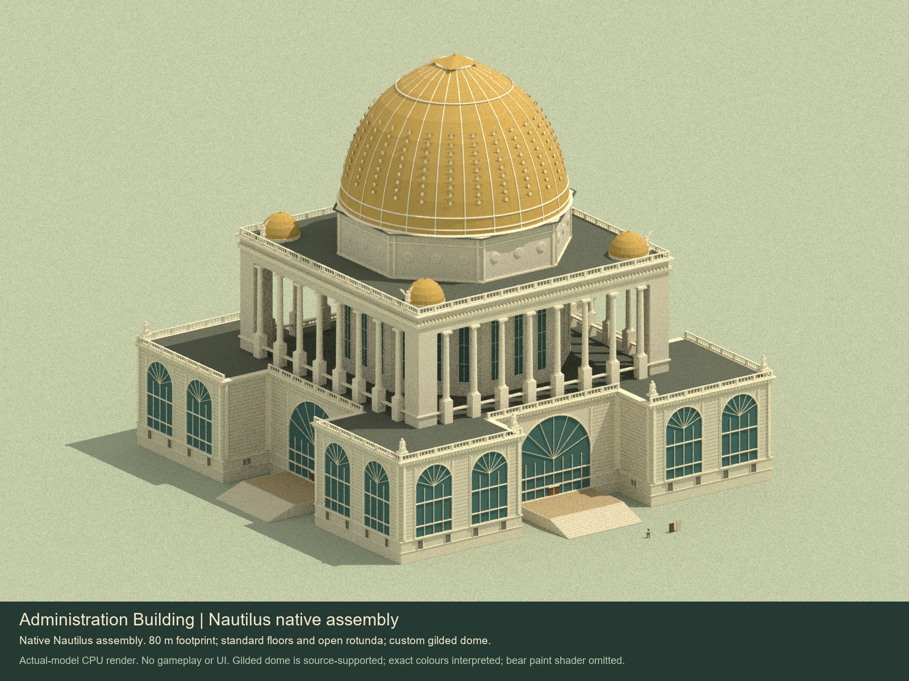

# Administration Building art candidate

The 1893 Administration Building has a complete exterior, native floor plates, an open octagonal rotunda, four circular stairs and the 13 front-office labels supported by the Hunt sheet. It uses the preserved Nautilus `wallPanels`, `measureWallRun` and `wallRunErrors` implementation at `90054d07134116a5d9661f8318a76fe68f922aad`.

See the [artist handoff](handoff.md), [source/model comparison](previews/source-comparison.jpg), [shared-level review](previews/grid-review.jpg), [visual review](offline-review.json) and [check results](check-results.json).

The nominal body is 80 x 80 m. Native panels remain 1 x 2 x 0.16 m; floors use 1 m cells, 0.12 m slabs and the 2.12 m level pitch. Occupied pavilion floors are at levels 1, 3, 5 and 7. Levels 9, 19 and 23 carry roof/gallery/terrace rings; no slab spans the rotunda above level 1. The 76.32 m crown is a custom feature at grid marker 36, rather than 36 occupied stories.

Current Nautilus maps have six layers. The supplied assembly contains five independently validated local tiers with native level offsets. Whole-building catalogue registration and runtime capability intake remain separate work; the asset is not yet in the production street or engine Asset library.
