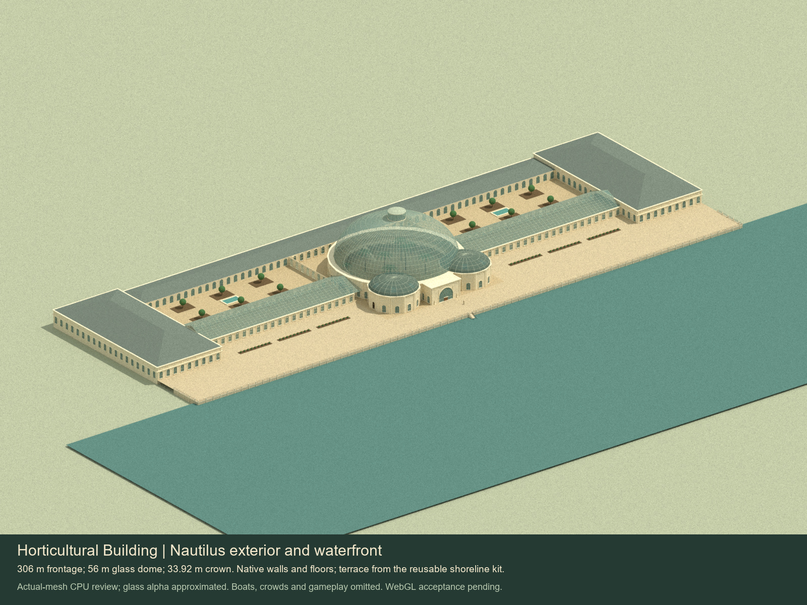

# Horticultural Building, 1893

Native Nautilus art candidate on `codex/horticultural-building-art`, built from the preserved shoreline checkpoint `c6ddd51d7dd47a2ec148159e6a6d64a8d00bd2a9` in the existing artist checkout. User authorization: “you are greenlit for the horticultural building.”

The building has a great glass dome and lantern, twin ribbed front cupolas, long glazed galleries, two planted courts, pavilion galleries and three stairs. Its companion terrace uses the unchanged shoreline recipes. Ordinary walls, doors and floor slabs preserve native geometry; the dome, curved ornament, boundary cuts and stairs are explicit custom forms.

- [Central pavilion](previews/central-pavilion.jpg), [rear exterior](previews/rear-exterior.jpg), [roof plan](previews/roof-plan.jpg).
- [Interior cutaway](previews/interior-cutaway.jpg), [gallery stair](previews/gallery-stair.jpg), [native bear and waterfront detail](previews/entry-and-terrace.jpg).
- [Period plan comparison](previews/source-plan-comparison.jpg), [native height audit](previews/native-floor-audit.jpg).
- [Handoff and reproduction](handoff.md), [offline review](offline-review.md).
- [Source/rights register](../../../art/source/exposition-horticulture/sources.json), [measurements and adaptations](../../../art/source/exposition-horticulture/measurements.json), [runtime manifest](../../../assets/art/exposition-horticulture/manifest.json).

These are actual-mesh CPU review images. Whole-building provider registration, production placement, simulation and WebGL/browser acceptance remain for the architect/coder contract.
