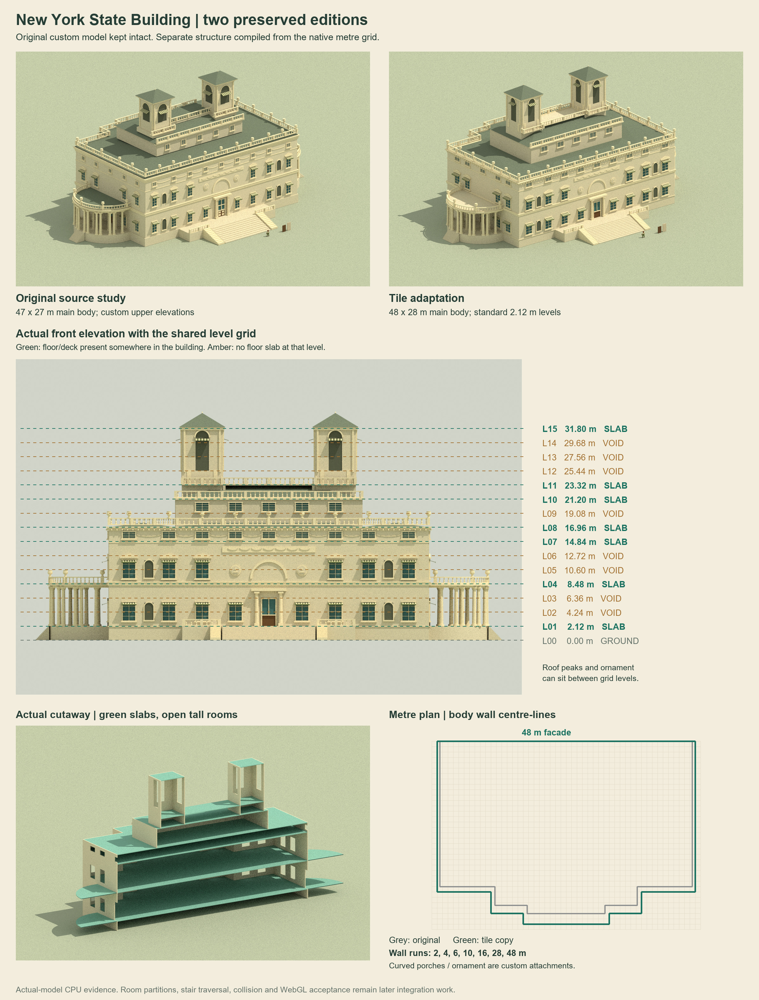

# New York State Building: tile adaptation

The original [source-study asset](../exposition-new-york/README.md) remains unchanged at `5e8d64b8b41637637d57ed762eb5157e5d521b4f`. It reused native-sized parts but included custom wall spans and upper elevations; it was not a complete simulator tile build.

This separate asset has a 48 by 28 m main body, even-metre structural wall runs and actual floors on the shared 2.12 m pitch. Two main rooms span three standard levels each. Intermediate levels have no slabs. Custom roof slopes, porticoes and ornament preserve the landmark's identity.

See the [geometry and integration handoff](handoff.md), [explicit tile/level recipe](../../../assets/art/exposition-new-york-tile/plan.js), [runtime manifest](../../../assets/art/exposition-new-york-tile/manifest.json) and [preserved-original inventory](../../../art/source/exposition-new-york-tile/preserved-original.json).

