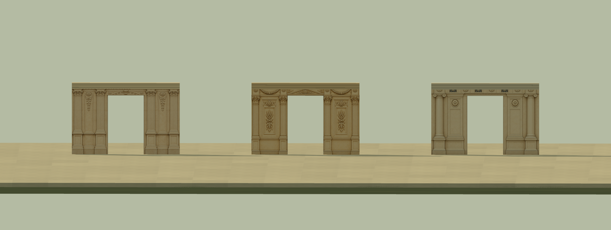

# Facades designed for Farmyard Commando proportions

The v3 Liberal Arts, Agriculture and Fine Arts skins are authored around the original Farmyard Commando wall and door kit. They replace the v2 appearance bindings for the same three stable profile IDs. Earlier PNGs and their generation records remain unchanged.

| Native part or spacing | Metres |
| --- | --- |
| Wall module | 1 wide × 2 high × 0.16 thick |
| Door opening | 1 wide × 1.65 high |
| Door lintel | 1 wide × 0.35 high × 0.16 thick |
| Closed door leaf | 1 wide × 1.65 high × 0.12 thick |
| Floor origins | 2.12 apart, including 0.12 slab |
| Entrance appearance region | 3 wide × one 2 m wall story |
| Wing appearance repeat | 5 wide × 2 high, with five painted bays |

These dimensions come from the unchanged pinned Farmyard `roomBoxes` templates, not a Tinderbox clearance preset. [Native scale evidence](../../engineering/exposition/native-scale.md) records the source commit and measurements. Walls, doors, pivots, original surface UVs, attachments and actor scale stay unchanged.

Each painted bay now occupies one metre of wall frontage. A 13 m entrance assembly has five bays on each wing; a 23 m assembly has ten. Width adds native wall modules and repeats the material. Extra stories add 2 m walls at 2.12 m floor origins. The door, central 3 m entrance painting and texture density remain fixed.

## Artwork

| Stable profile | v3 identity |
| --- | --- |
| manufactures | Slender round-headed glazing, Corinthian dividers, medallions and geometric frieze; compact coffered lintel motif |
| agriculture | Slim arched glazing, paired leafy dividers, harvest garlands and relief panels; compact pediment motif |
| fine-arts | Rectangular recesses, Ionic scroll capitals and star lattice; a straight entrance entablature |

The six opaque sRGB PNGs total **13,791,863 bytes**. Bay images are 1983 × 793 pixels; entrance images are 1536 × 1024. Each entrance is a single-story design around the native opening, so it also works on a one-story assembly.

Generated mask placement is approximate. The manifest records measured image bounds, which the material maps to the exact 1 × 1.65 m opening. No generated image was resized, cropped or painted by a script. A deterministic [doorway guide](../../../art/source/exposition-buildings-v3/doorway-template.svg) records the requested proportions. The separate art attributes leave source mesh positions, normals, indices and surface UV values intact.

[Asset manifest](../../../assets/art/exposition-buildings-v3/manifest.json) · [Exact prompts and refinement history](../../../art/source/exposition-buildings-v3/generation.json) · [Historical sources and geometry provenance](../../../art/source/exposition-buildings-v3/sources.json).

The building references remain Arnold and Higinbotham's 1893 official photographs, plates 3, 18 and 60. Colours and compact ornament are art adaptations. These are reusable facade fragments rather than complete measured reconstructions.

[Wide repeating facade](native-previews/liberal-arts-native-wide.png) · [Single-story Agriculture](native-previews/agriculture-one-story-desktop.png) · [Native Fine Arts door on phone](native-previews/fine-arts-native-door-phone.png).

## Use and review

The existing `exposition-v1` skin set and `manufactures`, `agriculture`, `fine-arts` profile IDs now load the v3 pairs. New York State, Fisheries and Transportation retain their prior PNGs and native-scale bindings. Simulation, collision and the original closed door material are unchanged.

The [private art workbench](../../../workbenches/art/skins.html) shows original and painted finishes on identical native geometry. The review covers native dimensions and source UVs, one through five stories, 3/7/13/23 m widths, quarter-turn headings, fixed entrance pixels, rendered wing repeats, support/destruction visibility, actor identity and GPU disposal. The [v3 review record](building-facades-v3-review.json) records the completed checks and selected previews.

This is a contribution to the cumulative **Nautilus shell** from the Tinderbox artist branch. It provides image files, stable profiles, exact Farmyard dimensions, provenance and review evidence. Nautilus import/catalog integration remains separate; these files have not been imported or validated in the Nautilus engine.
