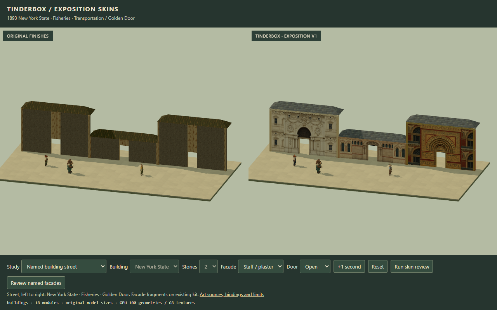
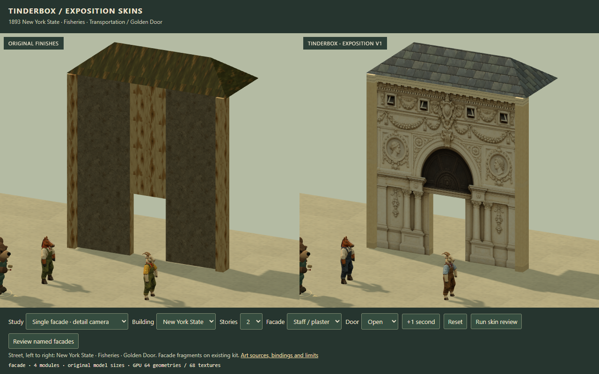
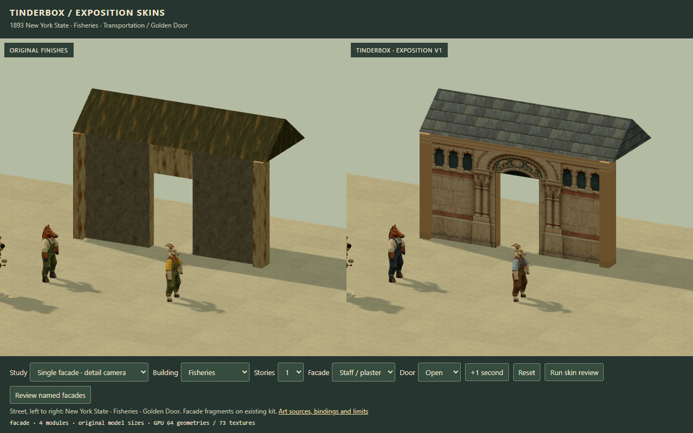
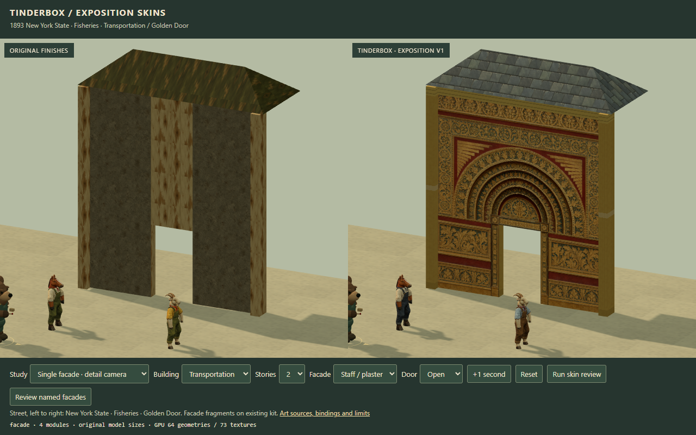
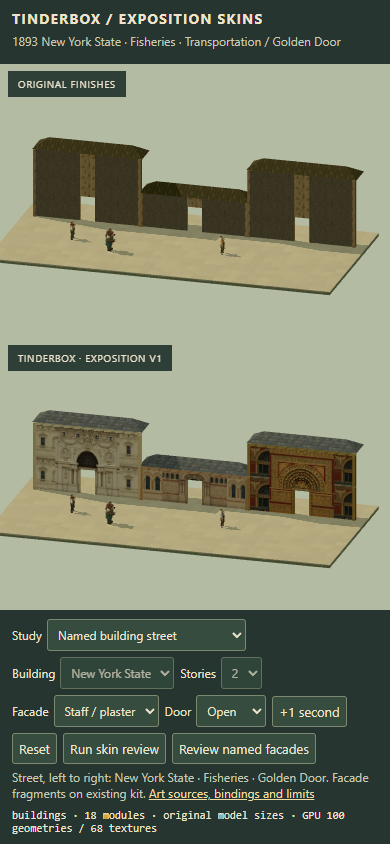

# Building-specific Exposition facades

> Native-scale correction: the enlarged dimensions and review images below describe the original delivery. Current bindings use unchanged 2m AFT walls, 1 × 1.65m doors and 2.12m floor spacing. See [current native facades and checks](building-facades-v2.md).


This artist expansion adds six authored textures for three identifiable 1893 buildings. It builds on art candidate `3f3291565178ff66accecf6914957a05263cbc15` and the existing 1–5-story kit. Architect review selects production composition and promotion.

| Facade profile | Source identity carried into the art | Entrance canvas |
| --- | --- | --- |
| `new-york-state` | McKim, Mead & White elevation plate 44 and Arnold plate 64: rectangular pedimented sash windows, round niches, swags, medallions and attic vents | Two stories |
| `fisheries` | Arnold plate 53 and the 1893 Conkey description: close-set Romanesque arcade, colonnettes and marine ornament | One story |
| `transportation` | Arnold plates 39/41: broad side arches, transoms, winged spandrels and the Golden Door's nested ornamental archivolts | Two stories |

Each has a repeating story bay and a ground entrance panel. The New York and Golden Door entrances span two stories as a single composition. Additional floors repeat complete facade bays above that entrance. Their one-story doorway variant uses a plain matching frame; the tall portal is enabled at two stories. Fisheries uses its marine entrance on the first story.



## Sources and authored output

The [source ledger](../../../art/source/exposition-buildings-v1/sources.json) records exact primary references, inspected local files, SHA-256 values, rights evidence and interpretation limits. The [generation record](../../../art/source/exposition-buildings-v1/generation.json) preserves all six final prompts and reference-image roles. Built-in image_gen generated the new textures from those references.

- New York: [architect elevation/plan](https://archive.org/details/gri_33125006526145/page/n98/mode/1up), with the built photograph in [Arnold's 1893 official views, plate 64](https://www.gutenberg.org/cache/epub/22847/pg22847-images.html).
- Fisheries: [plate 53 in the same official album](https://www.gutenberg.org/cache/epub/22847/pg22847-images.html), plus the Fisheries description in [Conkey's 1893 plans and diagrams](https://www.loc.gov/item/05028673/).
- Transportation: [official plates 39 and 41](https://www.gutenberg.org/cache/epub/22847/pg22847-images.html), with the [Smithsonian 1893 catalog entry](https://siarchives.si.edu/collections/siris_arc_401345) as a separate identity cross-check.

The photographs are monochrome digital derivatives. Ivory, buff/coral and russet/gold/teal are chosen game palettes. Sculpted reliefs, portrait identities and fine ornament are simplified and reauthored. These assets are facade fragments: the existing kit supplies rectangular wall parts and roof caps. Source towers, pavilions, balustrades and giant-building massing remain outside this texture pass. Story/bay dimensions are game adaptations.

[Asset manifest](../../../assets/art/exposition-buildings-v1/manifest.json): six opaque sRGB PNGs, **18,885,443 bytes** total, with dimensions, hashes and profile bindings.

- new-york-state-bay-v1.png / new-york-state-portal-v1.png
- fisheries-bay-v1.png / fisheries-portal-v1.png
- transportation-bay-v1.png / transportation-portal-v1.png

The original vendor assets and the prior seven v1 images retain their bytes. The runtime fetches only a requested profile's two new PNGs. A mixed profile map loads the pairs it uses; comparison workbenches can explicitly preload all six.

## Binding and integration

The normal `exposition-v1` appearance set remains the base for trim, timber, brick, roof and civilian clothes. Named profiles replace the plaster/cream facade materials. Existing facade/trim/door/roof skin-slot IDs are unchanged. No new simulation fields are needed.

```js
const art = await createArtScene({
  THREE, scene, renderer,
  skinSet: 'exposition-v1',
  facadeStyle: 'new-york-state'
});

// Or mix facades by existing module ID:
const street = await createArtScene({
  THREE, scene, renderer,
  skinSet: 'exposition-v1',
  facadeStyles: {
    'new-york-entry': 'new-york-state',
    'fisheries-wing': 'fisheries',
    'transportation-entry': 'transportation'
  }
});
street.update(snapshot);

```

For live style changes, create with `enableBuildingFacades:true`, then call `art.setFacadeStyle(id, moduleIds)` and update before rendering. Without moduleIds, the call changes the global facade and clears prior module overrides. IDs are `generic`, `new-york-state`, `fisheries` and `transportation`. Inherited defaults keep their existing loading/rendering behavior.

Piecewise appearance coordinates align each generated entrance rectangle to the real model gap. The actual 1.4 × 2.3 m passage stays clear; the closed leaf keeps that size. Portal art spans the piers and tall lintel continuously. Each upper story receives a complete bay, and the top cornice stays at the actual height. Shared floor bands are suppressed across the authored portal panels.

Position/normal/UV data, indices, skeletons, projected civilian paint, collision, physical material, fire timing, roof support and authoritative destruction rules stay in use. The added coordinates, palettes and ID map belong to the artist layer.







## Review and evidence

[Skin workbench](../../../workbenches/art/skins.html) opens on a mixed named-building street. The left panel has inherited finishes; the right uses the three new profiles on the same meshes and snapshot. Phone stacks the panels. Single facade, 1–5-story gallery and courtyard modes expose individual profiles. Courtyard uses the game camera; facade/gallery/street views frame the art studies.

The visible **Review named facades** button runs the new checks and the prior skin review. [Machine-readable handoff](building-facades-review.json) includes current source fingerprints and evidence hashes. Full local outputs are in `artifacts/art-review/buildings-v1`; selected comparisons in building-previews are committed.

- All 56 behavior tests, 66 own-script syntax checks, 74 resolved modules, one shared Three pair and five raw provenance inventories pass.
- Six new image hashes/dimensions/reference bindings and nine artist adapter fingerprints pass.
- At 1280 × 800 and 390 × 844: 60 comparisons per viewport cover three profiles × five counts × four headings. Original geometry/pose signatures agree; snapshot state and ground openings are preserved.
- Twelve style cycles remain at 64 geometries / 82 textures after warm-up, with no module geometry rebuilds. Full named-palette disposal returns **0 geometries / 0 textures**.
- Prior cloth/head identity, fixed clocks, 0.8 / 0.28 m/s gait, actor recreation and actual burnt-part/roof-liveness checks pass. Each named style also respects the burnt pier/lintel state.
- Twenty-six captures; 21 linked programs with empty logs; no console warnings/errors or failed requests. The original inherited Exposition review passes.
- Production package: 91 files / 59,869,697 bytes. All 89 served files match the reviewed hashes under /dist/ and private workbenches are absent. Each packaged named style requests exactly two new images and releases to 0 / 0.

```powershell
npm run check
npm run build
node workbenches/art/review-buildings.mjs --playwright <absolute-path-to-playwright-index.mjs>

```

The existing loopback server needs a fresh registered state directory and real expiry. Chrome closes in finally. The completed task retains no preview service; its local cleanup receipt is recorded in the handoff.



The viewport review ran on desktop Chrome 155 / WebGL 2 / RTX 3080. It establishes layout and correctness at phone dimensions; physical-device performance remains unmeasured.
