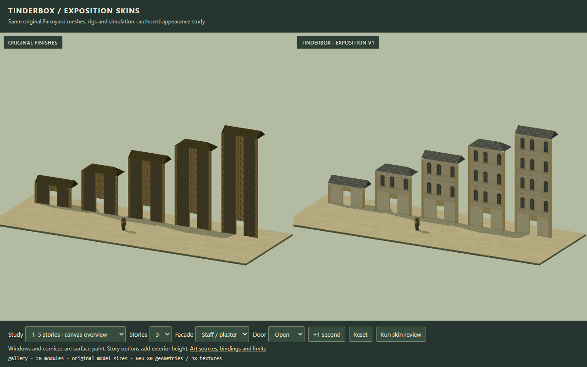
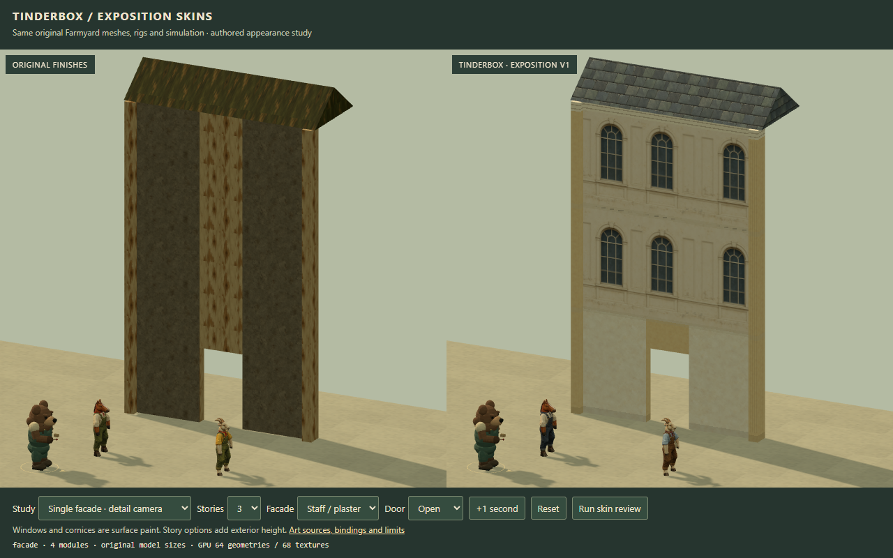
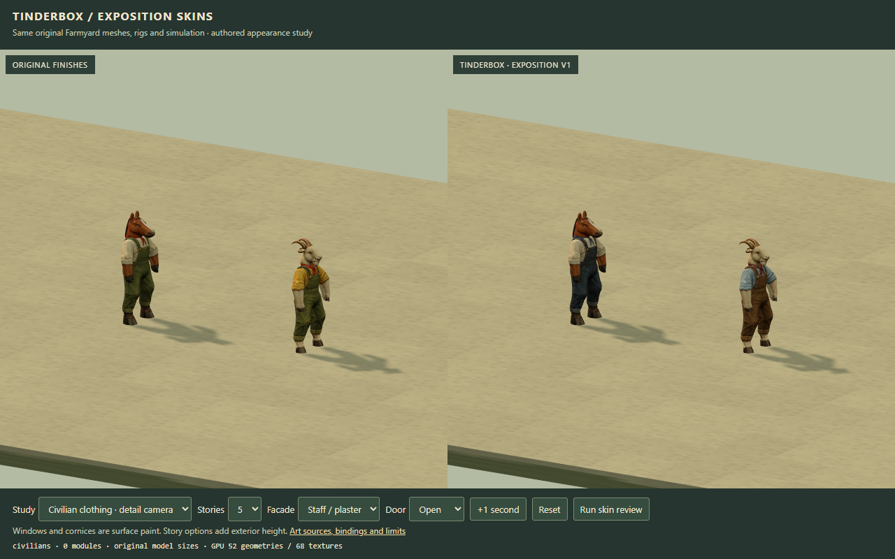
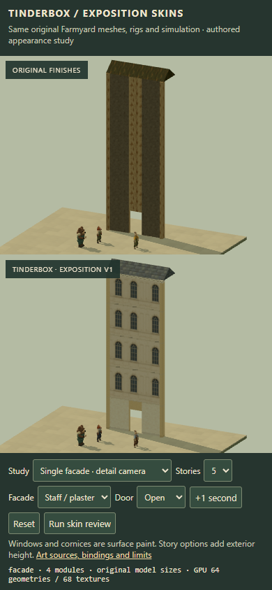

# Exposition skins v1

> Native-scale correction: the enlarged dimensions and review images below describe the original delivery. Current bindings use unchanged 2m AFT walls, 1 × 1.65m doors and 2.12m floor spacing. See [current native facades and checks](building-facades-v2.md).


Artist candidate on `codex/art-assets`, incorporating checked coder checkpoint `c3b7ec415366df09733c97146a3cfc10622ef4c4` through normal merges. The first set gives the existing wall/door/roof kit and normal horse/goat a coherent fictional 1893 Exposition finish. Architect review selects the production default and promotes the candidate.

## Delivered artwork

Seven opaque PNGs, 15,654,834 bytes total. [Asset manifest](../../../assets/art/exposition-skins-v1/manifest.json) records dimensions, SHA-256 values, sources and bindings. [Exact prompts and generated-file records](../../../art/source/exposition-skins-v1/generation.json) record built-in image_gen mode; no CLI/API fallback was used.

| Finish | Authored export | Binding |
| --- | --- | --- |
| Warm ivory staff | staff-ivory-v1.png | Plain facade/frame surface |
| Arched glazed facade bay | staff-window-bay-v1.png | 4 m bay × one story, repeated vertically |
| Cream trim | Shared staff image + #f2dfb8 tint | Floor courses, 0.28 m top cornice, pilaster flutes |
| Ochre timber | timber-ochre-v1.png | Existing wood facade and door slots |
| Sienna brick | brick-sienna-v1.png | Existing brick facade slot |
| Muted slate | roof-slate-v1.png | Existing roof slot |
| Horse workwear | horse-exposition-worker-v1.png | Indigo cotton duck / ivory linen / muted blue scarf |
| Goat workwear | goat-exposition-worker-v1.png | Tobacco canvas / pale blue shirt / burgundy scarf |

The material swatches are 1254 × 1254; the facade bay is 1402 × 1122. Both projected clothing sheets retain the original 1774 × 887 dimensions and four-view layout. These are period-inspired authored assets, not copies of historic photographs or claims about exact 1893 colours. Form references remain in the [research record](README.md) and [source inventory](sources.json).

## Existing asset bindings

The shared `inherited-*` skin IDs and facade/trim/door/roof slots retain their contract. `skinSet` selects their material palette. [src/art/skins.js](../../../src/art/skins.js) owns the new appearance binding; [src/art/exterior-kit.js](../../../src/art/exterior-kit.js) still consumes the same compiled geometry and authoritative liveness.

```js
const art = await createArtScene({
  THREE, scene, renderer,
  skinSet: 'exposition-v1'
});
art.update(snapshot);

// For a comparison that starts on the inherited palette:
const comparison = await createArtScene({
  THREE, scene, renderer,
  skinSet: 'inherited', enableSkinSwaps: true
});
comparison.setSkinSet('exposition-v1');
comparison.update(snapshot); // Apply before rendering.

```

Omitting these options preserves the inherited default and avoids fetching the new images. Select the set explicitly when integrating it into production.

The wall compiler, original donor roomBoxes, civilian factories and vendor files are unchanged by this skin commit. Position/normal/UV data, indices, skin weights, skeletons, PAINT_FRAME, original projected visibility atlas and source validity mask remain in use. The cloth sampler wraps the original material hook: shirt/bib parts change; existing cuff and scarf regions are guarded by bind-space height and source colour. Head/fur, hooves, mane, horns and beard keep the original source paint. No cap, uniform, equipment or weapon is introduced.

New images live under `assets/art/exposition-skins-v1`; originals remain under the versioned vendor tree. The original paint hashes and source pin are in the authored manifest. Existing raw provenance remains in city.json; art.json updates only artist adapter fingerprints and adds the new binding.

## One through five stories

The new facade coordinates use the shared `stories` and `storyHeight` contract. The five options are 3.2, 6.4, 9.6, 12.8 and 16 m. Each upper story receives another complete window row and floor course; one top cornice stays at the actual facade height. Custom story spacing uses its supplied value. Legacy explicit-height modules receive one complete story across that height.

Doorway modules keep a plain ground-level frame and the exact 1.4 × 2.3 m opening. Upper piers and the tall lintel share continuous facade coordinates, so their window rhythm joins. Painted windows are closed glazing on the existing solid parts. Story options add exterior height and do not create accessible upper floors. Skins do not change collision, physical material, fire, support or damage state.







## Review and reproduction

Open [the skin workbench](../../../workbenches/art/skins.html) through the existing read-only art server. Desktop shows side-by-side views; phone stacks them. Both use the same authoritative snapshot and geometry. Courtyard uses the game camera; facade/gallery/clothing studies label their adapted cameras. Select Single facade to inspect each height. The visible Run skin review button prints the actual results.

```powershell
npm run check
npm run build
node workbenches/art/review-skins.mjs --playwright <absolute-path-to-playwright-index.mjs>

```

The server and browser must follow the registered-helper lifecycle, including a fresh state directory and real expiry. The review runner closes Chrome in finally. The completed preview has no retained service; see its local cleanup receipt.

[Machine-readable handoff](skins-review.json) records source fingerprints and evidence hashes. Full local evidence is in `artifacts/art-review/skins-v1`; the five selected images in skin-previews are committed for remote review.

- 56 behavior tests; 63 own-script syntax checks; 71 resolved modules; one shared Three pair; five raw provenance inventories pass.
- Authored image bytes, original paint hashes, projected sheet sizes, exact prompts and eight artist adapter fingerprints pass.
- Paired review passes at 1280 × 800 and 390 × 844. All five geometry/pose signatures match across skin sets. Open/closed ground leaves keep their size.
- Original head/fur pixels above 1.33 m match exactly in an isolated 420 × 280 render: hash 1235647038, 2,496 nonzero colour-channel samples in each view.
- Frozen snapshots and clocks stay unchanged. Gait remains 0.8 m/s normally and 0.28 m/s under powder.
- Eight palette swaps and four civilian recreation cycles stay at 86 geometries / 76 textures after first-use warm-up. Full paired disposal returns 0 / 0.
- Actual burning removes the authoritative pier, unsupported lintel and roof in both palettes; surviving parts remain.
- Twenty comparison captures, 17 linked shader programs with empty logs, no browser warnings/errors or failed requests.
- Original Exposition review and legacy art smoke pass.
- Self-contained build: 83 files / 40,972,140 bytes. All 81 served files match reviewed hashes under /dist/; private QA workbenches are absent. Packaged new-set load includes both original civilians and returns to 0 / 0 on disposal.



The phone check emulates a viewport on desktop Chrome/RTX 3080; it is not a physical-device performance claim. Fine paint and trim are deliberately subdued at game scale. The bear/effects and world composition remain the existing work; this candidate changes appearance assets and their bindings.
