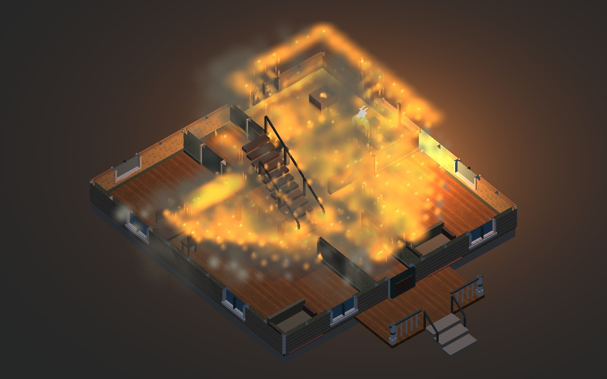
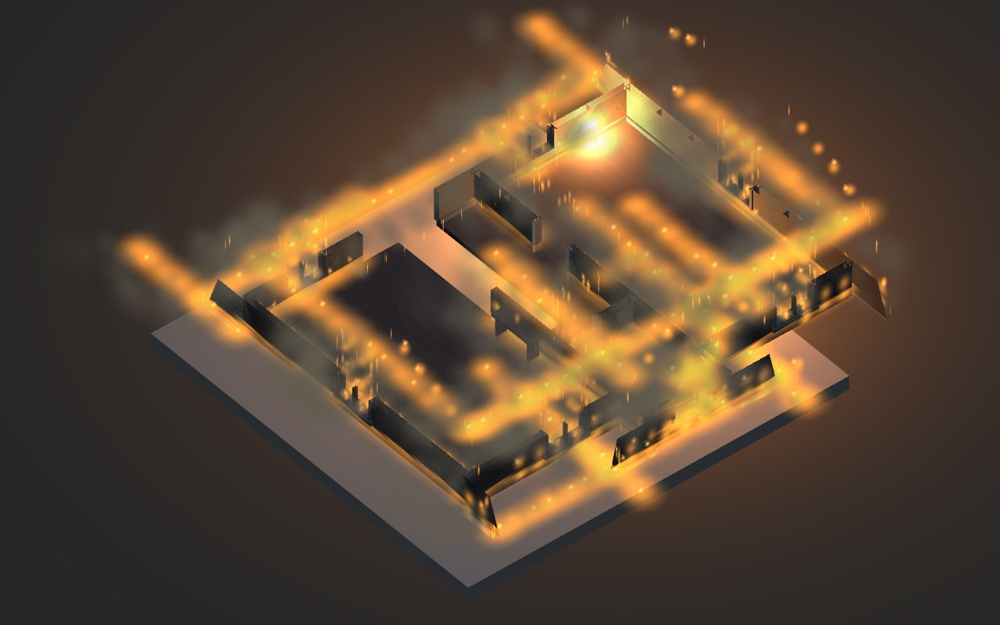
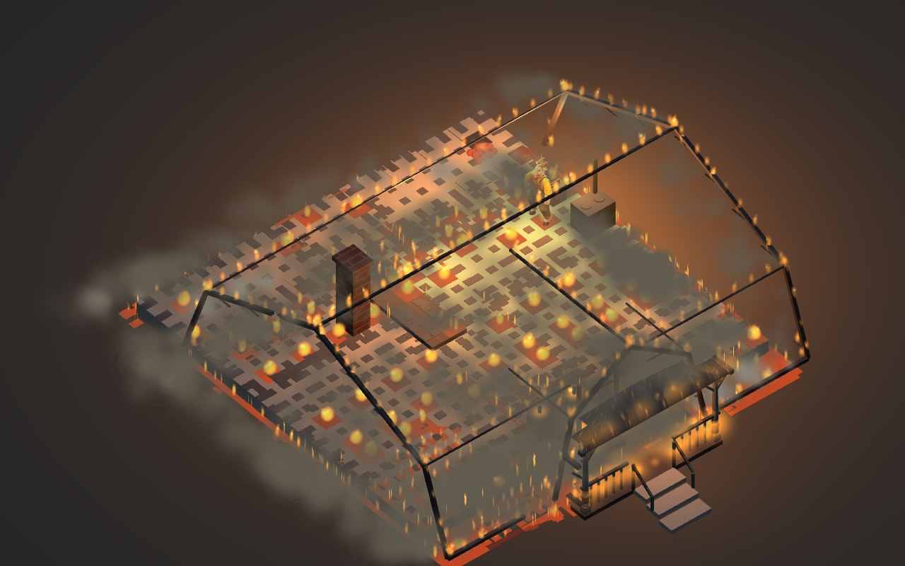
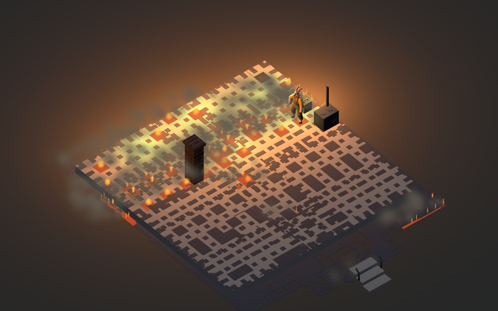

# Furnished Hopkins 15 replay

[Play the actual WebGL movie](kitchen-night-replay.mp4): 82.5 seconds, showing 330 world seconds at a labelled 4× speed, 1280 × 800, 30 encoded frames per second. This is an owner-review prototype before game integration. [The architect review](../../../reviews/2026-11-11-furnished-house-replay.md) records rules, checks, costs and limitations.

One match starts the kitchen-side wall fire. The camera alternates exterior, ground-floor and upper-floor cutaways, then shows the wreck. The simulation retains each piece's fuel and burn age through local material failure, mechanical support loss, falling and supported rubble. The selected animal is the native goat at its original scale.

The movie contains 2,475 actual rendered frames. Every active fire source remained represented. Maximum absolute fuel error is 3.083 × 10⁻⁸ prototype units; maximum relative heat error is 5.655 × 10⁻¹¹. Four decoded samples, including the late wreck, verified the saved H.264 MP4. Export took 568.38 seconds; that is export throughput, not game frame rate.

Representative actual frames:

[The manifest](manifest.json) supplies exact source pins and SHA-256 values. The inputs, compressed final physical state, stage counters, decoder result and cleanup evidence accompany the movie. Both original capture processes and their direct children were independently verified absent after a Windows close-promise timeout; the original warning is preserved. No preview service is retained.

Current limits include strong bloom/haze, repeated flame streaks, visible grid-like rubble and roof-trim effects that remain above cutaway-hidden geometry. The wind is the labelled ambient eastward 1.5 m/s control, not an obstacle-resolved house bake. This recording does not establish city-scale performance, a stress-engineering solver, AAA visual acceptance or the broader fire-cost target.
