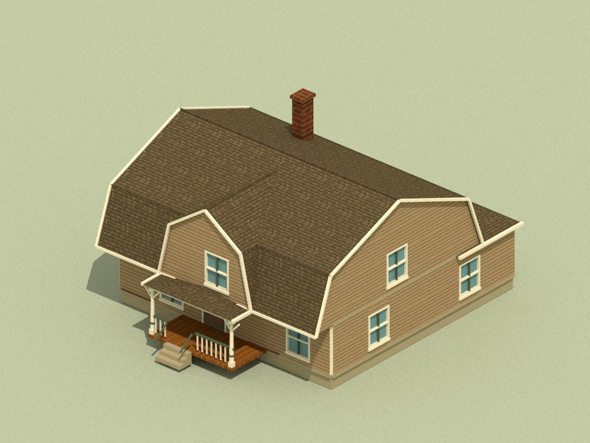

# Hopkins No. 15 roof revision

The previous roof followed room outlines and produced a notch above the porch. The replacement has a continuous main gambrel and a projecting front gambrel. Steep lower skirts meet shallow crowns at clear bends, with actual valley cuts where the roofs intersect. The chimney shaft reaches below the roof surface. The user requested **horizontal clapboard on the vertical gable faces around the windows**; cedar shingles remain on the sloped roof planes.



[Original / previous / revised comparison](previews/roof-15-comparison.jpg) · [front](previews/roof-15-front.jpg) · [rear](previews/roof-15-rear.jpg) · [geometry review](roof-15-geometry-review.json).

## Source and decisions

Hopkins, *Houses and cottages*, Book 4 (1891), [illustration leaf n26](https://archive.org/details/DSHopkinsHousesandcottagesbookno40001/page/n26/mode/1up), facing the description on printed page 24 / leaf n25. The written description names a gambrel-roof cottage; the perspective supplies the main and projecting front roof forms. It gives no roof pitches, knee positions or measured eaves. The exact source image hashes, observations, uncertainties and art decisions are in [roof-15.json](../../../art/source/hopkins-housing-v1/roof-15.json).

The main slopes are approximately 70 and 22 degrees; the front slopes are 77 and 35 degrees. These are artist choices. Wider eaves clear the existing two full native wall courses, and the front ridge is slightly lower than the main ridge. The source's shingled gable finish is superseded by the user's horizontal siding direction. Unseen rear roofing remains an interpretation.

## Reusable roof art

[The gambrel module](../../../src/art/gambrel-roof.js) builds planar panels in one-metre longitudinal runs with separate cut ends. Local origins sit on the ridge centreline at the run start and eave elevation. Main and front profiles are declared in the prefab's `roofAssembly`; `span`, `kneeRun`, `kneeRise` and `upperPitch` determine the two slopes. No mesh is stretched. `grossUV` uses metres along the run and true sloped surface distance, so the existing cedar texture keeps its physical density.

The result contains 52 roof panels: 48 standard runs, four cut ends, and 24 panels cut at the crossing valleys. Convex-volume clipping removes buried roof faces instead of leaving roof planes through the upper rooms. Closures and removable clapboard facings preserve the three existing gable sash apertures and hide with the roof in interior cutaways. All six existing texture files remain unchanged.

This is a reusable artist mesh kit and prefab recipe. It does not add an editor tile palette or change Nautilus's map schema, wall-run fragments, runtime collisions or gameplay.

## Checks

- `node workbenches/art/check-hopkins-roof.mjs`: prior native-body hash preserved; 1,152 headroom rays find exactly one roof surface; 453 physical UV edge checks; three gable window apertures clear; distinct slope profiles; metre runs and cut ends; cutaway hiding and disposal pass.
- `node workbenches/art/check-hopkins-housing.mjs`: all twelve houses, 24 levels and 112 rooms; 1,333 exact native attribute comparisons and 792 roof coverage samples pass.
- Pinned Nautilus trace validation and the thirteen-house Gross regression pass. Other eleven Hopkins models and all twelve wall-run fragments remain unchanged.
- Full repository tests, build and package hashes are recorded in [package-review.json](package-review.json). Saved exterior, front and rear images use the actual exported meshes and unchanged textures in Mitsuba scalar_rgb. Browser GPU review remains unavailable on this host; the static gallery is reviewed separately.

Wall 1 x 2 x 0.16 m; door 1 x 1.65 x 0.12 m; floor pitch 2.12 m; mesh scale [1, 1, 1]. Floor plans, furnishings and opening positions are unchanged. **The centered two-space window is deferred to the user's separate map-editor request.**

Reproduce the selected exterior and review angles after exporting `--id hopkins-4-15`:

```text
python art/source/hopkins-housing-v1/render-review.py --id hopkins-4-15 --only-exterior --width 1200 --spp 64
python art/source/hopkins-housing-v1/render-review.py --id hopkins-4-15 --only-exterior --camera front --output-root artifacts/hopkins-roof-15 --width 1000 --spp 48
python art/source/hopkins-housing-v1/render-review.py --id hopkins-4-15 --only-exterior --camera rear --output-root artifacts/hopkins-roof-15 --width 1000 --spp 48
python art/source/hopkins-housing-v1/build-preview-sheets.py
python art/source/hopkins-housing-v1/build-roof-15-review.py
```

The renderer merges selected views into the existing review record. Mixed image dimensions and sample counts are recorded per image. The previous preview is retained only as labeled comparison evidence from candidate `e49465128970ea02d2a3a1b9040548d4d136cda3`.
