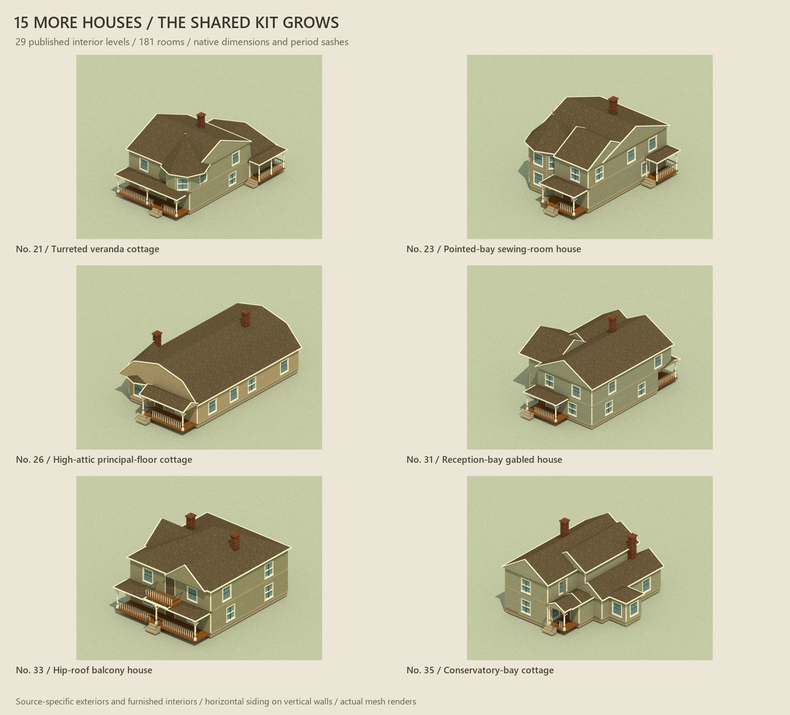

# Hopkins neighborhood houses / second set

Fifteen new artist prefabs from D. S. Hopkins, *Houses and cottages, Book 4* (1891), designs **21–35**: **15 exteriors, 29 published interior levels and 181 labeled spaces**. Together with the first twelve Hopkins houses and thirteen Gross houses, the library now contains forty house designs. Every new house has its original exterior/floor-plan plate, native-grid room data, a complete exterior, furnished cutaways and a pinned Nautilus wall-run fragment.



[All 44 views](gallery.html) · [all fifteen exteriors](previews/collection.jpg) · [principal/first floors](previews/first-floors.jpg) · [second floors](previews/second-floors.jpg) · [source comparisons](previews/source-to-prefab.jpg) · [workbench](../../../workbenches/art/hopkins-neighborhood.html).

| Design | Distinguishing source features |
| --- | --- |
| 21 | Faceted upper front chamber with pointed cap; broad veranda; four upper chambers |
| 22 | Cross-gables; inset porch; lower chamber and three upper chambers |
| 23 | Two-storey chamfered bay; pointed cap; sewing room and bath |
| 24 | Narrow frontage; four upper chambers; separate rear service spaces |
| 25 | Chamfered parlor; corner vestibule; sitting-hall stair |
| 26 | Principal-floor cottage with high attic and pointed front bay; no attic plan invented |
| 27 | Paneled cross-gables; front/side porches; four chambers and rear bath |
| 28 | Rear wood house and pantry; three upper chambers and wing storage |
| 29 | Double porches; chamfered parlor; three upper chambers |
| 30 | Broad T-plan; lower side bay; four upper sleeping rooms and bath |
| 31 | Reception bay; front vestibule; four chambers and bath |
| 32 | Scroll-gables; rear wood house; four chambers and store room |
| 33 | Main hipped roof; secondary gables; full veranda and central upper balcony |
| 34 | Southern-style plan; bed alcove; wraparound porch; open pier foundation |
| 35 | Conservatory bay; lower chamber/bath; two upper chambers and rear stair |

## Source evidence and adaptations

The [source register](../../../art/source/hopkins-housing-v2/sources.json) identifies the [original 1891 catalogue](https://archive.org/details/DSHopkinsHousesandcottagesbookno40001), its Public Domain Mark metadata, exact PDF SHA-256 and all **26 individually inspected source pages**. Illustration leaves are n32, n34, n36, n38, n40, n42, n44, n46, n48, n50, n52, n54 and n56; each has its facing description. Designs 23/24 and 34/35 share plates. Each prefab retains written overall feet and story heights separately from the game dimensions. No. 29 is **26 x 43 ft**, verified visually; OCR misread the depth as 48 ft.

These are interpretations of published pattern-book designs, rather than surveyed Chicago houses. Source observations, known gaps and art adaptations are stored separately. The drawing supplies room relationships and major roof forms; it does not supply measured roof pitches, a complete opening schedule or every rear elevation. Native-grid snapping consolidates small closets, enlarges landings and uses one aligned 1 x 3 m stair flight where the source has multiple flights. Colors, furnishings, roof angles/overhangs, connecting roofs, straight substitutes for curved eaves and simplified timber ornament are artist decisions.

No. 26 publishes a principal floor and only offers optional attic rooms in the prose; those rooms are not invented. Its plate also draws a rear bed room beyond those listed in the description, which is retained with that discrepancy recorded. No. 34 explicitly has no cellar and uses posts/piers; it remains labeled southern-style and is shown with an open undercroft. Its primary porch entry is an adaptation; the separate outside service-hall door is omitted. No new cellar partition plans or undocumented attic levels are added.

## Reusable construction

Walls remain **1 x 2 x 0.16 m**, doors **1 x 1.65 x 0.12 m**, floor/slab thickness **0.12 m**, floor pitch **2.12 m**, and every mesh scale **[1,1,1]**. Two full native courses replace half-storey source proportions. Original native box positions, normals, indices and UVs are compared exactly. New roofs/foundations/ornament are separately authored art and do not redefine engine wall dimensions.

The corrected Nautilus period sculpture is used in **146 centered 2 m bays**: 0.5 m wall + 1 m opening + 0.5 m wall. Odd exterior runs use the existing centered single-unit sash. The adapter preserves each boundary's direction so wallpaper remains inside and clapboard outside; the existing twenty-five houses retain their accepted geometry. Separate frames, sashes and glass remain native meshes. Source window pin: `90054d07134116a5d9661f8318a76fe68f922aad`; Farmyard/Three pin: `30a3b8cae5f36bb0c1df3685b7fba16f701c2083`.

[The new roof module](../../../src/art/pattern-roofs.js) builds gable, hip, faceted pointed and gambrel profiles as planar unions in one-metre strips with separate cut ends. `grossUV` measures true surface metres. Roof intersections remove faces inside another roof volume above its eave plane; native room solids remove roof faces buried inside occupied building volumes. Legitimate lean-to underlaps below higher eaves remain. Exposed gable ends and vertical closures use horizontal clapboard, while slopes keep the existing cedar paint. Chimneys extend below the sampled roof surface. Foundations follow occupied polygons, and side verandas put rails on free edges with stair gaps. All roofs/ornament hide in cutaways.

Only the six existing painted materials are used, with unchanged bytes: Gross clapboard, cedar, oak and wallpaper (1 m repeats), and exposition brick/slate (2 m repeats). No new bitmap textures or donor imports are added. Existing Nautilus notices/provenance remain applicable to its already imported kit.

## Use and checks

```js
import {loadHopkinsNeighborhood, createHopkinsNeighborhoodHouse} from './src/art/hopkins-neighborhood.js';
const library = await loadHopkinsNeighborhood(THREE, {renderer});
const house = createHopkinsNeighborhoodHouse(THREE, library, 'hopkins-4-33');
scene.add(house.root);
house.setView({view: 'cutaway', level: 1});
// renderer.localClippingEnabled = true;
house.dispose();
library.dispose();
```

[Geometry review](geometry-review.json) checks all fifteen connected/non-overlapping room plans, aligned stair shafts, exact native attributes, all 146 window boundaries, **2,628 bidirectional aperture rays**, roof coverage and buried-face handling, physical UV distances, chimney seating, siding assignments, cutaway visibility and idempotent disposal. The aperture check hides sashes and excludes movable interior door leaves and furniture to measure the fixed building envelope. The [Nautilus compatibility record](nautilus-compatibility.json) validates fifteen fragments, 1,713 segments, 458 apertures and native panel/cut widths against `cc52f89de6333a1d94e2dfe45d47d1317369fac0`.

The forty-four saved views export actual Three meshes, host material assignments, physical UVs and cut planes into Mitsuba 3.9.1 scalar_rgb. The diffuse path tracer substitutes for browser StandardMaterial lighting/shaders. The final [offline](offline-review.json), [browser](browser-review.json) and [package](package-review.json) reports distinguish what was actually reviewed. Live WebGL remains unavailable on this host; saved renders and gallery behavior do not establish GPU shader/performance validation.

```text
node art/source/hopkins-housing-v2/build-layouts.mjs
node art/source/hopkins-housing-v2/build-nautilus-traces.mjs
node workbenches/art/check-hopkins-neighborhood.mjs
node workbenches/art/check-hopkins-nautilus.mjs --set2 --nautilus-source PATH_TO_PINNED_CHECKOUT
node art/source/hopkins-housing-v2/finalize-manifest.mjs
node art/source/hopkins-housing-v1/export-render-scenes.mjs --collection hopkins2
python art/source/hopkins-housing-v1/render-review.py --collection hopkins2 --width 900 --spp 40
python art/source/hopkins-housing-v2/build-preview-sheets.py
npm run check
npm run build
```

The [manifest](../../../assets/art/hopkins-housing-v2/manifest.json) hashes runtime recipes, assemblers, five existing Nautilus runtime dependencies and six unchanged textures. Package checks verify working, built and served hashes plus all source pages and previews. Runtime imports are self-contained within Tinderbox; the caller supplies the shared Three namespace.

This is an **artist candidate on `codex/art-assets`**, with exact delivery commit reported in chat. The JSONs and wall-run extensions do not implement a house importer, navigation, collisions, stair traversal, glass breakage or fire integration. Only the architect promotes the candidate. The ordered queue now points to Book 4 designs 36/37, then 1–8, then later source books. No continuing worker or automation is scheduled.

The temporary preview uses the existing art server with a private STOP marker, a real 900-second expiry, exact process identity and lifecycle registration. Restart sources and confirmed shutdown/port release are kept in ignored `artifacts/art-preview/hopkins-neighborhood-v2/`. Saved images need no service.
