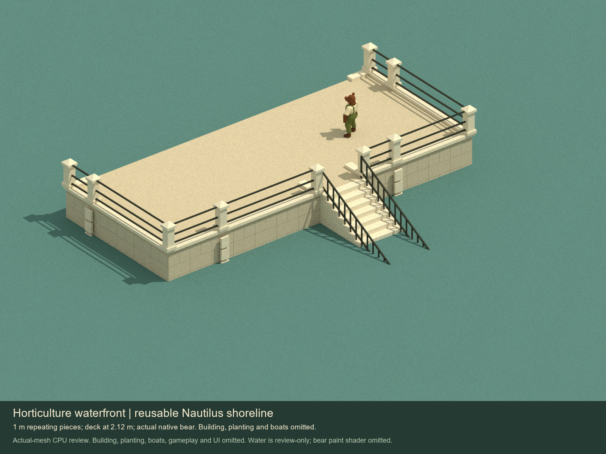

# Horticulture waterfront tile kit

Nine reusable shoreline pieces follow the capped posts, dark horizontal railing, coping and rusticated retaining piers visible in Arnold/Higinbotham's 1893 photograph of the Horticultural Building. This is the requested waterfront addition for that building; the main greenhouse is separate work.

The pieces use the actual pinned Nautilus `wallPanels` generator at `90054d07134116a5d9661f8318a76fe68f922aad`. Native cores remain 1 x 2 x 0.16 m, floor cells 1 x 1 m and slabs 0.12 m thick. The deck is at native level 1 / 2.12 m. Coping, post caps, rails, facing and stairs are explicit custom parts.

See the [nine-piece catalogue](previews/tile-catalogue.jpg), [source comparison](previews/source-comparison.jpg), [handoff](handoff.md), [visual review](offline-review.json) and [checks](check-results.json). The kit remains an art provider candidate for later Nautilus/Tinderbox catalogue intake. Water, traversal and collision are not wired by these assets.
