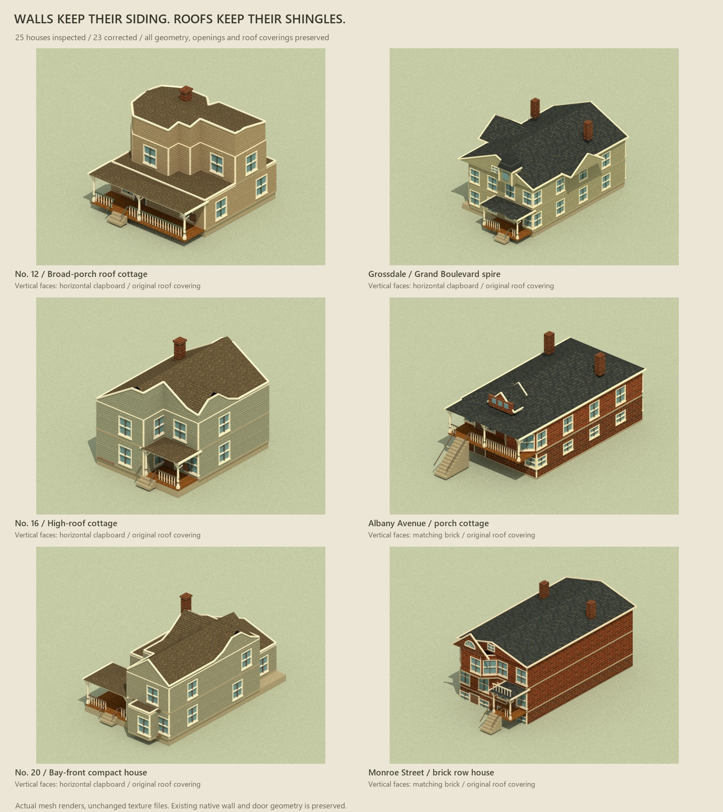

# Housing siding audit

The No. 15 material issue also appeared in eleven other Hopkins houses and twelve Gross houses. Their vertical roof closures, gable infills, dormer fronts and tower drums used the cedar gable material. These faces now continue their exterior wall finish: horizontal clapboard on timber houses and brick on masonry houses. No. 15 and `grossdale-hip` already passed.



[All 25 houses](gallery.html) · [Hopkins sheet](../hopkins-housing-v1/previews/collection.jpg) · [Gross sheet](../gross-housing-v1/previews/all-exteriors.jpg) · [geometry/material checks](geometry-review.json) · [package checks](package-review.json).

## Evidence and boundaries

This follows artist candidate `ec77f460e539d2bf114c806ed520c0a7945edabc`. [The captured baseline](baseline.json) fingerprints every prefab JSON, mesh attribute, transform, UV channel and roof material binding before the correction. [Art direction and source registers](../../../art/source/housing-siding-review/material-direction.json) distinguish the user's current finish choice from the unchanged historical source scans. No new raster textures were generated or edited.

All 25 prefabs and all geometry/UV fingerprints match that baseline. All 25 roof-covering fingerprints and six texture-file hashes also match. The audit checks 1,058 vertical enclosure triangles. No vertical enclosure retains a roof texture. The 48 tiny vertical faces on No. 15's ridge/break caps remain correctly assigned as roof trim.

Walls remain 1 x 2 x 0.16 m; doors 1 x 1.65 x 0.12 m; floor pitch 2.12 m; every mesh scale remains [1, 1, 1]. Room plans, windows, hinges, diagonal cut ends and Nautilus wall-run fragments are unchanged. This task does not alter physics, fire, collisions, imports or gameplay. The user will handle the new Nautilus window discussion/import; Nos. 13 and 15 retain their existing windows.

## Changes and checks

- `src/art/hopkins-housing.js`: footprint roof closures use the house exterior material.
- `src/art/gross-housing.js`: vertical gables, dormer fronts and spire drums use the house exterior material. Sloped envelopes retain the roof material.
- Both collection manifests refresh their assembler hashes and link this review.
- The existing mesh exporter/renderer now accepts either housing collection. Twenty-four refreshed exterior renders and the unchanged No. 15 image are saved with collection/source sheets. The 53 existing interior-level images/geometry are unaffected.
- `node workbenches/art/check-housing-siding.mjs`: 25 data/geometry/UV/roof fingerprints and six texture hashes pass; 23 corrected houses; zero remaining incorrect vertical material assignments. Cutaway hiding and resource disposal pass.
- Existing Hopkins, No. 15 roof and Gross geometry checks pass, including 3,268 native attribute comparisons, 792 coverage rays and 1,152 No. 15 headroom rays. All 59 repository tests pass.
- `npm run build` and working/package/served hash checks are recorded in `package-review.json`. Gallery image loading and responsive layout are recorded in `browser-review.json`.

The images are renders of the actual exported Three meshes and unchanged texture files in Mitsuba scalar_rgb. Live browser WebGL remains unavailable on this host; static gallery checks do not establish GPU shader behavior or performance. Earlier Gross GPU review records remain historical evidence for their stated revision.

Reproduce from the artist worktree:

```text
node workbenches/art/check-housing-siding.mjs
node workbenches/art/check-hopkins-housing.mjs
node workbenches/art/check-hopkins-roof.mjs
node workbenches/art/check-gross-housing.mjs
node art/source/hopkins-housing-v1/export-render-scenes.mjs --collection hopkins --only-exterior
node art/source/hopkins-housing-v1/export-render-scenes.mjs --collection gross --only-exterior
python art/source/hopkins-housing-v1/render-review.py --collection hopkins --exclude-id hopkins-4-15 --only-exterior --width 800 --spp 48
python art/source/hopkins-housing-v1/render-review.py --collection gross --only-exterior --width 800 --spp 48
python art/source/hopkins-housing-v1/build-preview-sheets.py
python art/source/housing-siding-review/build-review.py
node art/source/gross-housing-v1/finalize-manifest.mjs
node art/source/hopkins-housing-v1/finalize-manifest.mjs
```

The preview helper has a private STOP marker and automatic expiry. Its current lifetime, restart snapshots and confirmed shutdown/port release are recorded under ignored `artifacts/art-preview/housing-siding-review/`. No service is required to view the saved images. The exact delivered commit is reported with the handoff; only the architect promotes the artist candidate.
