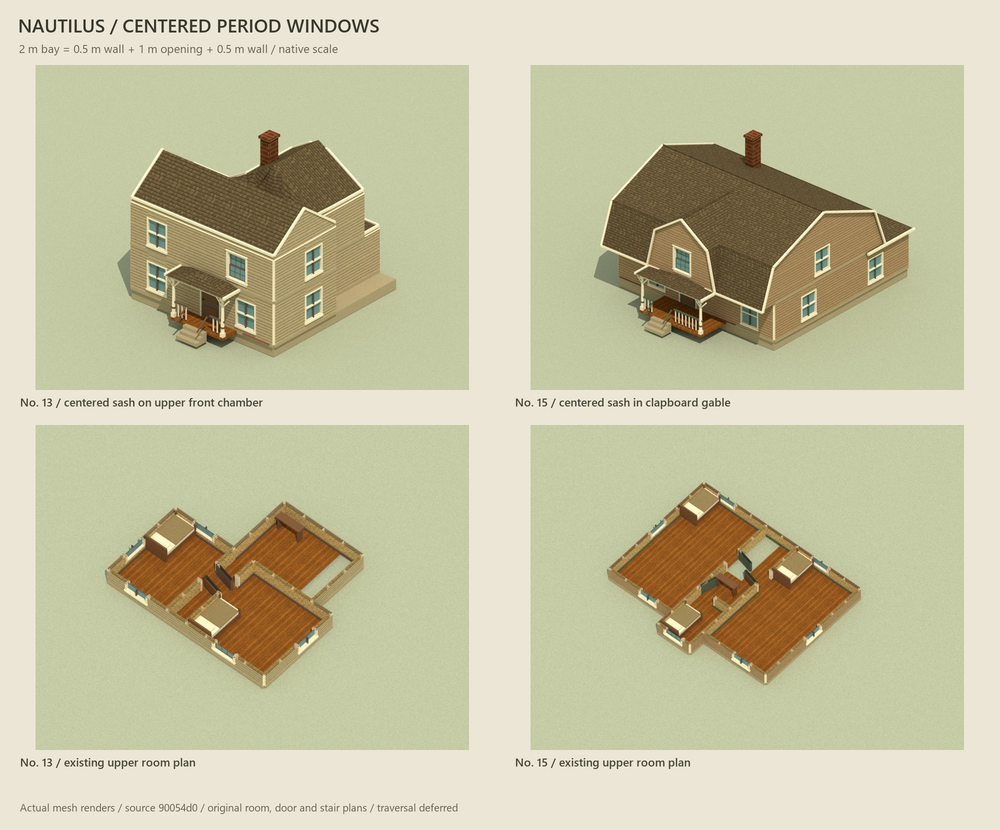

# Centered Nautilus windows in Hopkins Nos. 13 and 15

The corrected Nautilus kit is imported at **90054d07134116a5d9661f8318a76fe68f922aad**. Both `window-bay-compact` and `window-bay-period` are available through `src/art/nautilus-windows.js`. Nos. 13 and 15 use the period sash at native scale: **2 m overall = 0.5 m wall + 1 m opening + 0.5 m wall**. The aperture is 1.2 m high; the compact profile keeps its own 0.7 m opening height.



[Exterior/interior gallery](gallery.html) � [geometry checks](geometry-review.json) � [package checks](package-review.json) � [source and hashes](../../../art/source/nautilus-windows-v1/import.json) � [accepted changes](../../../art/source/nautilus-windows-v1/adoption.json).

## Placement and preservation

- No. 13: upper front bay from `(1,0)` to `(3,0)`, centered at x=2 on the 4 m chamber facade. The other front chamber retains its existing centered sash.
- No. 15: upper front bay from `(4,-1)` to `(6,-1)`, centered at x=5 on the 2 m front face. The removable clapboard gable facing now has matching half-metre piers around the opening.
- Room polygons, doors, stairs, furniture, wall height/thickness, floor pitch and all roof coverings retain their previous values. The other 23 houses retain their prefab and geometry fingerprints. No. 13뭩 previously floating chimney moves 0.84 m into the existing rear roof footprint and its base extends below the roof. This is an art placement repair.

Source positions, normals, UVs and sash geometry remain unchanged. The Tinderbox adapter adds physical `grossUV`, a 180-degree orientation at scale [1,1,1], and host exterior/interior draw groups. Existing painted clapboard, wallpaper, trim, glass and accent materials are injected; a borrowed brass material supplies the sash fittings. Separate frames, glass, upper and lower sashes remain separate meshes. Cutaways use the existing clipping planes and hide the roof. Disposal releases the window geometry once and preserves borrowed materials.

## Provenance and limits

The source is the user-selected [Nautilus editor-assets candidate](https://github.com/Syntaxswine/nautilus-engine/commit/90054d07134116a5d9661f8318a76fe68f922aad). Five runtime modules and three evidence/notice files are byte-preserved under `vendor/nautilus-engine/90054d07134116a5d9661f8318a76fe68f922aad/`. The import register records every original/installed path, byte count and SHA-256. Its renderer statically depends on two AFT helper modules at `781246a668c723d5a4c5463e70534cc04b6a5641`; those remain inside the Nautilus snapshot. Host material injection avoids the default procedural texture generator. The shared Farmyard/Three baseline stays `30a3b8cae5f36bb0c1df3685b7fba16f701c2083`. The independent wall-run contract stays `cc52f89de6333a1d94e2dfe45d47d1317369fac0`.

Original NOTICE and ancestor provenance are preserved. They record mixed/unspecified licensing; this import does not assert a new blanket license. No donor checkout or other worker checkout is edited.

This is an **artist prefab candidate on `codex/art-assets`**. It imports and places the window art; engine editor placement, collisions, opening behavior, glass breakage and traversal remain deferred. No complete Nautilus house importer is claimed. Only the architect promotes to the integration branch.

## Verification

`check-nautilus-windows.mjs` verifies all eight imported hashes, both profiles, 246 exact source attribute comparisons, 60 bidirectional aperture/pier rays at three rotations, twelve whole-house aperture rays, matching native room/door/stair layouts, unchanged roof covering fingerprints, chimney seating and idempotent resource disposal. The collection audit preserves the other 23 geometry fingerprints and all 25 roof coverings; no vertical enclosure retains roof texture.

The saved renders export the actual Three geometry/material assignments into Mitsuba 3.9.1 scalar_rgb. Exterior, front and upper interior images were inspected for centering, siding, aperture joins and cutaway clipping. Browser review checks the static gallery and art workbench at desktop and phone sizes. WebGL remains unavailable on this host; GPU shader/performance review is still an integration limitation.

Reproduce from the artist checkout:

```text
node art/source/hopkins-housing-v1/build-layouts.mjs
node art/source/hopkins-housing-v1/build-nautilus-traces.mjs
node workbenches/art/check-nautilus-windows.mjs
node workbenches/art/check-hopkins-housing.mjs
node workbenches/art/check-hopkins-roof.mjs
node workbenches/art/check-housing-siding.mjs
node workbenches/art/check-hopkins-nautilus.mjs --nautilus-source PATH_TO_PINNED_CHECKOUT
node art/source/gross-housing-v1/finalize-manifest.mjs
node art/source/hopkins-housing-v1/finalize-manifest.mjs
npm run check
npm run build
```

Package verification uses the existing art server on port 4551. The task-owned preview has a private STOP marker and a real 900-second expiry; its identity, restart snapshot and confirmed shutdown/port release are recorded in ignored `artifacts/art-preview/nautilus-windows-v1/`. No helper is needed to view these saved images. Final delivery supplies the exact Tinderbox commit SHA.
