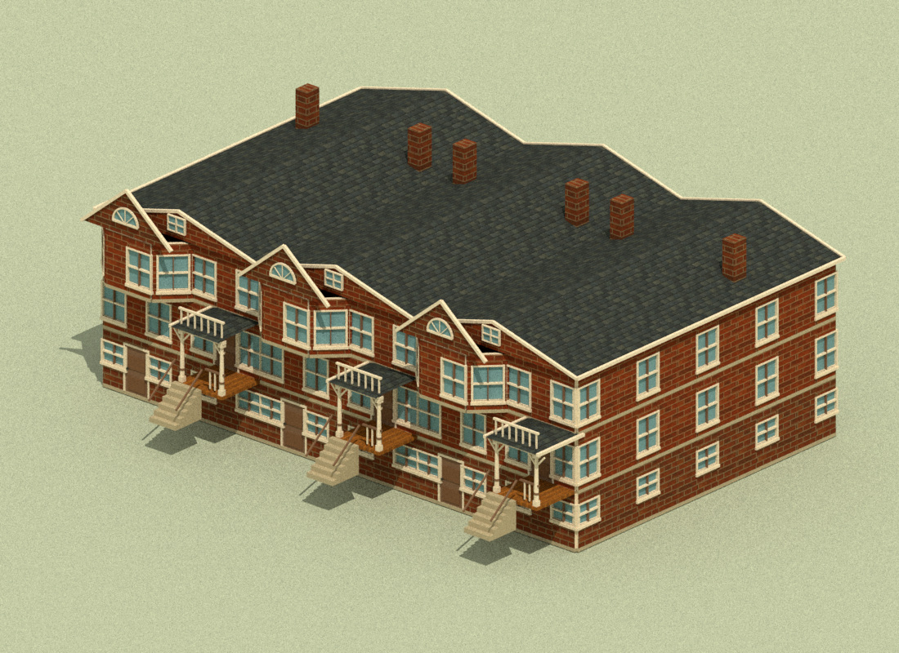

# TB-019 / joined Monroe houses and carried torch art

Artist candidate on `codex/row-ignition-art`, based on **3c6001d5d4035e950f25e500294eaec55bbf81d2**. The independent Hopkins v2 delivery remains preserved and pushed on `codex/art-assets` at **b61fa093e3491fb2f109f1f4b0ca5591d2637cc9**; none of that collection is absorbed here. Exact TB-019 delivery SHA is reported in the final handoff.



[All nine proofs](gallery.html) · [opposite exposed end](previews/row-front-right.jpg) · [rear and end](previews/row-rear-right.jpg) · [blank wall after neighbor burnout](previews/row-neighbor-burnout.jpg) · [lit idle torch](previews/torch-lit-idle.jpg) · [lit moving torch](previews/torch-lit-moving.jpg) · [spent torch](previews/torch-spent.jpg).

## Result and owned changes

- `src/art/row-house.js` derives Monroe variants from cloned original plan data and assembles them through the unchanged Gross builder. `src/art/neighborhood.js` consumes the authoritative party-wall descriptors, retains each house's independent burnout/fade group and changes only the Monroe rendering path.
- `src/art/carried-torch.js` adds a small carried flame from the existing Farmyard painted atlas at the original torch muzzle. `src/art/fire.js` owns its update/disposal, and `src/art/index.js` passes the existing review camera for billboarding. No native bear/tool model or attachment is changed.
- [Source manifest](../../../assets/art/row-ignition.json), [geometry/state checks](checks.json), [offline evidence](offline-review.json), [package verification](package-review.json), and the [reproducible export/render sources](../../../art/source/row-ignition/) record what was checked. No simulation, content placement, UI, architect review script or raw imported module is edited.

## Joined row contract

The source frontage remains **7 m**, depth **13 m**, with unchanged 1 m wall modules, 2 m wall height, 1 x 1.65 m doors, .12 m slabs, 2.12 m floor pitch and unit mesh scale. A direct source clone supplies explicit window edges. Joined sides have no sash, casings, apron or window openings in the basement or either occupied floor. Exposed ends retain the original side-window recipe. All front/back glazing and the original entry/bay geometry remain.

The production consumer reads detached `building.partyWalls = {left: neighborIdOrNull, right: neighborIdOrNull}`. Left/right refer to source local X=0/7. It validates reciprocal IDs, the same quarter turn and exact full-depth 7 m local-X spacing. Exact adjacent placements with missing authoritative join IDs are rejected. Art does not derive collision, accept arbitrary caller-supplied joins as valid gameplay, or alter the world. The low-level `createMonroeRowHouse` factory expects this already validated descriptor and is also used by explicit artist fixtures.

Joined geometry is clipped at its actual X=0/7 plane; original triangle attributes are interpolated, and zero-area inherited triangles are omitted from the derived result. New caps use physical metre UVs. The exterior masonry/slab cap owns the common body face; coplanar interior partition ends and redundant trim faces are removed behind it. Only one neighboring unit owns a visible coincident join cap. Exposed ends keep their original overhang/rim envelope. Source originals and templates remain byte exact; the adapter owns and disposes all derived geometry.

Burnout uses the original authored party-wall recipe. While the destroyed descriptor remains in the authoritative building list, a surviving house reveals its solid wall without rebuilding its windows. Reset restores the neighbor and its join visibility. The coder owns placement, overlap rejection, trimmed conservative colliders and retained descriptors; this branch does not implement those rules. The agreed x27/34/41, y31, q0 demonstration can consume this adapter after integration.

## Torch contract

The flame reads `player.tool`, `player.torch = {phase, remainingSeconds, durationSeconds}` and `snapshot.clocks.world`. It appears only for an equipped `torch` in the `lit` phase with remaining time. Neither `usingTool` nor held-button state controls its persistence. It follows the native muzzle during idle and locomotion, freezes when world time freezes, advances slowly with slowed world time, hides while holstered, and disappears when spent. It never calculates a second burn timer, consumes inventory, relights, targets a tile or adds heat. Existing authoritative discharge pulses remain separate.

The existing flame texture is cloned only as an owned sampler for its four atlas frames; the bitmap is unchanged and the borrowed original is never disposed. The card and its material/sampler dispose once. Match targeting and success feedback remain authoritative coder/UI concerns; no second art targeting calculation is added.

## Provenance and proof limits

Original house source: artist **56b028c2935b5a97fe259618f38e0a1550928ab4**, with [Gross n74 / printed p71 exterior and floor plans](../../../art/source/row-ignition/monroe-plate-n74.jpg), copied unchanged from `art/source/gross-housing-v1/plates/n74.jpg`. [Its source record](../../../art/source/row-ignition/source.json) carries exact bytes/hash and the catalogue URL. The preserved [intake register](../../../assets/art/neighborhood-intake.json) retains source dimensions, texture generation and rights evidence.

Other pins remain Nautilus **90054d07134116a5d9661f8318a76fe68f922aad**, native bear **4f5f53917990ec03b2f14c65f067e4b99ec8fcaa**, and Farmyard renderer/painted flame **30a3b8cae5f36bb0c1df3685b7fba16f701c2083**. Six housing textures, the flame atlas and all protected house/bear source records retain their recorded bytes. Provenance is not an independent license grant; existing notices and source rights records still apply.

Nine JPGs export actual final Three meshes, skinning and frame UVs into Mitsuba 3.9.1 scalar_rgb. The row proofs deliberately lower the grade to reveal all basement courses; runtime grade is unchanged. The bear proof uses the original native mesh, pose and source base colors; its multi-view paint projection shader is omitted, so it does not establish the final painted face/outfit. The flame uses the unchanged painted atlas and alpha mask, with CPU diffuse lighting in place of its unlit browser material. These are geometry/anchor proofs, not game screenshots or GPU shader/performance approval. Real desktop/phone WebGL acceptance remains architect-owned and pending; no unsupported WebGL recovery was attempted.

## Checks and reproduction

The art gate covers 12 standalone/two/three-unit cases across all quarter turns: 24 houses, 72 levels, 108 seal rays, 60 single-owner join samples, physical UV lengths and exact source-triangle UV interpolation, all opening recipes, burnout/reset persistence, and actual geometry/material disposal. Sixteen bear samples check moving/idle anchors without mutating the rig or snapshot. Torch phase, no-held-use persistence, frozen/slowed world clocks, holster/spent/reset, no invented ground/discharge flame, and borrowed texture ownership are checked. All 61 protected source records are hashed.

```text
node workbenches/art/check-row-ignition.mjs
node art/source/row-ignition/finalize-manifest.mjs
npm run check
npm run build
node workbenches/art/check-row-ignition-package.mjs
node art/source/row-ignition/export-review.mjs
python -X utf8 art/source/row-ignition/render-review.py
```

The renderer reuses the existing ignored Mitsuba dependencies in `artifacts/render-deps`. It records exact process identity and ends naturally, with a real 120-second deadline. The package verifier creates one private in-process HTTP server for the nested path, closes it in `finally`, verifies its port is released, and has a real 30-second deadline. Neither process is retained; nonsecret restart source code is committed here and receipts remain in ignored `artifacts/row-ignition-renders/` and `artifacts/row-ignition-package/`.

This candidate is ready for the architect's combined review with the coder and UI deliveries. It does not promote or deploy the project.
