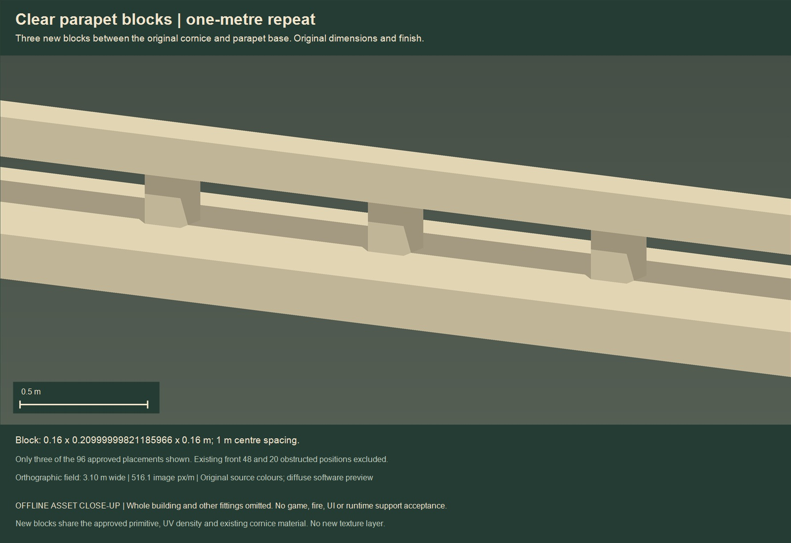
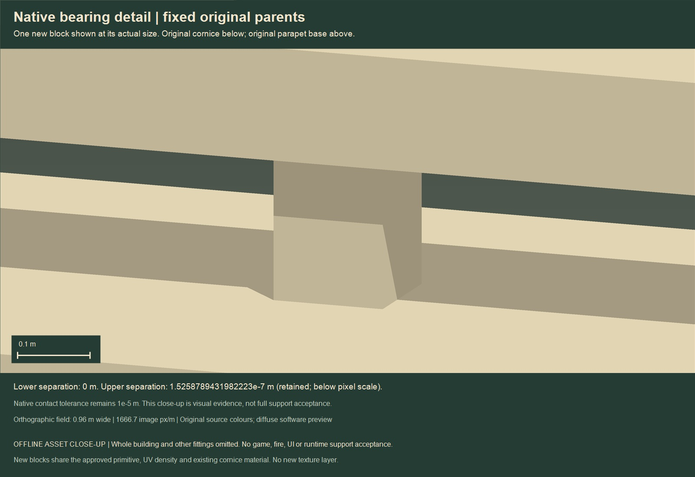

# Clear parapet blocks: additive artist handoff

17 November 2026. Candidate on `codex/shared-map-fire-bindings`; the containing
Git commit is the delivery identity. This is the separate export authorized by
architect `efe2b030e36d5887d616dfde5940d6e4541b8543`, following the exact
96-design acceptance at `c915d1822d24bfe3175c6a1f9396330cfd910aad`.

## Result and scope

[Addition manifest](../../../../assets/art/shared-map-support-additions/new-york-parapet-clear-blocking-v1/index.json):
96 placements, 1,152 instance triangles, 192 named local bearing selections,
16 original parents across eight clear families, zero new ground anchors.
No new geometry buffer or bitmap is needed. All original front 48 and all
20 obstructed roof-saddle positions remain excluded.

Only three directories are added:

- `assets/art/shared-map-support-additions/new-york-parapet-clear-blocking-v1/`
- `art/source/shared-map-fire-bindings/parapet-clear-blocking-v1/`
- `docs/art/shared-map-fire-bindings/parapet-clear-blocking-v1/`

The family counts are 28, 10, 4, 6, 6, 4, 10 and 28 for parapets
1, 2, 3, 4, 8, 9, 10 and 11 respectively.
IDs use `carrier/clear-parapet-blocking/main-parapet-N/bay-NN`;
each preserves its original `proposal-only/blocking/...` identity.

## Shared dimensions, finish and source chain

Reuse the front prototype from artist
`88538bb687e06911d63f728a17bd8668448805fe` without reauthoring it.
The shared indexed cube has 12 triangles and retains position, normal,
UV, grossUV and index arrays, its centre pivot and positive-scale matrices.
Dimensions remain **0.16 x 0.20999999821185966 x 0.16 m**, on the original
one-metre bay centres. No wall, character, roof or parapet is moved or stretched.

Each lower/upper selection retains both original surface witnesses and the
captured separation. Lower separation is zero; upper separation is
`1.5258789431982223e-7 m`. The native precision tolerance remains `1e-5 m`.
Selectors retain the distinct actual source-face elevations; witnesses are
not averaged or snapped. Upper child-loss regions cover only the original
one-metre bay. Runtime fragment mapping and loss behavior remain coder work.

The existing cornice material is shared by exact source index/material ID.
That captured source material has no bitmap map; no extra texture layer,
paint stock or coating is invented. The original primitive UVs retain
physical metre density. This simple fitting reuses the reviewed form and
finish, consistent with the shared modular art workflow.

[Modular evidence](../../../../art/source/shared-map-fire-bindings/parapet-clear-blocking-v1/modular-evidence.json)
records pivots, occupied stock cells, connections and placement restrictions.
The batch approves only the original matrices. It exports no mirrored or
procedurally rotated placements, corner variant or roof saddle.

Important SHA-256 values:

| Input / output | SHA-256 |
| --- | --- |
| New addition manifest | `08bcb4f535a59c67dcaa4e71ac57d7e7034d870ffb690d48ce191d3937b4dd78` |
| Accepted 96/20 design table | `481294255d3afd8dd0ea208d2dc0cc1c7adf1f2e6108e5929a0e887bbb1abfa4` |
| Existing front prototype index | `a5a34f18a4d18b5a316096edf58b941e727a7546e544636a5a29469bc5c5b1c2` |
| Shared geometry file | `c7356e7897372390040edb82ec1a92e33920230ca68de7e92ca52a7ff8d4d1ec` |
| Original complete bindings | `407c0f8bd582f8d95b9ade1471cd51892ac7b9a40fd2c005696bcc5485991eba` |

The primitive's canonical ID is
`a91bddde99e47a78d59ef47a12b88a7833b9ce17e686f48699325dc9e8f6e6ad`.
It hashes the compact JSON without its final LF; the file hash above includes LF.
All dependencies resolve to existing Tinderbox paths. No donor checkout or
moving branch is a runtime dependency. Original provenance/rights remain as
recorded in the reviewed source chain; this export makes no additional license grant.

## Quantity and source checks

Each new solid retains the accepted frame recipe and **0.0448** static
prototype units; the separate addition is **4.3008** units with no finish account.
[Numeric evidence](../../../../art/source/shared-map-fire-bindings/parapet-clear-blocking-v1/quantity-evidence.json)
distinguishes captured dimensions/volume, the unrounded volume/.12 recipe,
the accepted six-decimal amount and exact binary64 representations.
The stored batch value differs from the exact sum of 96 stored member values
by `-1/4503599627370496`; this is recorded, not hidden by a new rounding allowance.
Earlier quantities are unchanged. No combined world stock total is calculated.

[Check results](../../../../art/source/shared-map-fire-bindings/parapet-clear-blocking-v1/check-results.json)
pass deterministic export, 96 closed solids/bounds, metre UV density,
192 exact face-area/two-witness bearing reproductions, and 192 fresh calls
to the unchanged native triangle contact predicate. Shape measurement and
native calls are limited to **96 additions plus 16 named original parents**
(112 shapes, 13 geometry buffers including the shared block).

The [clear source-solid exclusions](../../../../art/source/shared-map-fire-bindings/parapet-clear-blocking-v1/source-solid-exclusions.json)
are reproduced by exact identity substitution into the already accepted
source proof: the primitive, placements, bounds, base bindings and all 182
original New York geometry byte pins remain identical. This does **not**
claim a fresh whole-building intersection calculation. Broad source bounds
alone are not treated as proof of empty space.

Five saved rejecting controls cover missing top bearing, duplicate earlier
front ID, obstructed roof-saddle row, widened native tolerance and inflated
static quantity. Three failed checker attempts are retained: an incorrect
18-parent assumption, a stale report literal, and counting ten calculation
archives without the separately archived original calculator. Their fixes
change checks/reporting only. The 3,543 earlier tracked source/evidence/asset
paths are unchanged; ten calculation archives (10,031,978 bytes) plus the
6,377-byte archived calculator remain unchanged.

Reproduce from the repository root with Python and Node:

```text
python -B art/source/shared-map-fire-bindings/parapet-clear-blocking-v1/export.py --check
node art/source/shared-map-fire-bindings/parapet-clear-blocking-v1/check-native-contacts.mjs --check
python -B art/source/shared-map-fire-bindings/parapet-clear-blocking-v1/check.py
python -B art/source/shared-map-fire-bindings/parapet-clear-blocking-v1/review.py
git diff --check
```

These do not start a renderer, simulation or native activation. The review
package pins the source files, failed cases, approval snapshots, dependencies
and JPGs. Runtime tests and a broad suite are outside this asset-only brief.

## Two offline close-ups





The first shows three actual blocks and the two original parent solids:
3.10 m image width, approximately 516.1 image pixels per metre, 0.5 m ruler.
The second shows one block and its two original parents:
0.96 m image width, approximately 1,666.7 image pixels per metre, 0.1 m ruler.
Both are 1600 x 1100 JPGs. The microscopic retained gap is below image resolution.

[Preview evidence](../../../../art/source/shared-map-fire-bindings/parapet-clear-blocking-v1/preview-evidence.json)
records exact cameras, geometry IDs, hashes and limitations. Whole-building
context, other fittings, game, effects, UI and runtime support acceptance are
omitted and labeled. Original source material colours are shown with simple
diffuse software shading; this is not a production renderer comparison.

One finite raster worker produced both views. Windows application control
blocked the preinstalled Mitsuba dependency, and execution policy rejected
a script-file encoder. Both errors are preserved. Ordinary OS image commands
converted the existing raster buffers, then added readable backing behind
labels; there was no geometry rerender or policy change. Only the two final
JPGs are delivered. Active rendering/conversion time was under 30 seconds.

[Lifecycle records](../../../../art/source/shared-map-fire-bindings/parapet-clear-blocking-v1/preview-session/cleanup-receipt.json)
verify the renderer and conversion lifetimes exited, with no owned TCP
connections, retained helper, browser or server. The renderer's 120-second
worker deadline was real; the failed first encoding record is preserved
rather than relabeled as a successful end-to-end run.

## Package verification source contexts

The original package at `7698e083b36635694e73dc07aa38748355e670a8` records
historical producer dependency hashes. The approved combined M29 tree
`df3dbcea7d6823e4c44479ded6c58d8bb176a94a` evolved two complete native helper
files while preserving the actual contact predicate and consumed geometry math.
The first default package verifier incorrectly compared those current whole-file
hashes with producer provenance. Its exact failure and original verifier/package
are [preserved](../../../../art/source/shared-map-fire-bindings/parapet-clear-blocking-v1/context-portability-v1/original-failure.json).

The [context policy](../../../../art/source/shared-map-fire-bindings/parapet-clear-blocking-v1/dependency-contexts.json)
now admits only the exact original pair or exact approved pair, from frozen Git
objects, with LF/CRLF normalization. Unknown edits, mixed pairs and a matching
predicate alone are rejected. Historical `dependencyPins` remain unchanged;
the current verification context appears in command output and is not rewritten
into producer provenance. The unchanged contact predicate SHA-256 remains
`4a1c082c518c22d31bfbf6c6d01ff49d4b6589a246eb8182b662b48d16f58441`.

Run the additional source-only controls with:

```text
python -B art/source/shared-map-fire-bindings/parapet-clear-blocking-v1/dependency-context.py
python -B art/source/shared-map-fire-bindings/parapet-clear-blocking-v1/context-portability-v1/check-package-contexts.py
```

This correction changes only the package verifier, its context evidence and this
handoff. All 41 other original payload files, producer dependencies, asset bytes,
JPGs, receipts, modular/quantity/contact evidence and the original failure remain
preserved. No geometry, rendering, native activation, runtime feature or combined
world accounting is rerun or newly accepted.

## Review boundary

Ready for architect review as an additive asset/source batch. The original
48, obstructed designs, geometry, world bindings, compiler/runtime indices,
source pins and all earlier proof packages are untouched. Native activation,
cold/active stock parity, fragment-port mapping, damaged-neighbor behavior,
final combined accounting, runtime integration and production acceptance
remain separate. This branch push is a candidate delivery, not promotion.
