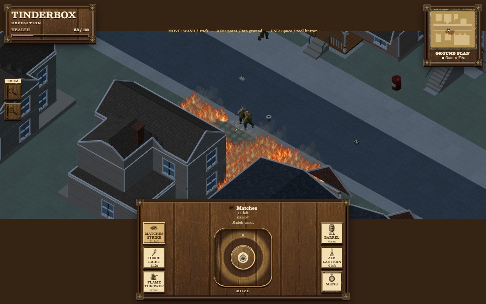

# Catalogue Street runtime delivery after the pacing correction

The modular Catalogue candidate now completes the actual input/interaction gate and reaches the approximate 30 fps prototype target in the representative short fire window. This is a coder delivery for architect review, promotion and publication. No worker action promotes `master` or deploys Pages.

The preserved local functional baseline is `ef302525dbb6257f870648e9d0230a6b970ca170`. Its [handoff](DELIVERY.md) and [measurements](performance.json) retain the failed 10.32 Hz result. The current [performance record](cache-performance.json) includes that baseline, the failed intermediate cache run, the final measurements, source-state hashes and cleanup. Do not relabel the old failures as passes.

## Scope and invariant

The full 51 × 47 m Catalogue Street, all eight house identities, shop, original actors/pickups/barrels, tools, native source dimensions and one shared thermal backend remain. Art stays pinned to `5deda67fbe3fe0968f90cdbc3e806e98baab0b86`, including its real 1.25 m H15 aperture/bearing correction. The three packaged artist JSON hashes remain exactly those in the baseline record. No art, renderer quality, thermal grid, physical fuel, coefficient, radiation work, clock, offscreen heat or movement rule changes in this correction.

The change caches repeated bookkeeping:

- Burning and loose-fuel candidates retain original registry order. Birth, consumption, depletion, spill, fall and escape update membership. The reference-equivalent logical `burnVisits` counter is retained; it is not a count of the reduced loop's physical iterations.
- Item bearing queries reuse the result only while index revision/count, position and current landing identity agree. Actual support retirement/pose, births and movement invalidate it.
- Smoke vents bind actual canonical portal objects. Boundary/opening membership and declared vent changes invalidate the binding; pose, permeability, retirement, sources, visibility and signal timing remain live. Smoke is recomputed normally.
- Accounting saves exact sequential prefix accumulators and rereads actual fuel records from the earliest dirty slot. Every amount, ignition, falling, loose-state and birth transition invalidates its slot. Native area/ID are immutable after birth. An early house change correctly recomputes a long suffix. No regrouping, subtraction identity, changed precision or numerical tolerance replaces the independent sums.

`?catalogue=modules&execution=reference` retains full-registry execution. The facet representation and original legacy/cottage controls remain. The [API](API.md) describes ownership, physical input profiles and diagnostic timings. Native simulation and metrics-query counters are subsets of backend advance; these durations overlap and must not be added twice.

## Measured attribution and result

The original real-loop fire cost was predominantly simulation: mean 87.51 ms/frame, versus art 5.57, UI .59 and renderer submission 9.24. After removing cold registry and smoke scans, the remaining backend gap was measured directly: control33 spent 686.74 ms in metrics queries during 120 fire advances, versus .887 ms in loose-fuel queries. The ordered prefix reduces that metrics work to 48.52 ms in control36.

| Fixed-input CPU window, ms/host advance | Quiet mean | Fire mean | Fire p95 | Fire worst |
| --- | ---: | ---: | ---: | ---: |
| Preserved baseline26 | 3.914 | 18.027 | 41.800 | 95.774 |
| Registry/vent/support caches, control33 | 1.045 | 11.250 | 31.012 | 100.260 |
| Final prefix cache, control36 | 1.012 | 5.000 | 18.803 | 22.209 |

These are individual bounded Windows Node24.15 CPU runs without WebGL. Each uses 120 quiet host steps, the same accepted walk/one match, and 120 fire steps ending at 42 burning patches. Intermediate control29's overall mean was worse (21.17 ms), despite reduced native work; it and the subsequent 14.07 Hz browser result remain preserved. Timings are not averaged into a claimed repeatability range.

The **complete whole-map final state** of control36 equals baseline26 after removing only `diagnostics.thermal.timing`. Both normalized state SHA-256 values are `e728535743f01ed689ade6c31a4c0c67aefca8be38ae460849b10ae7f2a3ca9e`. The comparison does not relax floating-point tolerances or omit physical state, events, fuel/heat ledgers or logical visit counters.

| Actual normal animation loop, run38 | Quiet | Growing fire |
| --- | ---: | ---: |
| Frames / raw rAF span (s) | 267 / 4.5166 | 123 / 3.7 |
| World span (s) | 4.516667 | 3.7 |
| Rate (Hz) | 58.894 | 32.973 |
| p95 / worst interval (ms) | 16.8 / 33.6 | 50.1 / 183.2 |
| Window dropped time (s) | 0 | 0 |
| Mean simulation CPU/frame (ms) | 1.414 | 14.793 |
| Mean art / UI / renderer submission CPU (ms) | 2.224 / .124 / 8.983 | 4.915 / .528 / 9.146 |

The real first burning frame is native185, world6.183333; the matched endpoint is native292, world9.733333: **3.55 actual fire world-seconds**, growing from 1 to 146 burning patches and 1 to 493 active cells. The baseline25 endpoint had 133 burning patches. The QA observer ends measurement at the first actual callback at least 3.5 fire-world seconds later; it does not pause/skip simulation. Screenshot or browser-command latency cannot improve the result by choosing a younger fire. Both raw rAF and completion-wall spans remain in the record.

This is Edge157/Three180, RTX3080/D3D11. Renderer submission CPU is not GPU duration. Initialization remains **31.8115 wall seconds**, with **10.0335 globally dropped seconds at the initial sample**, outside the measured windows. The result reaches the approximate target for this short case; it is not a 60 fps, phone-hardware or long-session claim. Occasional long frames remain.

The screenshot is taken afterward while normal gameplay continues, so its capture time is not the measurement endpoint.

## Current checks and package

- `cache-prefix-affected-37.log`: **75/75** affected sandbox, closing-time, native kernel and review tests pass. Six exact cache/reference controls cover pending rays/cooling/char, glazing, door/membership changes, early/late dirty order, deposits/new embers, depletion, positive escape, actual bearing retirement and landing. The preserved full baseline check is 392/392; the entire unrelated suite was not relabeled as rerun after this bounded correction.
- `combined-prefix-final-39`: **224 actual keyboard/mouse joystick waypoints** pass, both native flights up/down and returns, unchanged goat/body/identity/inventory, release and reset. Production-input replay also passes native direct cause/draw/one shot/real glazing cover, unseen-action suspicion without a shot, all pickups/powder/pour, cone/actor fire, finite torch, one native lantern payload, actual west-barrel retirement/east survival, finite damage and art disposal. No direct position or thermal-state writes. No browser errors.
- `production-live-prefix-38`: normal `autoStart:true`, real keyboard and mouse release, rendered-surface aim/one native match, matched fire age, explicit DOM blur pause/resume and reset pass. The headless focus stimulus is DOM blur, not an inferred OS tab activation.
- `cache-prefix-build-37.log`: **3540 files / 183,134,199 bytes**, hash/import/resource/JSON-texture checks pass under the nested `/tinderbox/` package. Manifest SHA-256: `a28e968161d29a19c475f5c1854151411bf1a12fe95e9273da13239b40aca114`. Only the selected runtime/art/data closure is published; no QA overlays, helpers, raw states or review HTML are included.
- Earlier `surface-final-22` remains the phone390×844 layout/trusted-touch/reset and original four-map/cottage opening evidence. The cache correction changes no HUD, input or map layout. It is not claimed as phone-hardware frame-rate evidence or a post-cache whole-landmark traversal run.

Current source/native staircase evidence: [house upstairs](previews/house-prefix-final.jpg), [shop upstairs](previews/shop-prefix-final.jpg). The final combined visit uses the same artist pin and real Open/input controls.

Raw records are under `artifacts/qa/catalogue-modular/`. The combined driver reuses the preserved accepted-command traces from `native-play-02`, `native-suspicion-16` and `native-tools-18`; these are input replays through the production dispatch API, not state overlays. Preserve those inputs when reproducing this check. The reference package is archived as `package-control-ef302525.tar.gz`, SHA-256 `dbb223a12c8807fe5815899f2f5181d088d44723693e1ef03147e73a0d2ab9ea`, plus its manifest. Exact cache32 packaged code/manifest is also retained before the final rebuild.

Both final browser/server sessions exit successfully, with exact identity receipts and both ports released; all finite CPU commands dispose and exit. No task helper or preview remains running.

## Remaining limitations

The new whole-street mode still declares ambient 1.5 m/s east wind. The original `?cottages=1` control retains its checked geometry-specific Nautilus bake; that bake is not relabeled as a wind field for different street geometry. Seven other houses remain exterior-only. Actual traversal here validates the native goat, not every species/posed equipment envelope. Inherited full-map unresolved support, mature collapse and fallen-item pose limitations remain as recorded in the baseline audits. Early dirty source records can require a long suffix. Longer multi-building fire, continuous 10–15 minute play and actual phone-hardware budgets remain unmeasured.
