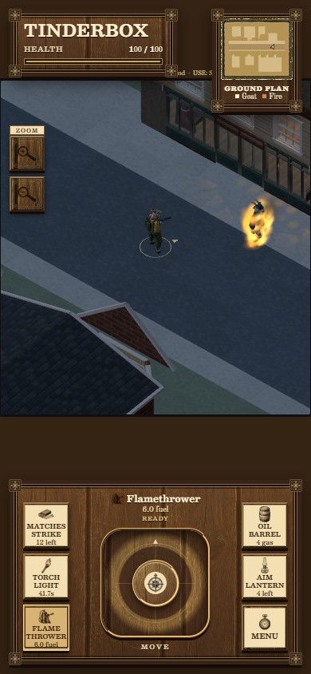

# Character shroud runtime delivery

Candidate branch: `codex/character-fire-shroud-runtime`; exact runtime commit is reported in the Git handoff. Common contract is `064d41865ae35f00f8a33d7cf1bd6f368f327c17`. Artist intake `a69f0920728fac774094d98923cab735db5b1d43` is preserved by `cherry-pick -x` as `f6ab3f665aa907c8ec78c343f3d5af2361b2ada2`. Its four runtime factory files, original sources, hashes and visual controls are unchanged. The approved animation source remains `7c60ba4b41f79de9dcca1f10b6e1dfffe9a74b26`; native model/source pins remain unchanged. [Package, log and media hashes](receipt.json) preserve this delivery's exact bytes and check scope.

The [adapter record](../character-fire-shroud.md) defines truthful detached `characterFire` state and the posed-body boundary. Existing damage, persistent NPC burns, player contact-only behavior, wind, movement, tools, UI and native model scale are preserved. The two old NPC body cards are removed. One shared shroud now covers actual native player, civilian, officer and resident bodies, including replacement officer cloth and actual floor elevation.

## Checks and package

| Check | Result |
| --- | --- |
| Integrated `npm run check`, Node v24.15.0 | 406/406 tests; 310 own scripts, 348 resolved modules, single shared Three/provenance and inherited art checker pass. |
| Focused host regressions | Real NPC cone burn, visible officer wool, immutable snapshots, matrix-only translation/elevation, fixed-time freeze, reset/removal/disposal; all pass in the full suite. |
| Contact controls | Actual native match on inert paving hurts without shroud; finite native oil burnout clears contact; ground/upper lit-fuel queries, legacy elevation limitation, union age, death, pause/powder and original stacked damage pass. |
| Build and nested-path release check | 3545 files, 183170988 bytes; all resource hashes/relative URLs pass. Manifest SHA-256 `9c1936d0a331bf9ec38f22ed553daa87b788b80a8154ac3e3dfd09bb2f331c49`. |
| Actual larger host | [Normal-loop gameplay pass](browser-acceptance.json), zero page/resource/shader errors. |
| Legacy and Nautilus cottages | [Real packaged browser visits](shared-hosts.json) pass driver-stepped actual pour/match contact, pause, exit, reset and disposal. No pacing claim for these short compatibility visits. |

The full suite ran on the final application runtime. Subsequent changes were confined to QA driver diagnostics/aim correction and delivery evidence; both QA drivers pass syntax and completed their actual browser runs. No application/package byte changed afterward. The artist's separate 13 source/native/factory checks are recorded in its [handoff](../../art/character-fire-shroud/HANDOFF.md); those are distinct from host gameplay and game FPS.

The first affected run exposed two new fixture mistakes: expecting a complete onset immediately, and pointing the officer test camera/cone away from the officer. Corrected fixtures pass in the full 406-test run. The initial browser attempt stopped before completing its warm control; its raised ground aim could cross a cell boundary. That incomplete attempt and cleanup remain under `artifacts/qa/character-fire-shroud/host-01/`. The corrected driver aims at the actual ground-cell centre; `host-02` passes. No simulation coefficient was changed to make a control pass.

## Actual host appearance and motion

The normal `autoStart:true` game loop opened the real title, four-destination selector and `/tinderbox/?catalogue=modules` visit. The driver used actual joystick, keyboard, mounted tools and rendered-surface picking. No burning snapshot, teleport, body replacement or alternate renderer was injected.

- [Before](previews/before.jpg) and [warm-only negative](previews/warm-only.jpg): the actual match reduces HP while the authoritative marker and submitted body splats stay inactive.
- [Moving native civilian](previews/moving-native-npc.jpg), [uniformed officer at 390 × 844](previews/uniformed-officer-phone.jpg), and [resident](previews/native-resident.jpg): actual held-flamer ignition, followed by the same wrapped effect after release. The officer fit reports `chicago-1893-city-beat` visible cloth.
- [Player contact](previews/player-contact.jpg), [exit](previews/player-exited.jpg), and [real 2.12 m landing contact](previews/elevated-player-contact.jpg): actual oil pouring and match input, contact-only marker, pause freeze and immediate clearing on exit. The elevated position was reached through the actual service stairs.
- [Moving civilian WebM](previews/moving-native-npc.webm) and [player moving/turning WebM](previews/player-moving-turning.webm): captured from the actual live viewport at normal zoom. World time continues during capture; nearby JSON snapshots and JPGs need not represent the identical frame.

The three selectable silhouettes and all-around posed fit are covered by the artist's labelled [factory controls](../../art/character-fire-shroud/HANDOFF.md). Gameplay here uses the native goat player, goat civilian/officer and horse resident; it does not claim three separate player ignition runs. Landmark visits have no character-fire gameplay/state. Provisional debug actors without native bindings are explicitly unsupported rather than receiving substitute body cards.

## Measured scope and resources

The [single active-character frame window](active-character-cost.json) uses one actually burning, moving goat in the larger map: 49 frames, 1.55 world seconds over 1.594 wall seconds, 30.966 Hz, frame p95 50.1 ms, worst 66.7 ms and zero dropped world seconds. MediaRecorder is active, so encoding overhead is included. Overall submission is 300–301 draws, GPU geometry registrations 358–359 and textures constant at 88. These whole-host values include other scene activity; they are not additional shroud allocations or a city-scale performance estimate.

The shroud adds one shared draw, one owned geometry and one material, with zero textures, lights or renderers. Early positive host snapshots submit 68 flame plus 4 smoke splats for the one active body, within the 88-splat bound. The factory remains at one geometry/material through six host resets (seven effect resets including initial binding); cleared frames submit zero. Final disposal leaves zero owned resources, bindings and active IDs. Current larger-host bindings are five bodies, below the 16-body cap. Capped/unsupported IDs remain explicit diagnostics.

The larger map retains its labelled ambient 1.5 m/s east sampler. The short cottage browser visit loads the existing checked Nautilus bake through `?cottages=1`; it does not create or claim a new whole-map obstacle-resolved bake. Legacy flat contact remains ground-only and cannot prove another floor's wall flame. Existing two-dimensional damage semantics are preserved.

## Cleanup and handoff

[Helper receipts](helper-retirement.json) preserve the incomplete first attempt, completed actual host and completed shared-host checks. Each uses the existing bounded browser lifecycle with exact PID/creation identity, automatic deadline, STOP-file control and finally cleanup. All browser processes exited and all recorded ports are released. No preview/helper remains running. The larger host's final disposal and the two shared-host disposals release all shroud resources.

Raw logs, input traces, complete snapshots, disposal records and restart inputs remain under `artifacts/qa/character-fire-shroud/`. Durable runtime/QA source, selected media and receipt hashes are committed with this candidate. The reusable normal-loop driver accepts `--npc-only --url https://syntaxswine.github.io/tinderbox/` for the architect's post-publication actual-ignition verification. This is a worker candidate; only the architect promotes and publishes it.
