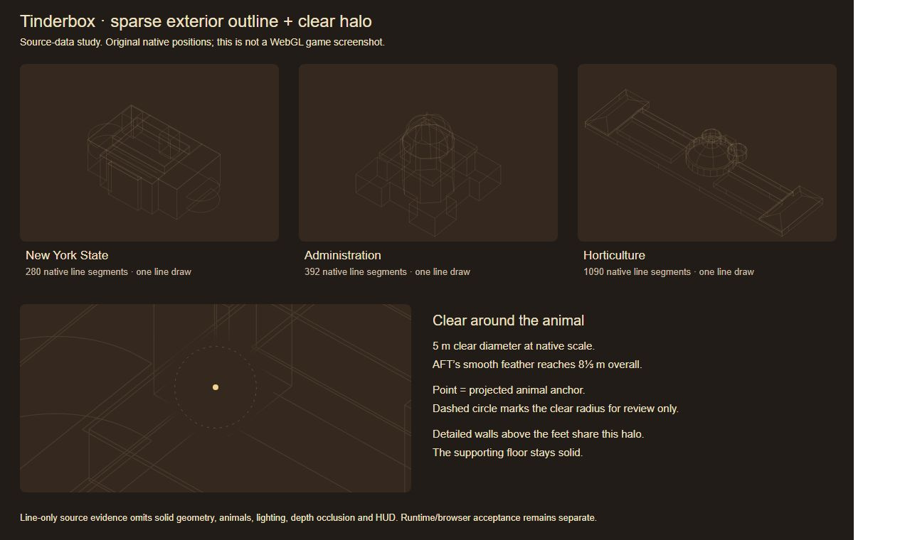

# Exterior ghost and AFT clear halo candidate

Direct human request: a simple ghost image using some exterior wire lines, with AFT3D's transparency halo. Clarification: **“Overall exterior outline with a clear halo.”**

Coder branch: `codex/exterior-ghost-coder`, from exact published checkpoint `dc7f537a83a7e832a0dfa0757d0b2700b909c053`. The final delivery identifies the exact candidate SHA. The existing coder checkout is reused; only the architect promotes or publishes this candidate.

New York State, Administration and Horticulture now retain a sparse overall exterior outline while their detailed native sections stream independently. Selected original wall-run corners, roof/deck perimeters and dome curves preserve each building's shape. Follow mode shows the outline at 14% opacity. The existing overview plan remains available and releases detailed sections and halo variants.

The original AFT wall X-ray supplies a clear circular centre and a smooth transparency feather. The adapter follows the selected animal's projected torso, current elevation, camera span and drawing-buffer ratio. The inherited clear diameter is five native metres, with the original two-thirds feather reaching an 8⅓ m outer diameter. Loaded walls, doors, windows and overhead surfaces above the feet use that same halo. The supporting floor remains solid. The global lines also fade away in the clear centre. There is no pointer tracking, added UI or second rendering pass.

## Reused source and immutable dimensions

`dist/tactics/wall-xray.js` is imported unchanged from the already approved AFT pin `4f5f53917990ec03b2f14c65f067e4b99ec8fcaa`: **5,963 bytes**, SHA-256 `12b586787c07c71d0b19afc124598ba9e4949f57b8136110db595f6dafc56a9a`. Its only import resolves through the existing explicit Three facade to Tinderbox's shared renderer. The original module, its reference-test identity, dependency, adapter differences and unresolved application rights are recorded in `vendor/animal-factory-tactics-3d/4f5f53917990ec03b2f14c65f067e4b99ec8fcaa/provenance/exterior-ghost.json`. Existing license/provenance notices remain intact. The donor checkout is read only.

Line positions derive from the already frozen original plans and compiled roof vertices. Wall runs use the native 2.12 m floor pitch and original source offsets; no model is stretched. All original geometry, navigation, collisions, source pins, artist exports, character dimensions, movement, doors and fire rules remain unchanged. In the three generated scene indexes, only `exteriorGhost` descriptors are added. Older gallery WIP and the artist's active interior work remain separate.

| Building | Segments | Position buffer | JSON bytes |
| --- | ---: | ---: | ---: |
| New York State | 280 | 6,720 | 14,442 |
| Administration | 392 | 9,408 | 20,393 |
| Horticulture | 1,090 | 26,160 | 61,982 |

Each selected destination adds one static line draw. The other destinations' outlines are not loaded. The asset contains positions, source groups, native bounds and exact source hashes, with a 12,000-segment hard limit. Runtime and production packaging both reject stale/mismatched outlines. Material variants retain the original physical-UV hook and live clipping plane, and retire with their reference-counted source materials. Aborted loads cannot recreate disposed variants.

## Changed paths

- Runtime: `src/runtime/{exterior-ghost,ghost-data,landmark,sections}.js`.
- Source/data: the AFT module/provenance above, `assets/art/exterior-ghost/*`, and only the descriptors in `assets/art/place-scenes/{new-york,administration,horticulture}/index.json`.
- Tooling: `tools/{ghost-outline,compile-exterior-ghost,review-exterior-ghost}.mjs`; the existing compiler now regenerates the outline after a production scene compile. `build.mjs` validates its exact source/hash, `check.mjs` verifies donor bytes, and `smoke-places-package.mjs` accepts task-specific receipt destinations to preserve historical evidence.
- Checks: `tests/integration/exterior-ghost.test.mjs`. Documentation/evidence: this folder and the coder registry row in `docs/workflow.md`. No UI files change.

## Validation and reproduction

- `node tools/check.mjs`: **195 tests passed**, 153 authored scripts checked, 186 static modules resolved, one shared Three implementation, all source provenance and retained artist checks passed. Nine focused tests cover valid/mismatched/cancelled loading, reproducible outlines, native dimensions/deduplication, projected halo/feather/DPR/elevation/zoom, supporting-floor shader eligibility, retained UV/clipping hooks, bounded variants, late exit and partial-construction disposal.
- `node tools/review-exterior-ghost.mjs`: **21** original source-position/height resource samples. With/without halo comparisons preserve section counts, geometry counts, triangle totals and readiness. No additional detail batches occur in those samples; the one exterior line draw is separate. At most 7/9/6 halo materials are live for New York/Administration/Horticulture, and all retire on overview/exit. This is resource evidence, not a navigated route or GPU frame-rate claim. See [streaming.json](streaming.json).
- `node tools/build.mjs` and `node tools/check-release.mjs`: **3,463 files / 163,414,373 bytes** pass public-path/resource/hash checks. `node tools/smoke-places-package.mjs --task=exterior-ghost --receipt=docs/engineering/exterior-ghost/package-smoke.json` verifies every packaged file over actual nested-path HTTP, all three landmark loaders including outline hashes, all three native rigs, registry entries and resource disposal. See [package-smoke.json](package-smoke.json).
- The existing package-cleanup failure fixture still exits with the expected failure while closing its server, even when both section loading and settled cleanup reject. [package-cleanup.json](package-cleanup.json) records this task's result; the original historical receipt is preserved.
- `node tools/compile-exterior-ghost.mjs` regenerates only these sparse assets/descriptors from the frozen compiled source. The focused reproduction test rebuilds all three position/group/bounds arrays and compares every value. Full production `compile-places.mjs` invokes this step automatically; diagnostic compilation does not write production outlines.
- `git diff --check` passes. Scope review confirms only the three scene descriptors change in existing generated art; navigation and detailed source arrays retain their original bytes.

## Visual evidence and remaining gate

[outline-study.jpg](outline-study.jpg) is an actual browser capture of the generated [source-data vector study](outline-study.svg). It shows the three exact line sets and the animal-centred clear region. It is explicitly labelled **not a game render**: solid geometry, animal meshes, lighting, depth occlusion and HUD are omitted. Its dashed radius and animal anchor are review annotations only.

The packaged title/menu and New York selection were exercised in Codex's available in-app browser. That browser reports **WebGL 2 unavailable before 3D view construction**, so real shader compilation, depth/transparent sorting and actual desktop/phone appearance/performance remain unverified. [webgl-unavailable.png](webgl-unavailable.png) and [browser-check.json](browser-check.json) record the observed failure. Architect acceptance still requires a WebGL-capable browser at the intended phone size and desktop, with all three animals, floors/stairs, doors, zoom/view changes and repeated exits. This candidate does not publish the feature or claim the deferred whole-map/interior acceptance is complete.

The temporary browser tab is closed. Preview PID **14788**, creation FILETIME `134378003092374670`, exited via its private stop file; port **4557** was verified released. Its real ten-minute deadline was present throughout. The finite final package verifier PID **46784**, creation FILETIME `134378007524274400`, closed port **63381**; the expected-failure fixture also closed its port. Restart/source records and logs remain under ignored `artifacts/helpers/exterior-ghost-preview`. No coding-task helper remains running, and no other worker or application process was stopped.
