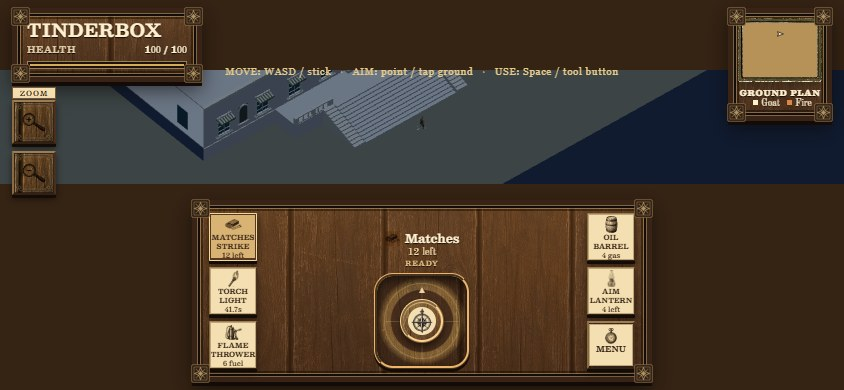

# Corrected source opens; phone layout assertion stops the review

Renewed authority `c202d3fc` allowed one corrected build and one three-minute
absolute browser session. Runtime and harness were exactly
`2b50c531f2421eaae7531d97fb519b30eddafa67`. The build passed: 3,617 files,
264,348,009 bytes, manifest SHA-256
`84a541ba308e6bc919e60bdcf2263a7b8e7e427587a1fc10e40c69c18f3786e2`.
The old `b0d02460` package remains separate historical evidence.

Real title, goat selection and New York selection succeeded. The application
entered its gameplay visit with the original goat at `[56,0,14]`, HP 100 and
unchanged inventory. One real Edge/NVIDIA ANGLE Direct3D11 renderer presented
three initial frames with 19 resident sections. Cold physics still had zero
thermal cells and zero active source carriers. There were no browser/resource
errors. These startup observations are not FPS, traversal or tool acceptance.

The first unexpected assertion compared the renderer's actual `844 × 114`
viewport to the browser's `844 × 390` viewport. The harness had incorrectly
assumed those rectangles were identical. Existing `src/app.css` instead reserves
70 pixels above and 206 below in short landscape, producing exactly
`390 - 70 - 206 = 114` pixels. This is consistent with the original CSS, not a
failed renderer resize. Its scene-readability consequence needs UI/architect
review before changing either layout or the harness assumption.

This is the sole failure JPG; it shows the scene squeezed between the HUD and
bottom control well at normal zoom. The planned stair, door, interior, glass/torch,
timber match and sustained-flame actions were **not run**, because the session
stopped at that first assertion. No second JPG or positive fire state was invented.
No game/UI source was changed or assertion relaxed during the run.

## Exact helper cleanup

The corrected lifecycle recorded identities, ports and the fixed deadline before
browser startup. Driver PID 74188 had creation FILETIME `134393776241963090`
(`node.exe`); browser PID 13024 had FILETIME `134393776258994585` (`msedge.exe`).
The only recorded ports were 61844 and 61846. The absolute lifetime was
08:27:05.473–08:30:05.473 UTC on 2026-11-17 and was never extended.

Finally cleanup completed at 08:27:11.561 UTC: one context created and closed,
zero remaining/pending, browser process exited, both ports verified non-listening.
Subsequent direct process checks found both recorded PIDs absent. No helper,
browser, server or watcher remains. No retry or additional build was launched.

The architect reviewed this screenshot/receipt and confirmed the short-landscape
scene is inadequate. The existing UI specialist owns the source-only responsive
visit-layout correction. Coder does not edit that worker's UI checkout or treat
the old layout as accepted.

The corrected harness measures the real canvas DOM rectangle and compares its
width/height to renderer metrics. A separate guard requires at least 300 pixels
of usable scene height in the 844 × 390 browser, projected native feet/body/head
inside the scene, at least 20 pixels of projected native body height, and the
canvas as pointer target at the player center. JPG review must still establish
the actual model is visibly readable. Four focused mock controls pass, including
the original 114-pixel negative and rejection of an input overlay. Syntax,
declaration and whitespace checks pass. Production source remains exactly
`2b50c531`; no new renderer/build ran for this source-only QA correction.

Complete local evidence remains in
`artifacts/qa/shared-map-runtime/phone-review-v2/`: exact build manifest/receipt,
plan, title record, first finding/failure, original JPG, frame/load/input log,
helper/restart record and cleanup receipt. The architect owns intake/review of the
UI candidate, corrected harness and any next bounded grant.
Phone-sized Edge remains distinct from actual iPhone Safari. There is no visual
acceptance or publication claim.
