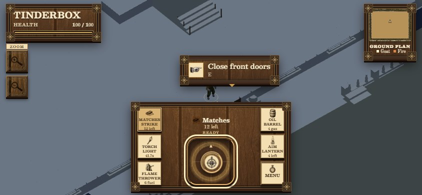
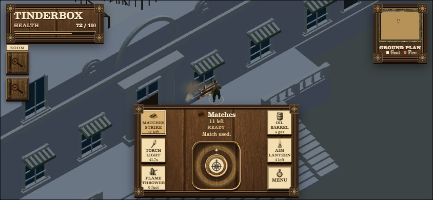

# Full phone scene and traversal pass; rapid tool ordering stops the run

Authority `4fc7f5643df770a1f1cff0433bf32c3147ade6ad` allowed one build/session.
Accepted combined runtime was `23081c53e4de7e605864d1067a1989546518a2bb`; the coder
merged that exact grant into its existing branch at
`b4000f597433315aaa0f253fb06b55316226ea67`, preserving the separate source-only
consumer proposal. The single build passed: 3,619 files / 264,631,261 bytes,
manifest SHA-256
`4d809ff0080ecae841ad165ec1159fbe5fa7a4c9f510f7ef4d49938b7cc82f94`.
The approved 48-block kit was present as an artifact but unconsumed: runtime
source still had 12,446 carriers and the `e9bee63a` / `1e93eb73` compact pins.

## Observed normal input and view

The real title/goat/New York selection opened one Edge renderer. Actual browser,
canvas DOM rectangle and renderer metrics all measured **844 × 390**. Projected
native goat height was **35.319 pixels**, with feet/center/head in the scene and
the canvas as pointer target at its center. No player/art was resized.

Trusted mouse joystick movement climbed the original front stairs. Contextual
keyboard E opened the real front door; the goat entered at 2.12 m, returned,
closed the door and walked around the original column row on its landing.
At the glass stance the actual camera selected
`new-york::carrier/main/0/lower-3/glass`; the aim point was on the canvas.

The floating Close card partly covers the head in this interior JPG. The
architect recorded this as a secondary visual finding, not an instruction to
expand this correction into a HUD redesign.

## First unexpected failure: numeric selection followed by Space

The harness retained the real rapid selection/use sequence. Trusted inputs were
Digit4 down at 11,591.9 ms / up at 11,592.5 ms, then Space down at 11,593.3 ms.
The game's authoritative events show:

| Event | Host tick | Actual outcome |
| --- | ---: | --- |
| 35 | 399 | `tool-selected: torch` |
| 36 | 399 | `tool-selected: matches` |
| 37 | 399 | Match `tool-use: heated`, cell `101,2,51` |
| 38 | 400 | Native match heat input 1.05, native tick 200 |

Digit4's mapping is correct. Before its selection had an authoritative UI
snapshot, the Space path read the previous `view.tool.id`. `beginAction` queued
that old matches selection again in the same tick, then struck the match. This
was an input-ordering bug, not a valid torch/pane negative.

The original harness waited 15 seconds for torch `lit`, then stopped. No second
torch press, intended jamb match or held-flamethrower attempt was run. During that
wait the unintended ordinary match naturally spread to 39 burning patches and
reduced HP to approximately 73.23. Torch remained unlit, matches fell from 12 to
11 and native heat input was 1.05. No direct heat command, forced fire, material
change or positive state was introduced.

This records actual fire presentation, but does not satisfy the intended tool
sequence or establish full visual/fire acceptance. No FPS or phone Safari claim
is made from these observations.

## Cleanup and source-only QA follow-up

Driver PID 41212, creation FILETIME `134393793439266997` (`node.exe`), and browser
PID 74668, FILETIME `134393793455817959` (`msedge.exe`), were recorded with ports
59377 and 59378. The single fixed lifetime was 08:55:45.198–08:58:45.198 UTC on
2026-11-17. Cleanup completed at 08:56:15.498: one context closed, zero remaining,
browser exited and both ports non-listening. Direct follow-up checks found both
recorded PIDs absent. No helper, retry, new build or additional lane remains.

Full local evidence is in `artifacts/qa/shared-map-runtime/phone-review-v3/`,
including the exact build manifest, source/authority plan, measured/checked layout,
route and door checkpoints, original two JPGs, glass aim, trusted input/frame/load
log, first finding, helper/restart record and cleanup receipt.

The UI owner received the exact sequence for a source-only numeric-selection /
Space fix, including rapid torch and held-flame/release coverage. The coder's
source-only harness follow-up preserves that rapid sequence; it adds **no wait
between Digit4 and Space**. It observes any first primary outcome, records it and
fails immediately if it used the wrong tool instead of waiting for the desired
positive. Three focused controls reproduce this exact event sequence, reject
old/selection-only events and accept a truthful new `no-fuel` result. They pass,
as do the four existing measured-layout controls and syntax/whitespace checks.
The bounded held-flame attempt also releases through a fixed two-second timer
and finally cleanup. No gameplay/UI source is changed by those QA checks.

These are frozen failed-run facts plus QA preparation. The UI race candidate and
any later build/session still require exact architect intake and a fresh grant.
