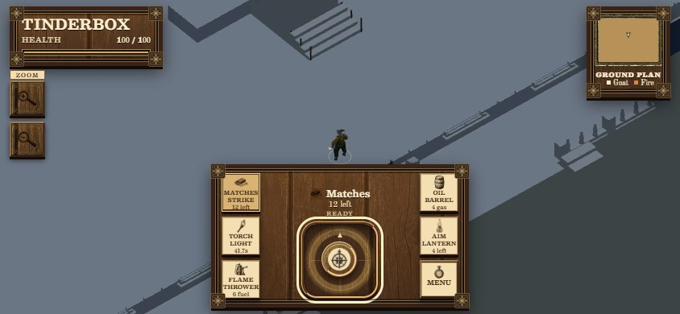
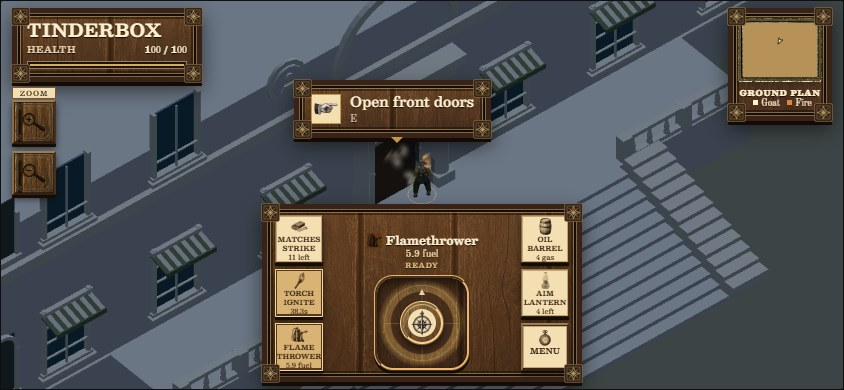

# Intended tools work; held-key timing fails

Authority `9e1f85cfb39059eb98d59646d969905f7ecd0661` authorized one build and one
finite session of combined source `cd443ccdd9cbbb38cf4c338ef697d902739726d6`.
The coder fast-forwarded to that exact authority, preserving separate support
documentation work without changing production sources. The single build passes:
3,619 files / 264,631,987 bytes, manifest SHA-256
`2f5332a626b97f9ed5f8bef62c869e8c93400f2583186ec1b1f8264498532b37`.
Declaration 22/39 and the exact production-source freeze pass before launch.
The source remains 12,446 carriers with compact pins `e9bee63a` / `1e93eb73`;
no later family, support-block or other-map material proposal is installed.

## Actual route and tool results

The single normal-zoom Edge visit opens the title, selects the native goat and
enters New York. Browser, actual canvas and renderer metrics measure 844 × 390;
projected native body height is 35.319 pixels and its center targets CANVAS.
Normal mouse joystick movement climbs the original front stairs. Contextual E
opens the original door, the goat enters at 2.12 m, returns, closes the door and
walks around the original column row. No body, collision, range or geometry is
changed. Nineteen initial sections grow to 45 resident sections during the route;
no section-load error is reported.

| Normal input | Authoritative result |
| --- | --- |
| Rapid Digit4 → Space | Torch selected and lit at host tick 381; event 37 is the requested torch action, with matches still 12. |
| Second torch press on original pane | Event 38 rejects as `no-fuel`; zero heated cells and native heat input remains zero. Actual camera selects `new-york::carrier/main/0/lower-3/glass` on CANVAS, 0.873 m away within the unchanged 1.1 m range. |
| Match on original timber jamb | Event 40 reports `heated`, one native cell and stock 12 → 11; native event 41 inputs exactly 1.05 energy. Actual camera selects the original jamb facet, within the unchanged 0.85 m range. |
| Rapid Digit5 → held Space | The actual flamethrower is selected, `usingTool` and discharge are true, stock falls 6 → 5.945, and one patch naturally ignites. The actual input duration fails the two-second limit. |

Digit4 keyup occurs at 11,376.0 ms and Space keydown at 11,377.1 ms; there is no
acknowledgement wait masking the repaired selection ordering. Digit5 keyup at
17,963.6 ms is followed by Space keydown at 17,964.7 ms. These are trusted browser
events on the real canvas. The glass negative and timber/flame positives do not
use direct heat commands or edited simulation state.

## First unexpected finding and measured limits

The held-flame release is scheduled after 1,800 ms. Trusted Space keyup does not
arrive until 26,845.8 ms: **8,881.1 ms actual hold**, so the unchanged <=2,000 ms
guard correctly fails. The harness stops at this finding, releases through its
finally path and disposes the application. It does not run the successful-path
menu-exit check or claim a passing bounded held attempt.

The saved receipts show the reason this needs runtime investigation rather than
a longer test allowance. Between the before/after held snapshots, host world time
advances 9.1167 → 9.6500 seconds over only five renderer frames. Active source
carriers grow 720 → 1,577 and native cells 14,694 → 27,952. Cumulative backend
advance work grows by 8,413.3 ms, including 6,200.2 ms of native simulation and
817.7 ms inside measured activation batches. These are overlapping/inclusive
counters and must not be added as separate costs. Exact per-phase blocking-frame
attribution is not available from the sampled receipts; no new profile/run was
started to manufacture it. Source activation, support rebuild and first hot-cell
work are candidates for a bounded source/CPU investigation.

After the attempt, native heat input is approximately 3.25, generated heat 0.3710,
one patch burns and player HP remains 100. Canonical static initial stock remains
15,767.943953000535; world-added stock is zero. The separately reported native
clipping delta is +0.0009537150, inside its existing source-local positive bound
0.0020598589. The original 1,038 unresolved source-support IDs remain explicit.
None of these receipts grants full support, whole-map or final promotion coverage.

The stopped JPG shows the native character/tool, entry, original stairs and a
small smoke plume at the recorded burning contact. This is not a flame-shape or fire-light acceptance;
the planned final art/light diagnostics and successful menu route were not reached.
The visit is desktop Edge on ANGLE/D3D11. It establishes neither phone Safari
readiness nor game FPS.

## Preserved evidence and cleanup

The [compact receipt](phone-review-v4.json) records exact input, timing, source,
accounting, section and image evidence. Full raw artifacts remain in
`artifacts/qa/shared-map-runtime/phone-review-v4/`, including the full build
manifest, plan, layout, all route/door/aim/tool snapshots, sampled frames and
trusted inputs, first failure, restart/helper identity and cleanup receipts.

Driver PID 47404 / FILETIME `134393822284519179` (`node.exe`) and browser PID
51588 / FILETIME `134393822301337112` (`msedge.exe`) were recorded with ports
50062/50063. The original fixed deadline was 09:43:49.716–09:46:49.716 UTC on
2026-11-17. Cleanup completes at 09:44:18.569: one context closed, zero remaining,
browser exited and both ports non-listening. Independent follow-up checks find
both original PIDs absent and both ports released. No helper, extra lane, new
build, retry or renderer remains. Another session requires a fresh architect grant.
