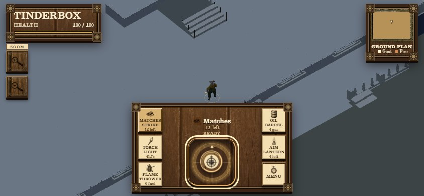
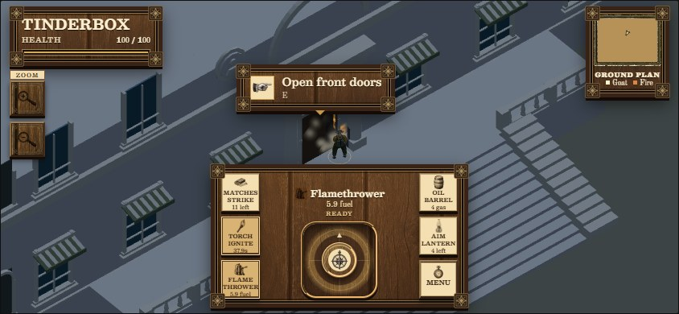

# Fifth visit reaches ignition; held-key timing fails

The [exact grant](phone-review-v5-grant.md) at
`822038cc7c3f3814f8aaa8e48c7973304b384fc2` authorized one fresh checked build and
one finite phone-sized Edge investigation of frozen combined source
`76290ae0ef5d08b2abdfcea5234f997f973b65e2`. **The browser investigation fails its
unchanged actual held-input timing check.** No second build, session, profile,
runtime correction or publication follows this finding.

The coder fast-forwarded its own branch to the exact authority, preserving the
unrelated support-region documentation WIP byte for byte. The production/source
freeze and declaration 22/40 pass. The source includes carrier-local continuity
candidate `55cd9b597744244fbd0168939b13fbc66662d7b3`, with support-module LF SHA-256
`1e6bd6ec6921119af942cce3e3fc69bf2449b0b3ead543697f88e435039bd98c`. Compact source
pins remain `e9bee63a` / `1e93eb73`, 12,446 carriers. Source-only remaining-material,
support-family and support-block proposals stay uninstalled.

The single fresh build and `tools/check-release.mjs` pass: **3,619 files /
264,636,740 bytes**, manifest SHA-256
`cf39fcfc2dd961f60d2ad6af8a03d738510d0aa2090c879e41b1bf958a8f8aac`.
The existing browser harness independently verifies the packaged file hashes
before launching. It serves this coder worktree's fresh package at a nested local
URL. [Raw receipts and restart records](phone-review-v5/archive-manifest.json),
[source audit](phone-review-v5/source-audit.json) and the
[derived result](phone-review-v5.json) preserve the exact evidence.

## Actual route and tool results

The real browser, canvas and renderer metrics measure **844 × 390**. The selected
native goat retains its 1.66 m authored height, with 35.319 pixels between projected
feet and head at production zoom 1. Its center targets CANVAS. Ordinary mouse
joystick movement climbs the original front stairs; contextual E opens the front
door. The goat enters at 2.12 m, returns, closes the door and walks around the
original column row. Nineteen initial sections grow to 45 resident sections, with
no reported section-load error. No pawn placement or direct simulation action is
used to obtain these outcomes.

| Ordinary input | Recorded outcome |
| --- | --- |
| Rapid Digit4 → Space | The requested torch lights; the primary receipt is torch event 37. Matches remain 12. |
| Second torch press on original glass | Torch event 38 returns `no-fuel`, zero heated cells and zero native heat input. The camera ray selects the intended original pane on CANVAS within the unchanged range. |
| Match on original timber jamb | Match event 40 reports `heated`, one native cell, matches 12 → 11 and exactly 1.05 input energy. The intended original jamb facet is selected within the unchanged range. |
| Rapid Digit5 → held Space | The actual flamethrower selects and discharges. Stock falls 6 → 5.94 and one patch naturally ignites. Actual held duration fails the bound. |

Trusted Digit4 keyup occurs at 11,336.3 ms and Space keydown at 11,337.4 ms.
Digit5 keyup occurs at 16,773.1 ms and Space keydown at 16,774.3 ms. The observed
gaps are 1.1 and 1.2 ms; no selection-acknowledgement wait masks rapid input.
All contacts use ordinary canvas targeting and keyboard actions through the
unchanged checked harness.

## First failure and remaining limits

The release is scheduled after 1,800 ms. Trusted Space keyup reaches the browser
at 19,374.2 ms, yielding **2,599.9 ms actual hold**, above the unchanged maximum
2,000 ms. The existing `requireHeldFlameAttempt` assertion correctly fails. The
harness records this first finding, releases input through its finally path and
disposes the application. It stops before the successful menu-exit stage and
final art/fire-light diagnostic. No later stage is presented as passed.

Between the recorded before/after held snapshots, 32 host steps advance world
time from 9.0833 to 9.6167 seconds across five renderer frames. Active carriers
grow 720 → 1,577 and native cells 14,694 → 27,952. Cumulative backend-advance work
increases by 2,121.9 ms, including 1,155.4 ms native-simulation work; activation
batch work increases by 812.2 ms. These are overlapping inclusive observations,
not separate costs to add. The receipts do not give exact per-blocking-frame
attribution. This one desktop investigation is neither an isolated/matched speed
comparison nor phone FPS or physical iPhone Safari acceptance.

At the stopped contact, native heat input is approximately 3.45, generated heat
0.3710, one patch burns and player HP remains 100. Canonical static stock remains
15,767.943953000535 and world-added stock is zero. The native clipping delta
+0.0009537150 stays inside its reported source-local positive bound 0.0020598589.
The original 1,038 unresolved source-support IDs remain explicit. These visited
controls do not establish the pending full support, source accounting, material
coverage or other-map rollout gates.

The stopped JPG shows the native animal and equipped tool beside the original
entry/stairs, with a small bright contact and smoke. Final art diagnostics were
not reached. Fire shape and cast-light acceptance remain pending; production
exposure, camera, night and fire settings were not changed for this review.

## Preservation and cleanup

The archive preserves 49 files by byte hash, plus its manifest: raw stage/state
receipts, both actual JPGs, commands, package/declaration pins, source/restart
records, build/check logs and the disk-only summary/archive producers. Archived
raw bytes retain their original line endings. The unrelated documentation remains
outside the evidence commit.

On November 17, 2026, the fixed browser lifetime starts at 06:54:54.912 EST and
expires at 06:57:54.912 EST, including launch overhead. Cleanup completes at
06:55:16.747 EST. The driver is PID 40560 / FILETIME `134393900935538442`; Edge is
PID 60744 / FILETIME `134393900953049314`. One context is created and closed, with
zero remaining. An independent check finds both original processes absent and
ports 59697 / 59698 free. The driver session exits 1 on the preserved timing
assertion. No helper, renderer or server remains; the single grant is consumed.

M29 remains unpublished. This evidence-only handoff makes no master or Pages
change and does not waive the failed input or outstanding source/visual gates.
