# A small Chicago fire-brigade trial

**Recommendation: reduce scope.** After the closing-time replay is reviewed, consider an alarm-and-route proof with labelled proxies. Defer the complete horse-drawn response until a pumper, quadruped team, harness, crew clothing and hose kit have an approved art budget. Existing characters and collision/thermal systems offer foundations; they do not constitute a brigade.

This is the documentation-only [milestone 24](../../milestones/24-fire-brigade-study.md) study, independent of the queued neighborhood sandbox. No implementation is authorized here. Repository evidence is frozen at `b6838d004778faa6ca08914546499f6af27ce0b6`; the brief alone is copied from `c2b8d45a72f326759399b0717e9319f7b4688f91`.

## Historical findings

Three primary records were inspected; dates, rights and limits are in the [source ledger](sources.md).

- **Municipal returns, published 1891:** the Census Office lists Chicago's steam engines, hose carts, horses, wired alarm boxes and hydrants. These are earlier returns, not an exact 1893 inventory. They support an apparatus-and-hose response supplied by street infrastructure. They do not establish a dispatch interval or company staffing. [Table VI, printed pp. 25–26](https://www2.census.gov/library/publications/decennial/1890/bulletins/demographics/100-social-statistics-of-cities.pdf#page=24).
- **Apparatus, ca. 1891:** Arnold's construction-period photograph shows a working wheeled steam pumper with connected hose. Horses are absent from this frame; its machinery and operator arrangement are useful visual evidence. [LOC item 2012646401](https://www.loc.gov/item/2012646401/).
- **Deployment, July 10, 1893:** Arnold's Cold Storage fire photograph shows apparatus, people, ground hose and a directed water stream in an open approach. It supports reserving working space and a continuous hose route. It cannot supply pressure, effective range or arrival timing. [University of Chicago, apf3-00016](https://photoarchive.lib.uchicago.edu/db.xqy?show=browse7.xml%7C77).

## Proposed smallest credible loop

The following is **gameplay inference**, not a reconstructed company drill. One horse-drawn steam pumper approaches one ground-level timber exposure. Three anthropomorphic crew represent a driver who tends the parked engine, a nozzle operator and a hose assistant. This compresses roles; neither three crew nor a two-horse team is established as standard by this evidence.

A reachable witness sees an authoritative fire, travels to a reachable alarm point and completes a report. Visibility uses world geometry and burning state even when flame particles are disabled. Reporting does not accuse the player. A dispatcher owns one deduplicated incident, its source position and world-time transitions; the existing officer's suspicion/shooting outcome must not become the alarm system.

The apparatus starts at a declared, loaded staging point and physically follows a validated street route. Crew ride or walk at their actual positions. Deployment requires clearance for the full team/vehicle turning envelope, supported ground, a reachable water connection, nozzle position and continuous hose path. The current civilian waypoint loop is not a vehicle planner. Bell & Alder is a game location; no authentic station-to-shop route or hydrant location has been established.

```mermaid
stateDiagram-v2
    [*] --> Observe
    Observe --> Report: visible fire + reachable alarm
    Report --> Approach: incident accepted; route clear
    Approach --> Deploy: actual apparatus and crew arrive
    Deploy --> Contain: water, hose and target paths valid
    Approach --> Hold: route blocked
    Deploy --> Hold: connection or deployment blocked
    Contain --> Withdraw: budget spent, danger or target lost
    Hold --> Withdraw: bounded retry expires
    Withdraw --> [*]: reachable retreat completed
```

A held response reports its blocker. It may use one bounded retry; it never jumps past an obstruction. Withdrawal must also use a reachable path. If retreat is blocked, stop and expose that failure for review. Pause freezes the response clock; reset clears its incident, actors and resource ledger.

## Finite intervention: a future contract question

Use an externally supplied pumper, not an invented onboard water tank. A future trial could cap total supplied water and pumping duration, debit accepted flow on world ticks, and affect only the first reachable surface along the nozzle path. Invalid water/line access applies no cooling. Separate crew/vehicle collision, hose routing and water-jet occlusion.

The simulation would own a finite cooling-energy debit, clamped to energy actually present, with water/energy accounting. Fuel, char, structural loss and burning debris remain authoritative; suppression may fail or be followed by reignition. The current trial only accepts nonnegative heat input, so passing negative heat is not an available shortcut. Moisture persistence, energy conversion, steam, flow/pressure and the relationship between cooling and combustion remain unresolved. This study supplies no coefficients or solver.

## Smallest proposed test and decision gate

After the replay gate, a separate contract could first exercise one incident, one fixed street route and three explicitly labelled proxy crew, with **no cooling**. Compare a clear route, an obstructed approach and a blocked deployment; verify accepted distances, actor positions, deduplication, pause/reset and an honest failure result.

Only after that proof and the new-asset decision should a containment comparison add one pumper/team and one connected hose against the same unassisted fire. Measure a finite water/energy ledger and a neighboring exposure's thermal outcome, rather than a success animation. Include lost water access, an occluded target, exhausted budget and blocked retreat.

The [reuse/gap table](reuse.md) is the implementation-cost boundary. Closing-time coder/artist work, production, Pages and the accepted replay remain untouched.
