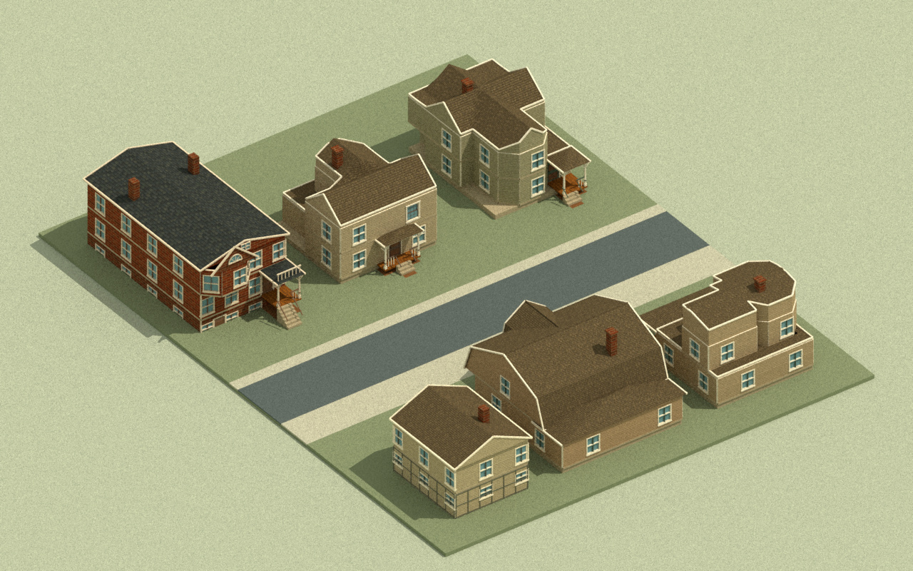

# Second catalogue block: architect review

Decision: **offline implementation checks pass; browser acceptance and promotion pending**. [Milestone 05](../milestones/05-catalogue-block-two.md) adds three existing artist designs to the first street. The public `master`/Pages build remains the reviewed exposition study.

The coder delivered **`143042467aea5780b401d0bf8041ed66a561036d`** on `codex/catalogue-block-two-coder`. The architect reviewed its 50 changed paths and cherry-picked it as **`0da02f015d6395dde9f12e8e4d3c16923db6dbd2`** onto `codex/catalogue-block-two`. [The detailed handoff](../engineering/catalogue-block-two/handoff.md) records the frozen source, checks and retired helpers. Architect coordination, the existing integration harness and JPG evidence are added in the review branch's follow-up commit. Candidate delivery is not promotion to `master`.

## Scope and exact sources

The combined base is **`1a3e2934072f98b7be9f691cf651ee369748d66f`**. Artist intake deliberately advances from `14d18d7` to **`56b028c2935b5a97fe259618f38e0a1550928ab4`**. The additions are **Hopkins 9**, **Hopkins 13** and the **Monroe Street brick row-house design**, facing the existing Hopkins 12, Hopkins 15 and Ashland cottage across the road. All six are distinct source designs, with one placed instance of each. The original three placements, player spawn, road, civilians and gameplay remain the foundation; the world extends from 36 by 26 m to 36 by 47 m.

The [intake manifest](../../assets/art/neighborhood-intake.json) records 25 unchanged runtime files, 12 source/generation evidence files, three notice/source-chain support files and one derived synchronous plan module. Both complete catalogue JSONs retain their original bytes; only six selected prefabs are instantiated. Each selected generated plan equals its individual source JSON and the corresponding full catalogue entry. Six original textures are reused. Active artist v2 work, other catalogue prefabs, the placement editor and vertical-fire branch are excluded.

This pin also deliberately adopts the centered sash sculptures in Hopkins 13 and 15 and the artist's corrected No. 13 chimney seating. Original Nautilus source **`90054d07134116a5d9661f8318a76fe68f922aad`** contributes five unchanged runtime modules and three preserved notices/source-chain records. The architect compared all eight files with the actual original Nautilus Git objects, including the two inherited AFT helpers. The host retains one existing Three implementation. Farmyard and shared-bear source pins are unchanged.

The architect inspected the archived original plates for the three additions, selecting the correct sides of the paired Hopkins plates. The [source/adaptation record](../research/catalogue-block-two/README.md) distinguishes period evidence, native module dimensions, unseen elevations and fictional placement. Monroe was illustrated as a continuous row; its detached lot here is an explicit game adaptation.

## Physical and source agreement

All six use native mesh scale `[1,1,1]`, shared wall/door/slab dimensions and 2.12 m floor pitch. The bear retains its .56 m radius and native model dimensions. Ground footprints follow the actual full plinth, porch and entry steps. The chamfered No. 9 parlor does not remove its real rectangular plinth. Monroe's elevated window projection and roof overhangs do not fill the ground. Closed native doors remain nontraversable.

An independent architect check covers **24 quarter-turn placements**, **52,608 structural vertices / 2,192 mesh observations**, and a maximum footprint miss below **`4e-9` m**. Source catalogue data remains unchanged and actual geometry/material resources dispose once. Both 47-part sash assemblies retain all original position, normal and UV attributes; their physical UV copies also agree. Sixteen held-out aperture rays per house find no opaque duplicate wall or gable facing across the window opening.

A .25 m collision-clear flood reaches every new frontage and the rear lane from the original spawn. Direct accepted movement across the road reaches No. 13's porch at y=28.425 after 10.425 m, using .834 L. Continuing against the porch consumes no additional gasoline. These are CPU geometry/simulation observations, not GPU or physical-device acceptance.

The existing coarse finite ground-fuel model governs all houses, including the brick-painted Monroe asset. This does not establish masonry combustion, vertical structural fire, stair climbing, interiors or collapse physics. Partial char must retain the entire house collider group; complete group burnout removes its visible prefab and colliders together.

## JPG evidence



[Closer JPG of the three additions](media/2026-10-28-catalogue-block-two-new-houses.jpg): Monroe at left, Hopkins 13 in the middle, Hopkins 9 at right.

The architect's offline exporter uses the combined candidate's actual placed source meshes, original textures and physical UVs. The overview includes **85,848 exported triangles**; the closer additions view includes **56,200**, including their ground/world meshes. Bear, civilians, fire and UI are omitted. Ground and barrels use base colors; the camera differs from the game follow camera. The close view omits the first-row house models; their ground-fuel patches remain visible at the image edge. These images support source appearance and layout review and do not establish WebGL shader or gameplay acceptance.

Both JPGs are 1280 by 800, RGB, quality 95 with no chroma subsampling. Overview SHA-256: `c7899f0ee11e2c0de3bbbca93253e186b2aff8c11240087158f67cd77ad228ea`; additions SHA-256: `73972d1b2208370d033718f8b2d7010453fb3be26333e70503b9f4b0952b0c67`.

Reproduce with:

```sh
node tools/review/export-neighborhood.mjs --view overview --out artifacts/qa/catalogue-block-two/overview
node tools/review/export-neighborhood.mjs --view new-block --out artifacts/qa/catalogue-block-two/new-block
python tools/review/render-neighborhood.py --input artifacts/qa/catalogue-block-two/overview
python tools/review/render-neighborhood.py --input artifacts/qa/catalogue-block-two/new-block
```

The renderer requires existing Mitsuba 3.9.1, Dr.Jit 1.5.0, NumPy and Pillow; `--deps` can select an existing dependency folder read-only. No packages are installed. PNG writing completes before JPG conversion. The updated tool reproduced the earlier three-house PNG exactly, SHA-256 `9240787c3319d59ff973b7e50ca2a19ad756eefd6e029cb151bfabbede21cc42`. Each one-shot render has a real 90-second deadline and exits after saving the bitmap and receipt.

## Checks and promotion

On the combined architect tree, `node tools/check.mjs` passes **85 tests**, 82 own-script syntax checks, 106 static-module resolutions, raw provenance checks, one shared Three implementation and the existing art checks. The architect's independent replay verifies all **40 raw runtime/support/evidence records**, generated plan identity, 24 actual mesh placements, source-window attributes/apertures, source immutability/disposal, reachable front/rear routes and accepted-distance pouring. Local receipts and the replay script are under ignored `artifacts/qa/catalogue-block-two/`. The separate source-chain receipt compares original donor Git objects, rather than only trusting an installed manifest's own hashes.

`node tools/build.mjs` produces **129 public files / 43,135,609 bytes**. `node tools/check-release.mjs` verifies every packaged hash and relative resource. The actual packaged house loader passes **36 nested-path HTTP resources**, loads two catalogues and six shared textures, and instantiates all six original assemblies plus the two centered windows. The unchanged bear package passes **26 resource checks**. Required upstream notices/source-chain records remain with the vendored window closure; workbenches, engineering documentation, JPGs and helper receipts are excluded from the public distribution.

Package servers on ports **64755** and **53684** exited and their ports were independently confirmed released. Both final render processes exited after writing their receipts. No preview or disposable architect helper remains running. The coder's separate [cleanup receipt](../engineering/catalogue-block-two/cleanup.json) records its natural exits and released ports. No app-managed runtime was stopped.

The existing browser graphics failure remains unresolved. No successful real WebGL run, desktop/phone shader/interaction acceptance or GPU performance measurement is claimed. Six source assemblies contain **4,614 mesh objects / 65,924 triangles** before ground, characters and effects; offline resource checks do not measure draw calls or frame rate. The existing integrated acceptance harness now has **18 checks**, expects all six source identities and includes a real-UI crossing to the new porch; those browser checks require a functioning WebGL context and have not passed a live run. The existing graphics failure was not retried or bypassed for this slice.

Repository instructions require **“browser review at the intended scale.”** JPGs provide the user's preferred quick visual handoff alongside that gate. Candidate branch delivery does not promote to `master` or publish Pages.
