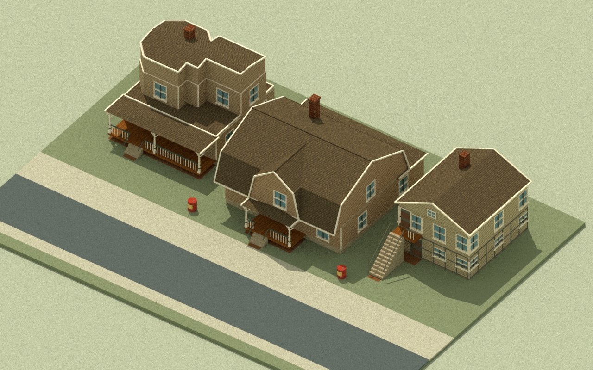

# Catalogue neighborhood: architect review

Decision: **offline implementation checks pass; browser acceptance and promotion pending**. This expands the [shared-bear checkpoint](2026-10-28-shared-bear-protagonist.md) with three selected original artist houses. The public `master`/Pages build remains the reviewed exposition study. See [Milestone 04](../milestones/04-catalogue-neighborhood.md) for the bounded assignment.

The coder delivered **`eb59547978393be73a1d513e71894f0536ece1ab`** on `codex/catalogue-neighborhood-coder`, based directly on the shared-bear checkpoint. The architect reviewed its 55 changed paths and cherry-picked it as **`b35086f`** onto `codex/catalogue-neighborhood`. The [detailed handoff](../engineering/neighborhood/handoff.md) records source paths, tests, browser failure evidence and the worker's retired helpers. Review-branch commits are not promotion to `master`.

## Actual assets and source boundary

The combined base is `b2942f98ed177faa7f319156d7bbdd24e35c5162`. The artist pin is **`14d18d7de667c7b83955150313347e198869f5ee`**, including the No. 15 gambrel revision and corrected vertical siding. Selected prefabs are **Hopkins 12**, **Hopkins 15** and the **Gross Ashland cottage**. The artist's active later window work is separate. No full artist, editor or vertical-fire branch is merged.

The [intake manifest](../../assets/art/neighborhood-intake.json) records 16 unchanged runtime files, nine preserved source/generation evidence files and one derived synchronous plan module. The derived records equal the original selected JSON values. Both full source catalogues remain intact, but only three houses are instantiated and interior furnishing is disabled. Six original textures are shared by one owner. The original artist assemblers, UVs, color bindings and gambrel mesh builder are preserved rather than replaced with generic building boxes.

The only additional Farmyard file is the unchanged 1,644-byte `hybrid-geometry.js` at the existing source pin `30a3b8cae5f36bb0c1df3685b7fba16f701c2083`. Its [native-unit provenance](../../vendor/farmyard-commando/30a3b8cae5f36bb0c1df3685b7fba16f701c2083/provenance/native-units.json) is checked against the original donor Git object. The existing source baseline and single shared Three implementation remain in use. Broader historical manifests are retained as source evidence, with uninstalled collection members clearly distinguished from this intake.

The architect inspected the original plates for all three designs, including the correct sides of paired Hopkins plates. [The source/adaptation record](../research/catalogue-neighborhood/README.md) distinguishes catalogue evidence from the fictional street arrangement, native module choices and interpreted colors/roof details. These are reusable game adaptations, not measured architectural reconstructions.

## Geometry, movement and fire agreement

Walls retain 1 by 2 by .16 m native dimensions, ordinary doors retain 1 by 1.65 by .12 m, and floor pitch remains 2.12 m. Every inspected mesh scale is `[1,1,1]`. The source bear and its .56 m collision radius remain unchanged. The narrow doors are visibly closed and remain nontraversable; no character was shrunk and no wall stretched to force entry.

There are separate source-derived foundation, porch and stair footprints for each house. Native walls and slab rims extend the main plan by .09 m at each side; the tall Ashland stair uses its actual 12 treads and rail envelope. Roof eaves and upper ornament do not fill the ground plane. An independent posed-mesh check covered **23,232 structural vertices / 968 mesh observations across 12 placements** (three houses at all four quarter turns). Maximum miss beyond the conservative footprints was below `4e-9` m. Source data remained unchanged and actual geometry/material resources disposed once.

Each house is one coarse finite ground-fuel group. It chars as surface fuel is consumed and keeps all its ground colliders until the group's surface and deposited fuel are spent. Collision and the visible prefab then disappear together, once. The existing ground-spread model is retained. This does not implement wall-climb fire, interior traversal or structural collapse.

Independent held-out checks compared 30 and 240 Hz presentation sampling: powder/inversion travel was 11.25 m, poured fuel .9 L, player clock 3.75 s and world clock .875 s in both runs. Pause preserved clocks, cells and building state. A separate rotated No. 15 burn fixture compared 30 and 144 Hz sampling, retaining all three colliders during partial burn and removing all colliders and the model with exactly one event at completion. That fixture uses accelerated burn rates for verification, not production fire timing.

The scenario-specific camera follows the model's player position. At actual production canvas sizes 1280 by 494 and 390 by 420, independent projection checks measured native bear heights of **48.76 px** and **49.74 px**. Off-centre ground aim round trips stayed within `8e-15` m. Five rear/gap positions per viewport caused conservative source-bounds house fading; the street restored opaque houses. Fading changes instance materials only and leaves source geometry, collision and fire untouched. These are CPU projection/geometry measurements, not rendered legibility or physical-phone performance results.

## Offline layout evidence

This is an offline Mitsuba `scalar_rgb` overview of **40,454 exported triangles** from the candidate's actual placed house/world meshes, with original house textures and UVs. Ground/barrels use flat base colors; procedural paint and ground instance tint variation are omitted. Bear, civilians, fire and UI are omitted. The overview camera differs from the game follow camera. This image reviews asset placement and appearance of the source houses; it does not establish browser shader, character or gameplay acceptance.

Reproduce the export with `node tools/review/export-neighborhood.mjs` from the candidate repository, then `python tools/review/render-neighborhood.py`. The renderer requires Mitsuba 3.9.1, Dr.Jit 1.5.0, NumPy and Pillow. An existing dependency folder may be supplied with `--deps`; the tool does not install packages. The source PNGs are read without edits. Local mesh exports and the one-shot run receipt stay under ignored `artifacts/qa/catalogue-layout/`. The renderer exits after writing the image and has a real 90-second deadline; no service is retained.

## Browser and promotion boundary

On the combined architect tree, `npm run check` passed **81 tests**, script syntax/import closure, source/provenance hashes, the single shared Three implementation and art checks. The independent intake, 12-placement footprint and held-out runtime replays also passed after cherry-pick. The root's additional work changes coordination/source records, the combined review harness and offline evidence tools; it does not alter the source art or simulation after those checks.

`npm run build` produced **117 public files / 42,934,553 bytes**. `node tools/check-release.mjs` verified all package hashes and relative module resources. The neighborhood package smoke passed **24 nested-path HTTP resource checks** and eight real loader requests (two catalogues/six textures), instantiating the three original assemblies through the actual packaged consumer. The bear package smoke passed **26 resource checks**. Both checks explicitly report no WebGL render. Ports **57121** and **57129** were independently confirmed released. The offline renderer also exited; no architect service remains running.

The package contains no workbench, review image, source-evidence documentation, helper record or external donor path. Actual source meshes total 2,135 mesh objects before other game art; this is not a GPU draw-call measurement. GPU transparency behavior and frame performance require the pending live review, particularly on the phone layout.

The architect reloaded the unchanged public exposition build during this task; it still failed to create WebGL. The coder's candidate browser attempt also reports GPU vendor/renderer disabled before a successful game render. This pre-existing environment failure does not establish an asset defect. The [earlier bear review](2026-10-28-shared-bear-protagonist.md) records the authorized recovery investigation and normal app restart checkpoint. No app-managed process or security setting was changed.

The expanded combined browser workbench now has **17 checks**, including source house identity, real UI powder pouring with the follow camera, rear-house occlusion, actual model-driven burnout/removal and four complete street rebuilds, alongside the earlier 12 mechanics/exposition regressions. Its new checks have **not passed a real WebGL run**. The worker's focused neighborhood page provides separate explicit review controls. Final desktop/phone inspection must include all houses, native bear, all five tools, held fire, trail, camera aim, fading and disposal.

Your repository instructions require **“browser review at the intended scale.”** Offline meshes, CPU projection, renderer API fixtures and this saved render do not waive that gate. This record does not approve promotion to `master` or a Pages deployment.

Independent local receipts are `artifacts/qa/catalogue-source-independent.json`, `catalogue-intake-independent.json`, `catalogue-footprints-independent.json` and `catalogue-runtime-independent.json`, with adjacent replay scripts. No task-owned preview is retained at the architect's handoff; app-managed processes and the artist's active work remain untouched.
