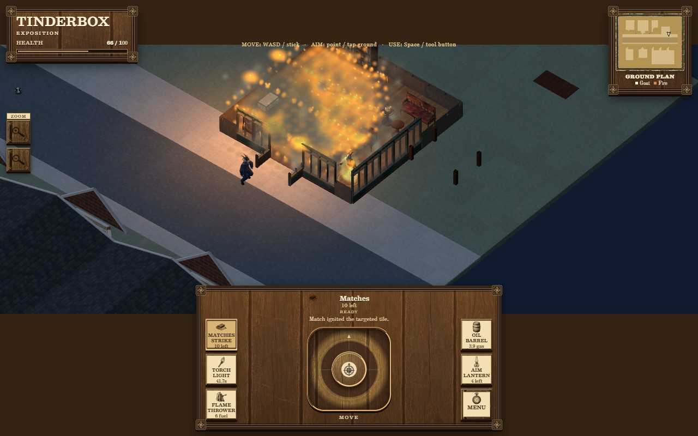
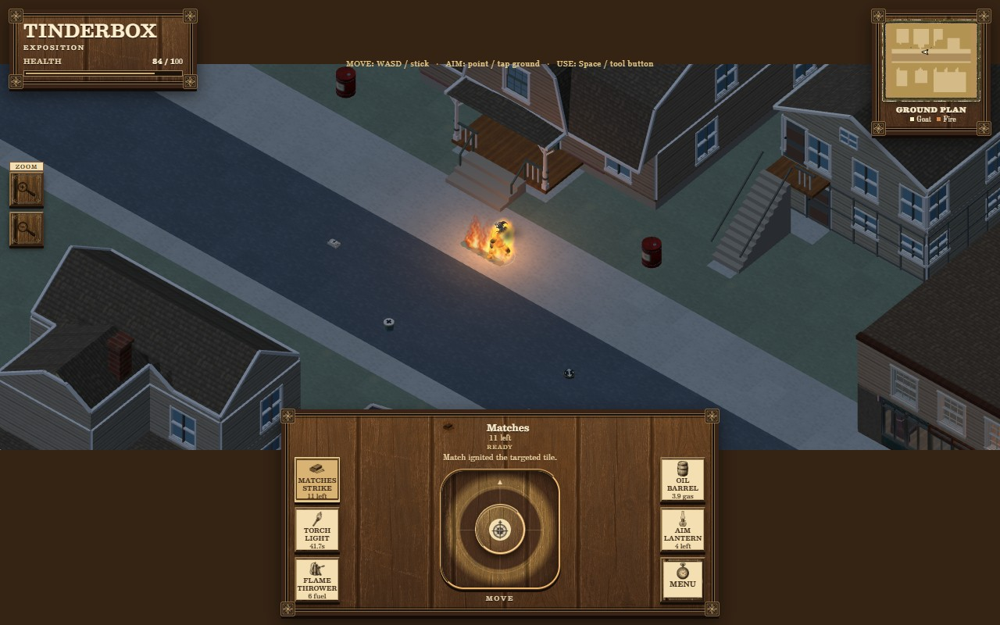

# Visual hill climbing: reference accepted, optimization pending

The corrected firelit reference passes source, numeric and initial appearance
review. **The requested further halving has not yet been demonstrated.** The
first isolated packing comparison is complete; it did not reach the target.

Baseline source is coder `d9ca47426bdbbf1ff707fd6a1d6c37079417edc9`,
intaken as architect `e619918b`. All 23 recorded source hashes match that commit;
the four archived runtime/art files match the reviewed bytes. Large reference
packages and raw runs remain in the coder's ignored
`artifacts/qa/visual-half-cost/`, with source/restart records and hashes.

## Correct reference and target

The [contract](../milestones/30-visual-half-cost.md) and
[machine-readable frozen reference](../engineering/visual-half-cost/reference-v1.json)
define the complete snapshot-publication + art + renderer-submission CPU sum,
per displayed host frame. Native-only rows and nested publication phases remain
separate. GPU is measured with actual non-disjoint queries and is not added to
CPU. All 120 dense-window rows/outliers are retained.

| Measure | Reference mean / p95, ms | Final target |
| --- | ---: | --- |
| Dense visual CPU, all displayed frames | 16.560 / 21.000 | <=8.280 / 10.500 and both fresh paired ratios <=0.5 |
| Whole-scene GPU | 9.297 / 12.225 | Investigate reproducible >10% paired regression |
| Full-frame CPU | 29.193 / 47.400 | Report separately; publication counted once |

Reference is 3,676 files /266,632,254 bytes, canonical package digest
`a26316d6366f0f9fedb9a2e799b3b1aadc594894d5a8309b8383a0a99b53f5bc`.
It uses Edge 158 /ANGLE D3D11 /RTX 3080, 1280x800 page, 1280x494 viewport,
normal zoom 1 and 12.6 m span. It is a current reference containing M27's prior
savings; the older unoptimized M27 implementation is not the denominator.

## Quality and measurement corrections

The earlier runs remain preserved as diagnostic evidence. One browser launch
failed in AppContainer Temp; setting the Node driver's task-owned temp path
before startup resolved it. A subsequent guard confused 20 offscreen character
paint renders with displayed frames. The corrected collector records both,
rejecting unaccounted preparation work inside scored windows. A mixed contact/
exit body window also cannot require continuous contact: current data has four
active rows of 24, historical data five; no burn rule was changed.

The appearance gate then found a real unpublished-reference defect. Component
firelights delegated to the shared host pool, but native samples lacked its
required exposure metadata. A narrowly recognized native-frame adapter now
normalizes missing exposure in the presentation copy only. Explicit false,
legacy/unknown inputs, physical DTOs and heat/fuel/events remain unchanged.
Thirteen independent source controls pass, including real native sample
provenance, negative inputs, off-camera light, six-light/power215 bounds and
disposal. No lamp/intensity or simulation tuning is included.

The corrected capture has 38 emitting surface sites, nine candidates and six
shared fire lights, visibly lighting the street and walls. Flames/smoke/light
remain enabled. The genuine oil-trail body control uses ordinary jerry-can and
match commands: 60 mature motion frames, 112 total setup/motion/exit steps,
0.09 m accepted travel and natural clearing. Architect reviewed the dense JPG
and mature start/middle/end at normal zoom. Both reference contexts closed,
maximum one renderer, with the browser/driver/ports released.

## First isolated experiment

Artist's direct structural-splat packing candidate is uncommitted, source hash
`d36848529642326f47bbbe11383458edf47267643248b1127e3b8c4017d42d88`.
Thirty independent controls preserve complete packed Float32 bits, ordering,
ties, counts, wind/camera/elevation behavior, culling, limits, retirement/reuse
and disposal. This proves output behavior, not reduced cost.

The candidate package overlaid only that file. The counterbalanced comparison
used four sequential reference/candidate/candidate/reference contexts, one
renderer at a time, with current native states and no captures/profile work in
the timed lanes. Architect independently recalculated the 120 dense rows in
each lane, verified per-frame publication/art/submission sums and actual GPU
queries, compared 29 state/workload fields across all lanes, checked nine
evidence hashes and the common endpoint. All pass; all four contexts closed.

| Lane | Visual CPU mean / p95, ms | GPU mean / p95, ms |
| --- | ---: | ---: |
| Reference A1 | 28.457 / 41.000 | 15.158 / 18.904 |
| Candidate B2 | 22.621 / 33.800 | 12.500 / 17.084 |
| Candidate B3 | 19.754 / 26.300 | 11.147 / 15.071 |
| Reference A4 | 20.470 / 28.000 | 11.998 / 16.427 |

Both pairs improved, but reference mean drifted downward 28.1%. The weaker
pair's CPU reduction is 3.5% mean /6.1% p95, with no GPU guard violation. This
does not establish a precise packing benefit or either half-target. Packing
remains uncommitted and QA-only; no unchanged-build timing retry is authorized.
Raw data, input/package proofs and cleanup receipts remain in coder QA
`packing-abba-01`; independent root audit is retained under architect QA.

The next source-only experiments are private native publication-payload reuse
(coder) and QA-only point-shadow program-change attribution (UI specialist).
Artist is inspecting the existing art-preparation profile for a larger remaining
mechanism. No new renderer or timing invocation has been granted by those source
assignments. The accepted reference, quality and half-target remain fixed.

## Source experiments held after review

Coder's occupancy-payload cache passes 36 controls but preserves every public
row allocation and adds cell/provenance/descriptor checks and private miss
allocations. Bounds already cache. Its operation census supports holding the
candidate without a performance run; it is uncommitted in coder QA
`publication-source-01`.

Artist's support/classification-binding cache also passes 36 controls, including
exact packed-output and mutation/lifecycle comparisons. Source hash is
`2d8d6de6e284b1cdf4356dfca8c3a47031b7056e4fd8b041bcd67f516fef2bd1`.
It skips only a post-routing suffix, adding dependency checks while retaining
validation, copies, dynamic routing, liveness, geometry calls and animation.
The entire classifySample sampled self weight is only 11.2% of art; the candidate
cannot claim the whole 5.178-ms building-art stage. Keep it QA-only without a
renderer run or production intake. Evidence/cleanup are in artist QA
`visual-half-cost-art/classify-bindings-attempt01`.

UI diagnostic preparation `bc521fe63aea54ea283f4b09c2d78e86a5cbd054`
passes six source/mock controls. Architect reviewed its insertion-only patch,
exact byte restoration, bounded counters, branch decisions and ordered draw/
state/error paths; independently verified source hashes. One separately granted
untimed probe compares unchanged and instrumented packages using the same current
input prefix. It establishes shadow/program attribution and workload/appearance
equivalence, not a performance saving. Production vendored renderer is unchanged.

The untimed probe now passes. Architect independently compared all 1,621 current
rows across 27 state/workload fields, checked 17 evidence hashes, reconciled
main-view and point-shadow draws, verified balanced zero-overflow counters and
inspected matched dense JPGs. No appearance discrepancy was observed. Two
contexts closed; browser/driver exited and ports 63548–63549 released.

| Attribution count | Quiet, 60 frames | Dense, 120 frames |
| --- | ---: | ---: |
| Ordinary point-shadow draws | 22,260 | 43,200 |
| Skinned point-shadow draws | 41,760 | 72,000 |
| Point-shadow program changes | 2,880 | 5,760 |
| Share caused by skinning transitions | 100% | 100% |

Both skinned and ordinary transitions use shared distance material 137. The
dense lane has 143,805 all-pass draws; renderer main-view accounting resets after
the shadow pass, so its 28,605 draws cannot stand in for the total. These counts
do not imply saved time.

UI is preparing a private compatible point-shadow material-family candidate;
coder is preparing compatible body-part batching, with native pose/shroud/
attachment and mutable-part exclusions. Artist is preparing whole owner-batch
reuse from native publication receipts. All are source-stage candidates pending
review, actual CPU/GPU measurement and appearance acceptance. No optimization
has been promoted, and the half-target is still unmet.

## Combined character B0 cost result

Independent source controls pass 42/42. Normal native bodies merge seven static
parts into one render mesh, keeping the mutable support arm separate; patrol
clothing/equipment stay separate. Original logical geometry/skin/paint/shroud
readers remain. A private bridge recognizes the frozen point-shadow helper's
render-only overrides and releases leases before batch retirement. Added copied
CPU buffers are about 0.51–0.52 MB per body, with no new texture or skeleton.

The exact six-file candidate package has 3,678 files and a checked 213-file
import closure. Its ABBA retains all 120 dense rows per lane. Architect
independently recalculated phase sums/GPU queries, verified state/workload fields
and evidence hashes, and checked the intentional -20 main-view draws/+5 geometry
delta per candidate frame. Submitted main-view triangles and textures match.

| Lane | Visual CPU mean / p95, ms | GPU mean / p95, ms |
| --- | ---: | ---: |
| Reference A1 | 15.846 / 19.500 | 9.394 / 12.289 |
| Candidate B2 | 15.893 / 20.900 | 7.649 / 10.246 |
| Candidate B3 | 14.564 / 18.100 | 7.376 / 9.866 |
| Reference A4 | 22.202 / 31.200 | 12.455 / 16.379 |

The first CPU pair is effectively unchanged in mean and 7.2% worse at p95; the
other improves with a 40.1% upward reference mean drift. GPU improves in both
pairs, with the weaker mean/p95 reductions 18.6%/16.6%. Neither half-target
passes. Hold B0 as research; no CPU-halving, precise overall gain, pixel
acceptance or promotion is established. Four contexts and all task helpers
closed; raw evidence is in coder QA `character-combined-abba-01`.

The artist's hostile source review found a P2 callback gap: admission/update
omitted `material.onBeforeRender`, which can depend on individual native object
identity. Default native callbacks in B0 are unaffected, but authored callbacks
need exclusion/invalidation. Coder is preparing the correction and regressions
as new bytes; B0 remains immutable and cannot stand in for that candidate.

The separate optional owner-batch consumer passes 42 source controls. Architect
reviewed its fixed-size receipt/presentation key, complete-batch bypass and live
outside-gate occlusion/lighting. UI is coupling it with a private immutable
render-packet producer while preserving public snapshots and existing geometry
proofs. This remains source-stage work; no real-game saving is established.

Master and Pages remain unchanged. M29's separate clocked/rendered-map gates
and all other unpromoted work are outside this performance pass.

The corrected B1 character source passes its callback controls. Combined with
the optional private receipt producer/consumer, the fourteen-file candidate
passes source and saved actual normal-zoom quality review. Its qualification
ends with a preserved signed-zero command-assertion failure; independent
offline review confirms all serialized commands, physical rows and endpoint,
and accepts the saved quality/eligibility evidence for cost testing only.

The subsequent cost run stops at the browser helper's intentional safety
deadline during lane three. Only one complete pair is available:

| Lane | Visual CPU mean / p95, ms | GPU mean / p95, ms |
| --- | ---: | ---: |
| Reference A1 | 53.183 / 78.600 | 23.947 / 31.288 |
| Candidate B2 | 104.124 / 183.500 | 22.416 / 25.346 |

This is a regression, not a completed ABBA or accepted optimization. New
publication copying outweighs the saved art/submission work. Root checks all
120 dense rows, 1,621 physical rows and 31 evidence hashes independently.
No second pair or reference-drift figure is available. All three contexts,
driver/browser and ports close; there are no retained helpers. Exact records
are coder QA `character-receipt-abba-01` and root QA
`character-receipt-partial-root-audit.json`. The next source-only experiment
targets unnecessary copying of already immutable native bounds. Original
half-cost targets and all appearance/physics gates remain unchanged.

The follow-up bounds-only source passes 46 distinct controls and a focused
seven-test rerun. A separate factory proof preserves cached immutable native
bounds across private/public copying; numeric geometry proof remains unchanged.
Root and the UI specialist review its source without actionable findings.
The actual C16 diagnostic passes all 1,621 physical rows, final endpoint, 22
actual imported-file proofs, positive firelight and mutable public-row isolation.
Root views its dense JPG against the frozen reference and observes no visible
loss. The complete dense window is still too costly:

| C16 diagnostic phase | Mean / p95, ms |
| --- | ---: |
| Publication | 22.196 / 38.800 |
| Art | 4.232 / 9.200 |
| Submission | 4.461 / 5.300 |
| Combined visual CPU | 30.888 / 51.000 |
| GPU | 10.088 / 14.702 |

This is a single candidate, not a paired improvement. Its subsequent bounded
CPU profile is attribution only. Independent root recalculation of the raw
profile confirms that the private and public recursive copiers account for
77.8% of sampled publication time; native frame generation accounts for 6.1%
inclusive. Recursive inclusive counts are deduplicated per sample; unresolved
builtins remain within caller self time. Do not add nested function totals or
treat profiled timings as speed evidence. Both invocations and their helpers
close. The existing coder is assigned a bounded copier optimization with the
public/ownership contracts preserved. No optimization code is accepted for
promotion yet. QA records are coder `publication-bounds-diagnostic-01` and
`publication-bounds-profile-01`, with independent root audit JSONs alongside the
earlier M30 audits.

The corrected one-file copier candidate passes all 55 source controls, including
the peer-found inherited-setter regression. Its fresh two-lane screen still
regresses and is rejected:

| Lane | Visual CPU mean / p95, ms | GPU mean / p95, ms |
| --- | ---: | ---: |
| Reference | 17.131 / 23.000 | 9.702 / 12.743 |
| Copier candidate | 25.842 / 47.200 | 9.515 / 14.387 |

Publication grows from 4.654 to 16.107 ms mean. CPU ratios are 1.508/2.052;
GPU ratios are 0.981/1.129, flagging the p95 guard for this pair. Root verifies
all physical rows, sums, queries, 32 evidence hashes and cleanup, and observes
no visible loss in the dense JPG. No repeatability claim follows from one pair.
The exact source/package/rows and original failures remain in coder QA
`publication-copier-screen-01`. No unchanged retry or further micro-optimization
of the full generic copy cycle is approved.

Read-only native-ownership and public-reader audits support a narrower native
creation-owned art packet alongside one complete public publication. Whole
returned native frames contain live nested references and cannot be adopted.
Normal art does not consume physical metrics/events/registration instances or
occupancy outside xray. Creation-proven immutable samples can be shared; poses,
geometry and debris children require explicit ownership/copying. Public
snapshots, unknown adapters, xray fallback, canonical firelight aliases,
once-only deltas and phase accounting must remain correct. The architect
authorizes this bounded source implementation, with source review before any
new run. The primary half-cost target remains unmet and Pages unchanged.
