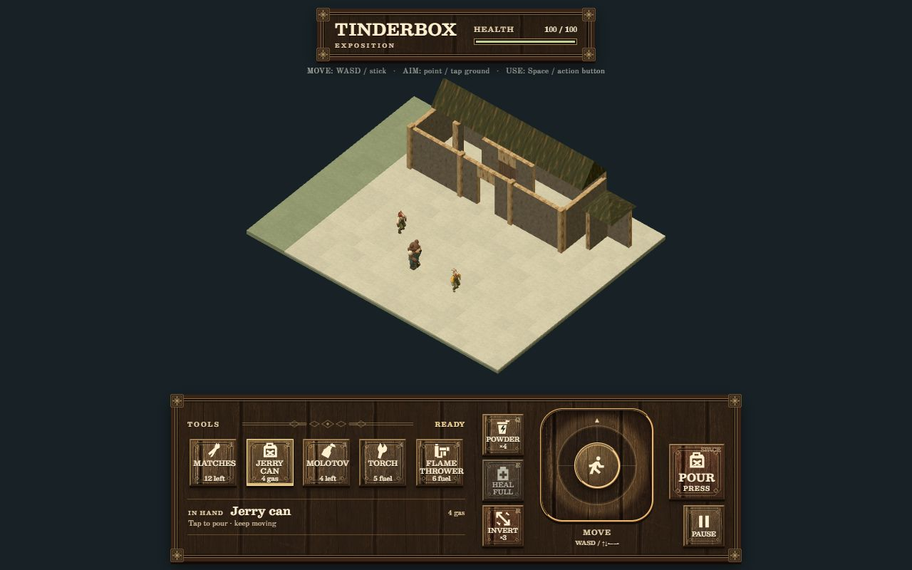

# Eastlake interface and period typography

User direction: add more Eastlake elements and use period-appropriate fonts and typography. Owner: UI specialist, `codex/ui-design`. This extends wooden candidate `5bb4fefcc0fea181b6d2ab90824ba622907032d8`; the reviewed game baseline remains `8a8405681614662a92f9b98fb9b9600bd06d3ad1`.

The wooden controls now have inset panels, incised geometric rules, reeded borders, chamfered button surrounds and square corner rosettes. The existing Farmyard timber pixels, switch/legend foundation, five tools, three drug actions, central joystick grouping and command/snapshot v1 contract remain. This pass changes presentation and font delivery; `src/ui/index.js` and `src/ui/model.js` are unchanged.

## Research and interpretation

[The design/source record](../../../assets/art/ui/eastlake-controls.json) connects each reference to its adaptation. The [Illinois State Museum's Eastlake account](https://museum.state.il.us/muslink/art/htmls/ms_eastlake.html) supports shallow geometric carving and incised flat surfaces. The [Quarry Farm furnishing study](https://marktwainstudies.com/quarry-farm-historic-interiors-and-furnishings/) describes corner blocks, bosses, reeding and geometric panels in surviving circa-1880 woodwork. Its object-image descriptions informed the treatment; those photographs were not visually reviewed or traced.

The title leaf of John J. Flinn's [1893 official guide, hand book edition](https://archive.org/details/officialguidetow00flin) was visually inspected again: contrasting roman sizes, capital/small-cap hierarchy and separating rules. The exact edition and PDF page 9 locator remain in [the existing G01 source register](../exposition/sources.json). The scan supplies hierarchy evidence, not an identified digital typeface.

The three SVG ornaments are original editable Tinderbox drawings. No museum or guide pixels are used in the runtime. The result is an Eastlake-informed game interface; exact historic cabinet construction, a facsimile sign system and exact 1893 font reconstruction remain outside this pass.

## Type system

| Role | Chosen face / treatment |
| --- | --- |
| Wordmark and selected tool | Besley, a Clarendon-inspired antique slab serif; strong roman weights. |
| Action buttons, labels and stock | Besley; restrained capital spacing, explicit Pour/Stop and empty feedback; lining tabular figures for changing counts. The longest secondary label uses tighter setting at the smallest breakpoint. |
| Menu headings | Besley semibold, with an incised rule establishing hierarchy. |
| Prose and descriptions | Old Standard TT roman, enlarged for readable small text. |
| Secondary pause prose | Actual Old Standard TT italic; synthetic styles are disabled. |

The [Besley designer's account](https://indestructibletype.com/Besley.html) explains its Clarendon influence and screen adaptations. [Old Standard's publisher description](font-sources/oldstandardtt/DESCRIPTION.en_us.html) identifies its Modern/classicist serif idiom with late-nineteenth- and early-twentieth-century editions. Both are modern designs/revivals selected for a period-informed hierarchy.

All three font files are self-hosted, unmodified TrueType distributions, totalling **631,000 bytes**. Both complete SIL Open Font License notices travel with the game. [The font manifest](../../../assets/art/ui/typography/manifest.json) records raw SHA-256 values, copyright/source metadata, exact URLs and distribution pins:

- Besley: Google Fonts `c13390277dfb1fcc7415d84ef7ef9cfc1e52f8c1`; upstream ancestry remains in `METADATA.pb`.
- Old Standard TT: Google Fonts `a01f27e9f42b5afad05090256d0d809928d84cae`; upstream ancestry remains in `METADATA.pb`.

Raw font/source records disable Git end-of-line conversion. The original OFL notices retain publisher whitespace; their complete raw hashes are verified rather than rewriting their text.

There is no runtime font-service dependency. The font-load proof resolves all three registered faces through the browser's native FontFaceSet, including the real italic.

## Changed paths

| Paths | Purpose |
| --- | --- |
| `src/ui/{styles.css,wood.css,typography.css}` | Period type hierarchy, inset/reeded/carved presentation, small-label fitting and menu bounds. |
| `assets/art/ui/eastlake-*.svg`, `eastlake-controls.json` | Original ornaments and their research/adaptation record. |
| `assets/art/ui/typography/**`, `docs/ui/eastlake/font-sources/**` | Byte-preserved fonts, notices, source metadata/descriptions and exact hashes. |
| `src/app.css`, `index.html` | Consistent game/loading/help type and local font preloads. |
| `.gitattributes` | Preserve upstream font/source bytes across checkouts; original OFL whitespace is retained. |
| `tools/{check.mjs,serve.mjs}` | Normal-gate font provenance verification and TrueType MIME support. |
| `workbenches/ui/{check-typography.mjs,import-ui.mjs,serve.mjs}`, vendor `provenance/ui.json` | UI import/provenance continuity, explicit font verification and preview MIME support. |
| `docs/ui/eastlake/**`, prior wood handoff link | Check evidence and this review record. |

## Verification and review

[Checks and screenshot hashes](checks.json) record: 56/56 Node tests; 18/18 browser interaction checks at 390 × 844, 1280 × 800, 320 × 568 and 844 × 390; 11/11 combined game checks at both main sizes. The small-label containment check has no overflow, and the phone options menu has no horizontal or vertical overflow. High contrast and reduced motion were exercised through the real controls.

`node tools/check.mjs` verifies 61 own scripts, 68 static modules, one shared Three pair, existing vendor provenance, and all nine pinned font/source/notice files. `node tools/build.mjs` and `node tools/check-release.mjs` pass for 88 packaged files. The nested hosted check verifies all 86 non-hidden files and module MIME, with QA workbenches absent. All three served font hashes and TrueType MIME are checked separately. The final production package was reviewed in the browser with no captured warnings/errors.

[Desktop game](evidence/desktop-game.jpg) · [Phone game](evidence/phone-game.jpg) · [Pause menu](evidence/phone-pause.jpg) · [Controls and options](evidence/phone-options.jpg)

This is a Windows browser/viewport review; physical phone and external assistive-technology testing remain unperformed. Font licensing is documented separately from the inherited unresolved Farmyard rights status. The architect retains promotion and deployment decisions.

The temporary browser tab and loopback preview are closed/stopped after review. Source/launch/restart records, complete local outputs and the shutdown receipt remain under `artifacts/eastlake-ui/`. The existing UI preview launcher can deliberately create and register a new bounded review lifetime.
