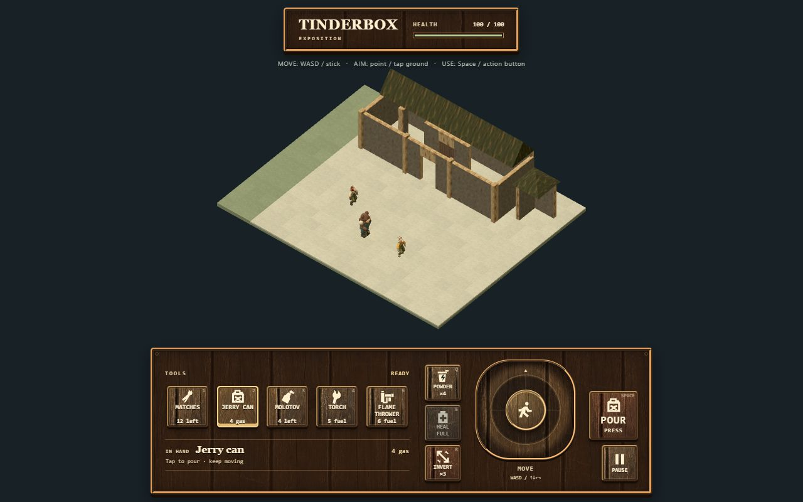

# Wooden Tinderbox interface

The later [Eastlake and period typography pass](../eastlake/README.md) extends this candidate.

User request: “lets make a UI out of wood”. Owner: UI specialist, `codex/ui-design`. Integration base: `8a8405681614662a92f9b98fb9b9600bd06d3ad1`, brought into the assigned UI worktree by a normal merge.

The HUD, tool switches, movement well, primary action and pause/options panels now use painted timber, carved edges and cream legends. A bright outline and lower inlay identify selection or active actions. Empty and disabled controls keep explicit stock labels. Pour changes to Stop from the authoritative snapshot.

The phone layout restores Farmyard's actual left action bank / central rounded-square joystick / right action bank composition. The desktop tool rack sits alongside that complete thumb layout to leave the field visible. Pause moves into the inherited right-hand bank. The existing normalized movement, independent pointer/keyboard sources, focus cancellation, disposal, menu semantics and snapshot/command v1 boundary remain in place. Pause stays available before the first snapshot and after death.

## Source and adaptation

[The material record](../../../assets/art/ui/wooden-controls.json) records exact source paths, source hashes, dimensions, retained components, adaptations and rights status. The approved donor pin remains `30a3b8cae5f36bb0c1df3685b7fba16f701c2083`.

- `game.html`: live `.hero-strip`, `.battle-bottom`, `.thumb-layout`, `.left-controls`, `.stick-column`, `.right-controls` structure.
- `touch-controls.css`: actual well/ring/knob, north mark, cross axes and caption. The scoped foundation preserves the 155/112/65 px base geometry, 160 px desktop well and 138/100/59 px small-screen geometry. Button dimensions and breakpoints are adapted to Tinderbox.
- `field-hardware.css` and the existing byte-preserved `industrial-switches.css`: icon/label/count grouping and pressed/lit/disabled/focus recipes.
- `aft/assets/environment/hybrid-surfaces/wood-factory-v2.png`: the already imported city timber texture, SHA-256 `fd84b8b6dffb4974ce19c51d8a8e0dbe7295a2dddcf8c262eaa94e542ed64021`. CSS changes its apparent value, scale and position and constructs the edges. Its bitmap bytes and city provenance remain unchanged.

All source paths above are under `sites/tactical-animal/dist/`. The six original UI imports remain byte-preserved. No new donor revision or raw asset import is introduced. The original Tinderbox SVG action symbols remain. The material is a game design adaptation; historical material and lettering accuracy remain outside this pass.

For comparison, the actual pinned `thumb-layout` subtree was rendered with its raw source styles and switch assets at 390 × 844 and 1280 × 800. This static reference runs no donor application code. [The phone reference](evidence/farmyard-reference-phone.jpg) shows the source's three banks, joystick silhouette and legend arrangement. The local exact extraction and hashes are retained under `artifacts/wood-ui/donor-reference/`.

## Changed paths

| Paths | Result |
| --- | --- |
| `src/ui/index.js` | Source-derived control grouping; existing event/state factory retained; Pause excluded from initial gameplay gating after relocation. |
| `src/ui/farmyard-controls.css` | Scoped adaptation of the actual live touch components. |
| `src/ui/styles.css`, `src/ui/wood.css` | Responsive layout, timber material, readable states, focus, contrast and motion handling. |
| `src/app.css`, `index.html`, root `README.md` | Field clearance, timber preload and current action-button help. |
| `assets/art/ui/wooden-controls.json`, vendor `provenance/ui.json` | Source/adaptation record and cross-reference to the existing city material. |
| `workbenches/ui/{import-ui.mjs,preview.ps1,serve.mjs,workbench.css}` | Reproducible metadata, complete timber preview/restart dependency, local asset allowlist and diagnostic spacing. |
| `docs/ui/wood/**` | This handoff, check results and selected review images. |

## Verification

[Checks and native input evidence](checks.json) record the results.

| Check | Result |
| --- | --- |
| `node tools/check.mjs` | 56/56 Node tests; 60 own scripts, 67 static modules, provenance and one shared Three pair pass. |
| Existing UI browser suite | 18/18 at each of 390 × 844, 1280 × 800, 320 × 568 and 844 × 390. Covers stock, Pour/Stop, independent pointers, keyboard, cancellation, focus, ARIA, disposal and targets ≥44 px. |
| Combined integration workbench | 11/11 at 390 × 844 and 1280 × 800, including real UI pouring, one inversion, drug use, pause and scene rebuilds. |
| Real browser pointer / keyboard | NE drag emits positive X/Y during inversion while Stop stays on. Native W emits move/up then neutral; native Space emits one primary press/release pair. |
| Pinned source checks | Four component-file hashes and the existing timber bitmap hash match. All previously imported raw bytes pass root checks. |
| Build / release / nested hosted bytes | 75 packaged files pass hashes and resource closure; 73 non-hidden served files match hashes and module MIME; QA workbench absent from package. |
| Browser review | Actual production package, pause/options, high contrast, empty stock, pouring plus inversion, and source comparison inspected. No captured console warnings/errors. |

The browser reviews use this Windows host. Physical phone testing and external assistive-technology review remain unperformed. Existing unresolved upstream rights status is preserved in the provenance records. Promotion and public deployment remain the architect's review decision.

## Visual evidence

[Desktop game](evidence/desktop-game.jpg) · [Phone game](evidence/phone-game.jpg) · [Wooden pause menu](evidence/phone-pause.jpg) · [Pouring with inversion](evidence/phone-pouring-inverted.jpg) · [Pinned source component](evidence/farmyard-reference-phone.jpg)

The temporary loopback preview and browser review tab have been stopped/closed. The local helper record, launch arguments, source snapshots, deadline and shutdown receipt are retained under `artifacts/wood-ui/helper/`; full local screenshots and check outputs are under `artifacts/wood-ui/`. Reopen the UI workbench deliberately with the existing `workbenches/ui/preview.ps1` and a fresh registered process lifetime when needed.
